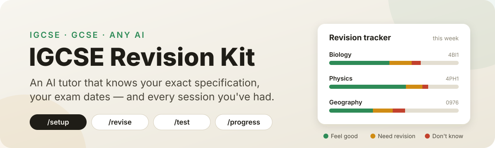
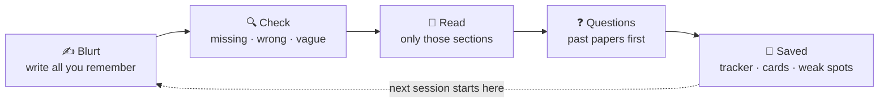
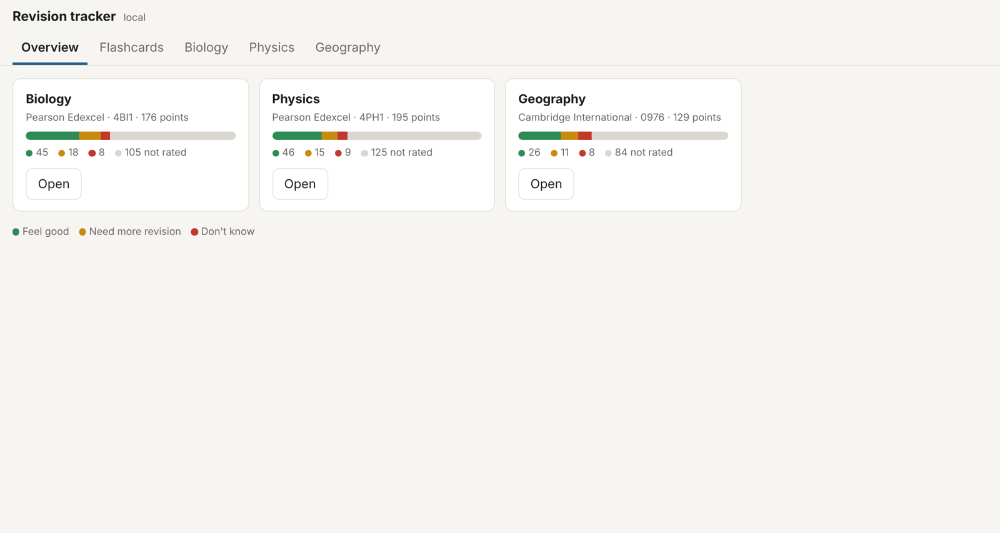

  

  <b>Works with</b> 
  
  
  
  
  
  

  <a href="#-set-it-up-in-5-minutes">🚀 Set it up</a> ·
  <a href="#-commands">⌨️ Commands</a> ·
  <a href="#-subjects">📘 Subjects</a> ·
  <a href="#-just-want-the-notes">📄 Just the notes</a> ·
  <a href="#-help-improve-it">🤝 Contribute</a>

---

**A folder that turns any AI into a proper IGCSE / GCSE tutor.** Download it, open it in the AI you
already use, type `/setup` — and it knows your exact specification, your exam dates and your
target grades, tests you on real past-paper questions, and remembers every session.

<table>
<tr>
<td width="25%" valign="top">

### 🎯 Your course
Every specification point mapped, with notes written for exactly that point — in the wording
your board rewards.

</td>
<td width="25%" valign="top">

### 🧑‍🏫 Real tutoring
One question at a time. You try first, hints before answers, every question checked before
it's asked.

</td>
<td width="25%" valign="top">

### 🧠 A memory
After every session it saves what you covered, your score and your mistakes. Next time starts
from there.

</td>
<td width="25%" valign="top">

### 📈 A plan
A weekly plan that fits your real time, flashcards only for what you missed, a tracker for every
point.

</td>
</tr>
</table>

## 🚀 Set it up in 5 minutes

**1 · Download** — green **Code** button above → **Download ZIP**, unzip somewhere it can stay
(e.g. Documents). Or `git clone` it.

**2 · Open it in your AI** — pick yours:

| Your AI | Open the kit | Commands |
| --- | --- | --- |
| **Claude** desktop app / Claude Code | Code tab → choose the folder · or `cd igcse-revision-kit && claude` | in the `/` menu |
| **Codex** (CLI, IDE or app) | open the folder · or `cd igcse-revision-kit && codex` | type them, or say them in words |
| **Cursor** | File → Open Folder | in the `/` menu |
| **Gemini CLI** | `cd igcse-revision-kit && gemini` | in the `/` menu |
| **GitHub Copilot** (VS Code) | open the folder, Copilot Chat in *Agent* mode | in the `/` menu |
| **Any other coding agent** | open the folder — it reads [`AGENTS.md`](AGENTS.md) | type them, or say them in words |
| **ChatGPT, Gemini, Claude.ai, any chat app** | upload the ZIP (or a project with its files), then say: *"Read AGENTS.md and follow it."* | type them, or say them in words |

**3 · Type `/setup`** — a few questions, one or two at a time: your subjects and options (tier,
set texts, case studies…), mock and exam dates, target grades, when you can revise, how you like
to be taught.

That's it. From then on just say what you want — *"let's revise"*, *"test me on waves"*, *"what
should I do today?"* — or use a command.

> [!TIP]
> **Coding agents** (Claude Code, Codex, Cursor, Gemini CLI, Copilot) get everything: they save
> your progress, run the tracker and build PDFs. **Chat apps** can't save files, so at the end of
> each session they hand you a short note to paste into your `me/` folder — upload it with the kit
> next time and it picks up where you stopped.

## ⌨️ Commands

| | Command | What it does |
| :---: | --- | --- |
| 👋 | **`/setup`** | Sets up your tutor: subjects, options, exam dates, target grades, time, preferences. Run again whenever something changes. |
| 🗓️ | **`/plan`** | A weekly revision plan that fits your time, your school tests and your targets. |
| 🔁 | **`/revise Biology enzymes`** | A full ~60-min session: write what you remember → see your gaps → read only those → questions → saved. Also teaches a topic you haven't learned yet. |
| ✍️ | **`/test Physics topic 3`** | You revised alone; this checks it stuck. Past-paper questions, marked one by one against the mark scheme. |
| 📊 | **`/progress`** | What to do today, how each subject is going against your target, flashcards due. |
| 🛠️ | **`/make-topic Chemistry "topic 3"`** | Writes (or fixes, or shortens) a topic's notes and builds its PDF. |
| ➕ | **`/add-subject AQA 8461`** | Adds a subject or exam board the kit doesn't have yet, from its official specification. |

You never have to remember these — plain words work too. Every command is one readable file in
[`commands/`](commands), so any AI can follow it.

### How a revision session goes

## 🧠 What it remembers

`/setup` creates a private **`me/`** folder. Every session reads it first and updates it at the
end — you never have to ask.

<table>
<tr>
<td width="50%" valign="top">

| File | Holds |
| --- | --- |
| `profile.md` | subjects, options, targets, how you like to learn |
| `study_plan.md` | exam dates, weekly plan, what's next |
| `sessions.md` | every session: covered, score, next step |
| `weak_spots/` | questions you got wrong, to re-test later |
| `progress.json` · `flashcards.json` | a rating for every spec point, your cards |
| `papers/` | past papers you download ([where](PAPERS.md)) |

</td>
<td width="50%" valign="top">

**See your progress:** `python3 tools/tracker/serve.py`, then open <http://localhost:8765>
([details](tools/tracker/README.md)).

</td>
</tr>
</table>

> [!IMPORTANT]
> `me/` never leaves your computer (unless you upload it to a chat app yourself) and is never
> committed. When you download a newer version of the kit, copy your `me/` folder across.

## 📘 Subjects

| | Subject | Board · code | Notes | Past papers |
| :---: | --- | --- | --- | --- |
| 🧬 | **Biology** | Pearson Edexcel International GCSE · `4BI1` | ✅ [5 topics](notes/README.md#biology) | [get them](PAPERS.md#biology) |
| ⚗️ | **Chemistry** | Pearson Edexcel International GCSE · `4CH1` | ✅ [4 topics](notes/README.md#chemistry) | [get them](PAPERS.md#chemistry) |
| ⚛️ | **Physics** | Pearson Edexcel International GCSE · `4PH1` | ✅ [8 topics](notes/README.md#physics) | [get them](PAPERS.md#physics) |
| 💼 | **Business** | Pearson Edexcel International GCSE · `4BS1` | ✅ [5 topics](notes/README.md#business) | [get them](PAPERS.md#business) |
| 💻 | **Computer Science** | Cambridge IGCSE (9–1) · `0984` | ✅ [10 topics](notes/README.md#computer-science) | [get them](PAPERS.md#computer-science) |
| 🌍 | **Geography** | Cambridge IGCSE (9–1) · `0976` | ✅ [10 topics + poster](notes/README.md#geography) | [get them](PAPERS.md#geography) |
| ➗ | **Mathematics A** | Pearson Edexcel International GCSE · `4MA1` | 🗺️ mapped | [get them](PAPERS.md#mathematics-a) |
| 📝 | **English Language** | Cambridge IGCSE (9–1) · `0990` | 🗺️ mapped | [get them](PAPERS.md#english-first-language) |
| 📚 | **English Literature** | Cambridge IGCSE (9–1) · `0992` | 🗺️ mapped | [get them](PAPERS.md#english-literature) |
| 🇵🇹 | **Portuguese** | Pearson Edexcel GCSE · `1PG0` | 🗺️ mapped | [get them](PAPERS.md#portuguese) |
| 🇪🇸 | **Spanish** | Pearson Edexcel International GCSE · `4SP1` | 🗺️ mapped | [get them](PAPERS.md#spanish) |

✅ notes ready · 🗺️ specification mapped — the tutor can already test and track it, and
`/make-topic` writes the notes.

> [!WARNING]
> **Check your code.** The same subject has different exams on different boards (`4PH1` is not
> `0625`). It's on your exam timetable and on the front of any past paper. Different board or
> subject? Use `/add-subject`.

## 📄 Just want the notes?

<table>
<tr>
<td width="60%" valign="top">

The notes work without any AI: **one PDF per topic**, every point you can be examined on, a
diagram wherever something has a shape, and nothing extra.

- **One topic:** open [the notes list](notes/README.md) and click a topic.
- **A whole subject:** download its zip from the [latest release](../../releases/latest).
- **One PDF + any chatbot:** attach the PDF, paste in
  [`docs/AI_tutor_prompt.txt`](docs/AI_tutor_prompt.txt) (edit the "MY COURSES" lines first) —
  the same tutoring style in a single chat.

</td>
<td width="40%" valign="top">

</td>
</tr>
</table>

## 💡 Good to know

<b>The specification is the boss</b>

Notes are written by a student and AI agents and checked against the specification, but mistakes
happen. If something disagrees with your specification or a mark scheme, trust those — and please
[report it](../../issues/new/choose).

<b>Geography case studies</b>

Each school chooses its own. The notes use one class's examples; if yours are different, tell
`/setup` and learn yours ([why](subjects/Geography_0976/CASE_STUDY_TRACKER.md)).

<b>Age limits</b>

AI apps set their own minimum ages (Claude's apps, for example, are 18+). Check the terms of the
tool you use; if you're under its age, use it with a parent or teacher, or pick a tool whose terms
allow your age. The PDFs need no AI at all.

<b>Privacy</b>

Nothing about you is ever written outside `me/`, and `me/` is never committed or uploaded by the
kit. If you upload `me/` to a chat app, that app's own privacy terms apply.

<b>For developers: how it fits together</b>

- [`AGENTS.md`](AGENTS.md) is the one rule file every AI reads; `CLAUDE.md` and `GEMINI.md` just
  import it.
- [`commands/`](commands) holds the commands as plain markdown. `python3 tools/sync_commands.py`
  generates the small pointer files that put them in each tool's `/` menu (`.claude/`, `.cursor/`,
  `.gemini/`, `.github/prompts/`); CI checks they are in sync.
- [`rules/`](rules) — how notes are written and how tutoring works. More in
  [docs/HOW_IT_WORKS.md](docs/HOW_IT_WORKS.md).

## 🤝 Help improve it

Fix a mistake, write a missing topic, or add your own exam board's subject — see
[CONTRIBUTING.md](CONTRIBUTING.md).

---

  Made by <b>Kirill Chistov</b> and contributors ·
  notes, diagrams and rules <a href="LICENSE-CONTENT">CC BY-NC-SA 4.0</a> (free to use and adapt, not to sell) ·
  code <a href="LICENSE">MIT</a> 
  Not affiliated with Pearson, Cambridge or any exam board.

