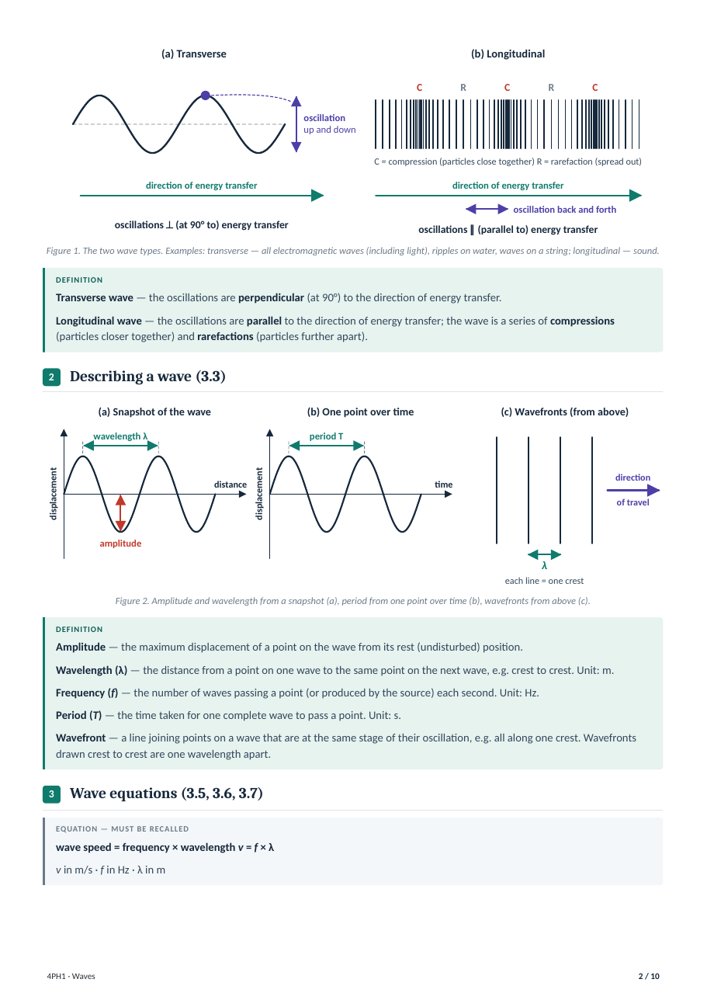

# 📚 IGCSE Revision Kit

**Free revision notes for IGCSE and GCSE, written point by point from the official specification —
plus links to every past paper, and an optional AI tutor that tests you and tracks your progress.**

  <a href="notes/README.md"><b>📘 Open the notes</b></a> &nbsp;·&nbsp;
  <a href="PAPERS.md"><b>📝 Find past papers</b></a> &nbsp;·&nbsp;
  <a href="#-revise-with-an-ai-tutor-optional"><b>🤖 Use the AI tutor</b></a>

## Find your subject

| Subject | Exam board · code | Notes | Past papers |
| --- | --- | --- | --- |
| Biology | Pearson Edexcel International GCSE · **4BI1** | [5 topics](notes/README.md#biology) | [where to get them](PAPERS.md#biology) |
| Chemistry | Pearson Edexcel International GCSE · **4CH1** | [4 topics](notes/README.md#chemistry) | [where to get them](PAPERS.md#chemistry) |
| Physics | Pearson Edexcel International GCSE · **4PH1** | [8 topics](notes/README.md#physics) | [where to get them](PAPERS.md#physics) |
| Business | Pearson Edexcel International GCSE · **4BS1** | [5 topics](notes/README.md#business) | [where to get them](PAPERS.md#business) |
| Computer Science | Cambridge IGCSE (9–1) · **0984** | [10 topics](notes/README.md#computer-science) | [where to get them](PAPERS.md#computer-science) |
| Geography | Cambridge IGCSE (9–1) · **0976** | [10 topics + a poster](notes/README.md#geography) | [where to get them](PAPERS.md#geography) |
| Mathematics A | Pearson Edexcel International GCSE · **4MA1** | coming later | [where to get them](PAPERS.md#mathematics-a) |
| English Language | Cambridge IGCSE (9–1) · **0990** | coming later | [where to get them](PAPERS.md#english-first-language) |
| English Literature | Cambridge IGCSE (9–1) · **0992** | coming later | [where to get them](PAPERS.md#english-literature) |
| Portuguese | Pearson Edexcel GCSE · **1PG0** | coming later | [where to get them](PAPERS.md#portuguese) |
| Spanish | Pearson Edexcel International GCSE · **4SP1** | coming later | [where to get them](PAPERS.md#spanish) |

**Check the code.** The same subject has different exams on different boards — `4PH1` is not
`0625`. Your code is on your exam timetable and on the front of any past paper. Different board?
See [Help improve it](#-help-improve-it).

## How to read or download the notes

- **One topic:** open [the notes list](notes/README.md), click a topic, and the PDF opens in your
  browser. Use the download button (↓, top right) to save it.
- **A whole subject:** download its zip from the [latest release](../../releases/latest).
- **Everything:** green **Code** button at the top of this page → **Download ZIP**.

Each PDF covers one topic of the specification: every point you can be examined on, a diagram
wherever something has a shape, and nothing extra.

## 🤖 Revise with an AI tutor (optional)

The kit also works as a tutor you run on your own computer. It quizzes you one question at a time,
marks you against real mark schemes, keeps a small deck of flashcards for what you got wrong, and
shows your progress per specification point.

You need [Python 3](https://www.python.org/downloads/) and an AI coding agent that can work in a
folder — the kit was built with [Claude Code](https://docs.claude.com/en/docs/claude-code/overview);
Codex, Cursor and Gemini CLI read the same instructions.

1. **Get the kit:** Code → Download ZIP and unzip it, or `git clone` this repository.
2. **Open the folder in your agent** (for Claude Code: `cd igcse-revision-kit` then `claude`).
3. **Type `/setup`.** Five minutes of questions: your subjects and options, exam dates, how much
   time you really have. Your answers stay in a private `me/` folder that is never uploaded.

Then just ask, in plain words or with a command:

| Say | It does |
| --- | --- |
| `/plan` | a weekly plan that fits your time and school tests |
| `/revise Biology enzymes` | a ~60-minute session: write what you remember → see the gaps → questions → saved |
| `/test Physics topic 3` | past-paper questions on a topic you've revised, marked one by one |
| `/progress` | what to do today and how each subject is going |
| `/make-topic` · `/add-subject` | write notes for a topic, or add a subject the kit doesn't have |

**Progress tracker:** run `python3 tools/tracker/serve.py` and open <http://localhost:8765>, or (with
Claude) keep it as a private page you can open on your phone — see [`tools/tracker`](tools/tracker/README.md).

## Good to know

- **The specification is the boss.** Notes are written by a student and AI agents and checked
  against the specification, but mistakes happen — if something disagrees with your
  specification or a mark scheme, trust those, and please [report it](../../issues/new/choose).
- **Geography case studies** are chosen by each school. The notes use one class's examples; if yours
  are different, learn yours ([why](subjects/Geography_0976/CASE_STUDY_TRACKER.md)).
- **Age:** Claude's own apps require users to be 18 or over. If you're younger, the notes and past
  papers need no account at all; for the AI tutor, check the terms of whichever AI tool you use, or
  use it with a parent or teacher.
- **Privacy:** nothing about you is ever written outside `me/`, and `me/` is never uploaded.

## 🤝 Help improve it

Fix a mistake, write a missing topic, or add your own exam board's subject — see
[CONTRIBUTING.md](CONTRIBUTING.md). How the notes and the tutor are built is in
[docs/HOW_IT_WORKS.md](docs/HOW_IT_WORKS.md).

## Licence

Made by **Kirill Chistov** and contributors. Notes, diagrams and rules:
[CC BY-NC-SA 4.0](LICENSE-CONTENT) — free to use, share and adapt, not to sell. Code:
[MIT](LICENSE). Not affiliated with Pearson, Cambridge or any exam board.
