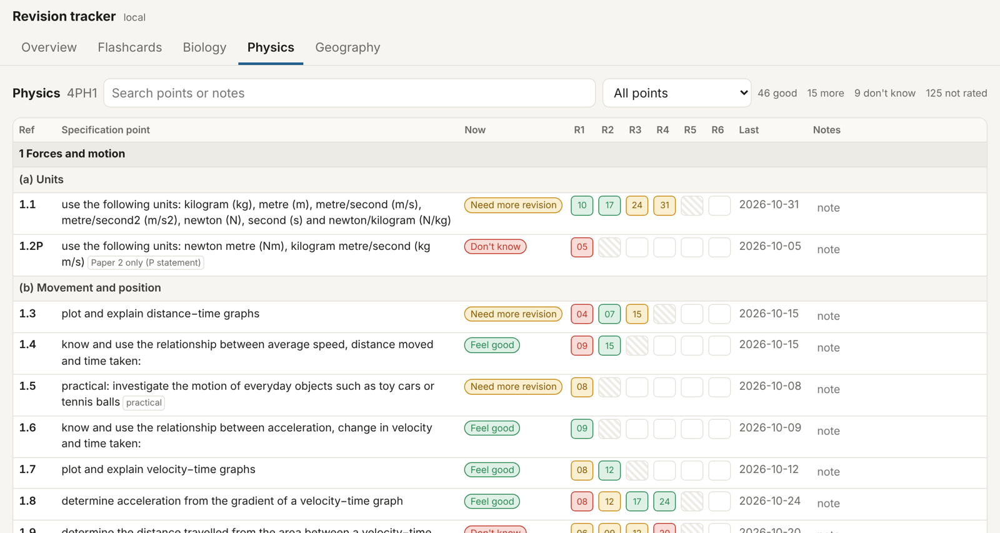

# igcse-revision-kit

**Specification-exact revision notes, an AI tutor that tests and marks you, and a progress tracker
with flashcards — for IGCSE and GCSE students, run with Claude Code or any AI coding agent.**

[](../../actions/workflows/checks.yml)
[](LICENSE-CONTENT)
[](LICENSE)

Most revision material is generic: written for "GCSE Biology" rather than *your* exam board's
specification, padded with background you'll never be asked about, and silent about what you've
actually forgotten. This kit starts from the official specification, point by point, and keeps
only what earns marks.

| | |
| --- | --- |
| 📘 **Notes** | One PDF per topic, written from the exact specification: every assessable point, nothing extra, a diagram wherever a process has a shape. 42 topic PDFs ready to use. |
| 🧑‍🏫 **Tutor** | `/revise` and `/test` run active-recall sessions: blurt, check, questions one at a time, attempt before answer, marked against the mark scheme. |
| 📈 **Tracker** | Every specification point rated over time (*Don't know → Need more revision → Feel good*), plus a small spaced-repetition flashcard deck built only from what you got wrong. |
| 🛠️ **Builder** | `/add-subject` and `/make-topic` turn any board's specification into the same kind of notes — so you can add the subjects that aren't here yet. |

<p align="center"> </p>

## What's included

| Subject | Board | Code | Notes |
| --- | --- | --- | --- |
| Biology | Pearson Edexcel International GCSE | 4BI1 | ✅ all 5 topics (`notes/Biology_4BI1/`) |
| Chemistry | Pearson Edexcel International GCSE | 4CH1 | ✅ all 4 topics |
| Physics | Pearson Edexcel International GCSE | 4PH1 | ✅ all 8 topics |
| Business | Pearson Edexcel International GCSE | 4BS1 | ✅ all 5 topics |
| Computer Science | Cambridge IGCSE (9–1) | 0984 | ✅ all 10 topics (Cambridge pseudocode) |
| Geography | Cambridge IGCSE (9–1) | 0976 | ✅ all 10 topics — 7 school-chosen case studies left for you to add ([why](subjects/Geography_0976/CASE_STUDY_TRACKER.md)) |
| Mathematics A | Pearson Edexcel International GCSE | 4MA1 | 🗺️ specification mapped, notes to write |
| English (First Language) | Cambridge IGCSE (9–1) | 0990 | 🗺️ mapped |
| English Literature | Cambridge IGCSE (9–1) | 0992 | 🗺️ mapped |
| Portuguese | Pearson Edexcel GCSE | 1PG0 | 🗺️ mapped |
| Spanish | Pearson Edexcel International GCSE | 4SP1 | 🗺️ mapped |

Taking AQA, OCR, WJEC or another Cambridge syllabus? `/add-subject` sets it up from the official
specification — and a pull request shares it with everyone else.

## Two ways to use it

### 1. Just the notes

Download the PDFs from [`notes/`](notes) (or the latest
[release](../../releases)). Check the code on the cover matches your exam — `4PH1` is not `0625`.

### 2. With an AI agent (recommended)

You need [Git](https://git-scm.com/downloads), Python 3.10+ and an AI coding agent that can read
and write files in a folder — [Claude Code](https://docs.claude.com/en/docs/claude-code/overview)
is what the kit was built with; Codex, Cursor or Gemini CLI also read the instructions in
`AGENTS.md`.

```bash
git clone https://github.com/<you>/igcse-revision-kit.git
cd igcse-revision-kit
claude            # or open the folder in your agent
```

Then type **`/setup`**. It asks which subjects you take (and options like tier, set texts or the
programming language your class uses), when your exams are, how much time you really have, and
how you like to be taught — about five minutes. Everything you tell it goes into `me/`, a folder
Git ignores, so it never leaves your computer.

| Command | What it does |
| --- | --- |
| `/setup` | first-run interview; run again to change subjects or preferences |
| `/plan` | a weekly plan that fits your time, school tests and weakest points |
| `/revise <subject> <topic>` | a ~60-minute loop: blurt → check → read the gaps → questions → recorded |
| `/test <subject> <topic>` | after revising alone: real past-paper questions if you've added them, marked one at a time |
| `/progress` | where you stand, flashcards due, what to do today |
| `/make-topic <subject> <topic>` | write, fix, shorten or audit a topic's notes and rebuild its PDF |
| `/add-subject <board> <code>` | add a qualification the kit doesn't have yet |

Plain words work too: "quiz me on enzymes", "make notes for Chemistry topic 3", "what should I do
today?".

**The tracker** runs on your computer — `python3 tools/tracker/serve.py`, then open
<http://localhost:8765> — or, with Claude, as a private claude.ai page you can open on your phone.
Details in [`tools/tracker/`](tools/tracker/README.md).

**Past papers** aren't included (they belong to the exam boards). Download them from your board's
site into `me/papers/<Subject>/` and `/test` will use them, marking against the real mark schemes.

## How the notes are made

```
official specification ──► specification_map.csv ──► topic.md per subtopic ──► notes/<Subject>/NN_<Topic>.pdf
   (what is assessable)       (every point, by number)    (markdown + SVG diagrams)     (one PDF per topic)
```

The rules an agent follows are in [`CLAUDE.md`](CLAUDE.md) and [`rules/`](rules). The short
version: *bare minimum, but still enough to fully understand the specification and get top marks*.
Every point is covered at the depth its command word asks for (*state* ≠ *explain* ≠ *evaluate*);
enrichment is cut, not labelled; every run ends with a separate "would the student lose marks
without this?" pass. Tutoring follows the design of Kestin et al., *AI tutoring outperforms
in-class active learning* (Scientific Reports, 2025): brief replies, one step at a time, attempt
before answer, every question solved and checked by the tutor before it's asked.

## Privacy and copyright

- Your profile, plan, marks, weak spots, past papers and school material live only in `me/`, which
  is in `.gitignore`. Nothing personal is ever written anywhere else (`CLAUDE.md` § Privacy).
- No textbooks, past papers, mark schemes or school documents are in this repository.
  Specifications are downloaded from the boards' own websites by `tools/fetch_specs.py`.
- Photographs used in notes are openly licensed and credited in each `assets/SOURCES.md`.

## Age

Claude's consumer products require users to be 18 or over. Many GCSE students are younger: if
that's you, use the PDFs directly, use the kit with a parent's or teacher's help, or check the
terms of whichever AI tool you use. Nothing in the kit itself needs an account.

## Contributing

New subjects, new topics, corrections and better diagrams are all welcome — see
[`CONTRIBUTING.md`](CONTRIBUTING.md). Found a mistake in the notes? Open an issue with the subject,
topic and specification point.

## Licence

Notes, diagrams, rules and skills: [CC BY-NC-SA 4.0](LICENSE-CONTENT) — free to use and adapt,
non-commercially, with credit. Code (`tools/`, `.github/`): [MIT](LICENSE). Not affiliated with
Pearson, Cambridge or any awarding body; the official specification and mark schemes always win.
