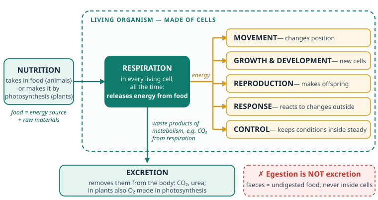

# Characteristics of living organisms

## Specification coverage

| Point | Section |
| --- | --- |
| 1.1 nutrition, respiration, excretion, response, movement, control of internal conditions, reproduction, growth and development | §1 (figure + table), §2 |

## 1. The eight characteristics

Every living organism — plant, animal, fungus, protoctist or bacterium — shows all eight, and
they depend on each other.

*Figure 1. How the eight characteristics depend on each other.*

| Characteristic | What it means | Animals | Plants |
| --- | --- | --- | --- |
| **Nutrition** | taking in or making food — the source of energy and of raw materials for growth | eat food made by other organisms | make their own food by **photosynthesis**; take in water and mineral ions from the soil |
| **Respiration** | chemical reactions in **every living cell** that **release energy** from food (glucose) | all cells, all the time | all cells, all the time — day **and** night |
| **Excretion** | removal of the **waste products of metabolism** (the chemical reactions in cells) | carbon dioxide (lungs), urea (kidneys) | carbon dioxide from respiration; oxygen from photosynthesis |
| **Response** | detecting changes in the surroundings (stimuli) and reacting to them | nerves and hormones | slow growth responses, e.g. shoots grow towards light |
| **Movement** | an action that changes the position of the whole organism or of part of it | usually move the whole body from place to place | move parts only, slowly, e.g. flowers open and close |
| **Control of internal conditions** | keeping conditions inside the body (e.g. temperature, water content) within limits so cells work properly | e.g. body temperature, water content of the blood | e.g. water content, by opening and closing stomata |
| **Reproduction** | producing new individuals (offspring) | sexual or asexual (→ Section 3) | e.g. seeds (sexual), runners (asexual) |
| **Growth and development** | growth = a **permanent increase in size and dry mass**; development = an increase in complexity as cells become specialised | fertilised egg → baby → adult | seed → seedling → flowering plant |

Recall aid: **MRS C GREN** — Movement, Respiration, Sensitivity (response), Control, Growth,
Reproduction, Excretion, Nutrition.

## 2. Living or not?

Something is a living organism only if it shows **all eight**. Non-living things can show one or
two: a car moves and releases energy from its fuel, giving off waste gases; a crystal grows. But
neither reproduces, responds to its surroundings or controls its internal conditions. Viruses show
none of the characteristics outside a living cell, so they are not living organisms (→ 1.4).

## Common misunderstandings

| Wrong | Right |
| --- | --- |
| Breathing is respiration | Breathing moves air into and out of the lungs; respiration is the chemical reactions in every cell that release energy |
| Respiration makes or produces energy | Respiration **releases** energy from food; energy is never made |
| Growth is any increase in size | Growth is a **permanent** increase in size and **dry** mass — taking up water is not growth |
