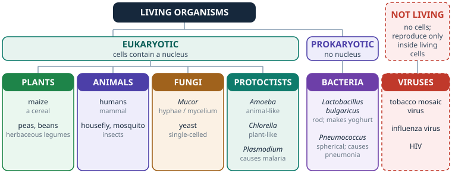
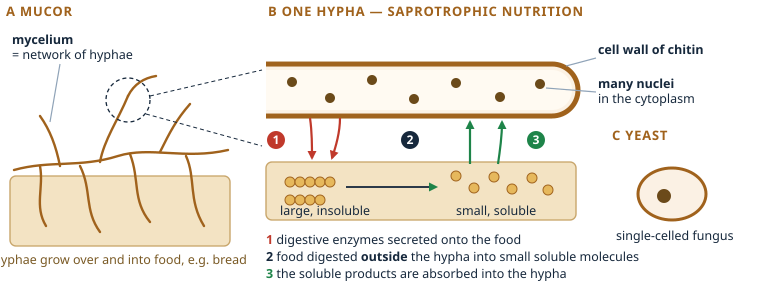
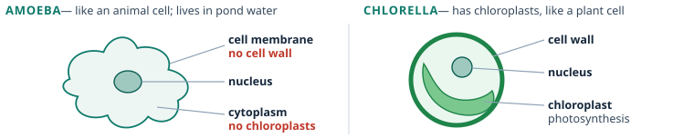
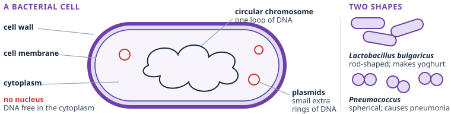
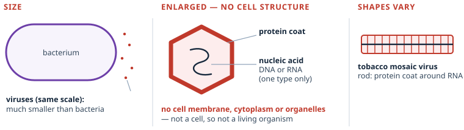

# Variety of living organisms

## Specification coverage

| Point | Section |
| --- | --- |
| 1.2 eukaryotes: plants, animals, fungi, protoctists — features and named examples | §1 (Fig. 1), §2 (table, Figs 2–3) |
| 1.3 prokaryotes: bacteria — features and named examples | §1 (Fig. 1), §3 (Fig. 4) |
| 1.4 pathogen; pathogens may be fungi, bacteria, protoctists or viruses; virus features and examples | §4 (Fig. 5) |

## 1. Eukaryotic and prokaryotic organisms

**Definition — Eukaryotic organism:** an organism made of cells that contain a **nucleus**.

**Definition — Prokaryotic organism:** an organism whose cells have **no nucleus**; its DNA lies
free in the cytoplasm. Bacteria are prokaryotic.

*Figure 1. The groups, with the examples named in the specification.*

## 2. Eukaryotic organisms

| | Plants | Animals | Fungi | Protoctists |
| --- | --- | --- | --- | --- |
| **Cells** | multicellular | multicellular | usually a **mycelium** of thread-like **hyphae** containing many nuclei; some single-celled (yeast) | microscopic, **single-celled** |
| **Chloroplasts / photosynthesis** | yes | no | no | some (*Chlorella*); others not (*Amoeba*) |
| **Cell wall** | **cellulose** | none | **chitin** | some have one |
| **Carbohydrate store** | **starch** or **sucrose** | often **glycogen** | may be **glycogen** | — |
| **Also** | — | usually **nervous co-ordination**; move from place to place | feed by **saprotrophic nutrition** | — |

### Fungi

**Definition — Saprotrophic nutrition:** feeding by secreting digestive enzymes onto food material
**outside** the organism (extracellular digestion) and absorbing the soluble organic products.

*Figure 2. Mucor has the typical fungal hyphal structure; yeast is a single-celled fungus.*

### Protoctists

*Figure 3. Two protoctists: one animal-like, one plant-like.*

## 3. Prokaryotic organisms: bacteria

Bacteria are microscopic and single-celled. A few can photosynthesise, but most feed off other
living or dead organisms.

*Figure 4. A bacterial cell and the two named bacteria.*

## 4. Pathogens and viruses

**Definition — Pathogen:** a microorganism that causes disease.

Pathogens may be **fungi, bacteria, protoctists or viruses**. The named pathogens are
*Pneumococcus* and *Plasmodium* (Figure 1) and the three viruses below.

*Figure 5. Virus size and structure.*

Viruses are **parasitic**: they can reproduce **only inside living cells**, and they infect every
type of living organism. They vary widely in shape and size. Outside a cell they show none of the characteristics of life, so they are
**not living organisms**.

| Virus | Disease |
| --- | --- |
| **Tobacco mosaic virus** | discolours tobacco leaves by preventing the formation of chloroplasts |
| **Influenza virus** | flu |
| **HIV** | AIDS |

## Common misunderstandings

| Wrong | Right |
| --- | --- |
| Fungi are plants | Fungi have no chloroplasts, have **chitin** (not cellulose) walls, may store **glycogen** (not starch) and feed saprotrophically |
| Yeast is a bacterium | Yeast is a single-celled **fungus**: eukaryotic, with a nucleus |
| Bacteria have no DNA | Bacteria have no **nucleus**; their DNA is a circular chromosome plus plasmids, free in the cytoplasm |
| Viruses are tiny bacteria | Viruses are not cells: only a protein coat around DNA **or** RNA |
