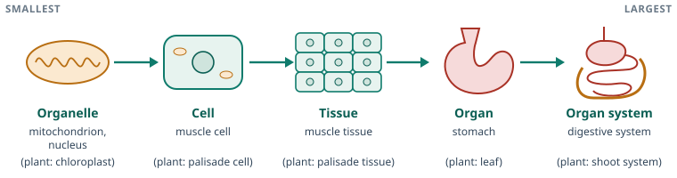

# Level of organisation

## Specification coverage

| Point | Section |
| --- | --- |
| 2.1 levels of organisation: organelles, cells, tissues, organs, systems | §1 (Fig. 1) |

## 1. From organelle to organ system

*Figure 1. Each level is built from units of the level before it.*

- **Organelle** — a structure inside a cell with a specific function.
- **Cell** — the basic structural and functional unit of an organism.
- **Tissue** — a group of **similar cells** working together to carry out a particular function.
- **Organ** — a structure made of **several different tissues** working together to carry out a
  particular function (the stomach contains muscle, glandular and lining tissues).
- **Organ system** — a group of **different organs** working together to carry out a particular
  function (digestive system: mouth, oesophagus, stomach, intestines, pancreas, liver).

::: traps
A tissue is made of **one type** of cell; an organ is made of **several types of tissue**. Do not
call the heart a tissue or muscle an organ.
:::
