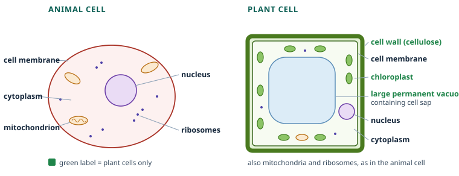
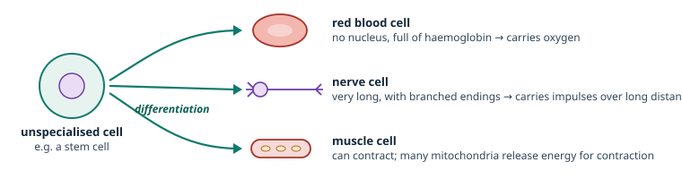

# Cell structure

## Specification coverage

| Point | Section |
| --- | --- |
| 2.2 structures: nucleus, cytoplasm, cell membrane, cell wall, mitochondria, chloroplasts, ribosomes, vacuole | §1 (Fig. 1, table) |
| 2.3 functions of the same structures | §1 (table) |
| 2.4 similarities and differences, plant and animal cells | §1 (Fig. 1, "Found in" column) |
| 2.5B importance of differentiation for specialised cells | §2 (Fig. 2) |
| 2.6B advantages and disadvantages of stem cells in medicine | §3 |

## 1. Cell structures and their functions

*Figure 1. Plant cells have every structure an animal cell has, plus three more.*

| Structure | Description | Function | Found in |
| --- | --- | --- | --- |
| Nucleus | large organelle bounded by a membrane; contains the **chromosomes** (genetic material) | **controls the cell's activities** | both |
| Cytoplasm | jelly-like fluid inside the membrane, holding the organelles | where **most chemical reactions** of the cell take place | both |
| Cell membrane | thin, **partially permeable** layer around the cytoplasm | **controls which substances enter and leave** the cell | both |
| Cell wall | tough layer of **cellulose** outside the membrane; **fully permeable** | **supports** the cell and keeps its shape; stops it bursting when it takes in water | plant only |
| Mitochondria | small organelles with a folded inner membrane | site of **aerobic respiration**, which releases energy | both |
| Chloroplasts | organelles containing green **chlorophyll** | **absorb light** for **photosynthesis** | plant only (green parts) |
| Ribosomes | very small organelles in the cytoplasm | site of **protein synthesis** | both |
| Vacuole | large **permanent** space filled with **cell sap**, surrounded by a membrane | stores sugars and salts; when full of water keeps the cell **firm**, supporting the plant | plant only (animal cells: small temporary vacuoles at most) |

## 2. Cell differentiation — Paper 2 only

::: definition
**Differentiation** — the process by which an unspecialised cell develops the structures it needs
to become a **specialised cell** with a particular function.
:::

*Figure 2. Each specialised cell has structures suited to one job.*

**Importance.** A multicellular organism needs many different functions (carrying oxygen,
carrying impulses, contracting…). A specialised cell carries out **one function very
efficiently**. Differentiated cells of the same type form **tissues**, tissues form **organs**
(→ 2.1). Without differentiation, the cells produced by division of a fertilised egg would all
stay the same, so no tissues or organs could form.

## 3. Stem cells in medicine — Paper 2 only

::: definition
**Stem cell** — an unspecialised cell that can divide to make more stem cells and can
**differentiate** into specialised cells.
:::

:::: grid
::: card | Embryonic stem cells
From early embryos. Can differentiate into **any** type of cell.
:::
::: card | Adult stem cells
Found in some adult tissues, e.g. **bone marrow**. Can form only a **limited range** of cells
(bone marrow → blood cells).
:::
::::

Use in medicine: grow stem cells into the type of cell a patient has lost and use them to
**replace damaged or diseased cells** — e.g. bone-marrow transplants for leukaemia; possible
treatments for type 1 diabetes (insulin-secreting cells), paralysis (nerve cells) or heart damage.

:::: grid
::: advantages
- Could treat conditions that cannot be cured at present, by **replacing damaged cells**.
- **Embryonic** stem cells can form any cell type.
- The patient's own adult stem cells are **not rejected**.
- Stem cells can be grown in large numbers in the lab.
:::
::: disadvantages
- **Ethical objections**: collecting embryonic stem cells destroys an embryo.
- Donor cells may be **rejected** by the immune system; drugs are then needed to prevent it.
- Stem cells may **divide uncontrollably** and form tumours.
- Cultured cells may carry **viral infection** to the patient.
- **Adult** stem cells form only a limited range of cells.
:::
::::

## Common misunderstandings

| Wrong | Right |
| --- | --- |
| The cell wall controls what enters the cell | The wall is fully permeable; the **membrane** controls entry and exit |
| Mitochondria make energy | Mitochondria **release** energy from glucose by respiration |
| All plant cells have chloroplasts | Only cells in green parts; root cells have none |
| Animal cells have no vacuoles | They have no **large permanent** vacuole; small temporary ones may occur |
