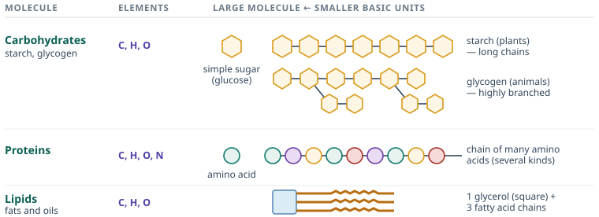
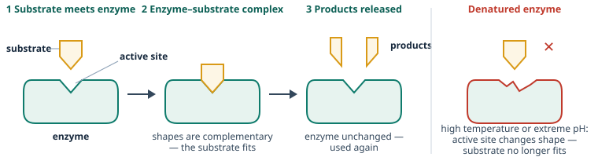
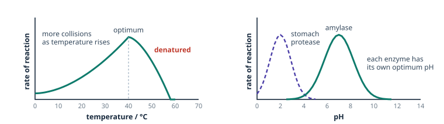
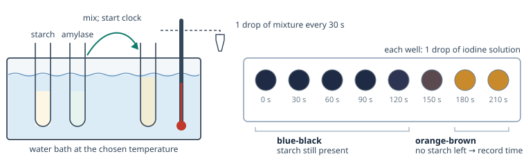

# Biological molecules

## Specification coverage

| Point | Section |
| --- | --- |
| 2.7 elements in carbohydrates, proteins, lipids | §1 (Fig. 1) |
| 2.8 large molecules from basic units: starch/glycogen, protein, lipid | §1 (Fig. 1) |
| 2.9 practical: food tests for glucose, starch, protein, fat | §2 |
| 2.10 enzymes as biological catalysts | §3 (Fig. 2) |
| 2.11 temperature and enzyme function; active-site shape | §4 (Fig. 3) |
| 2.12 practical: effect of temperature on enzyme activity | §5 (Fig. 4) |
| 2.13 pH and enzyme function; active site altered | §4 (Fig. 3) |
| 2.14B practical: effect of pH on enzyme activity | §5 |

## 1. Carbohydrates, proteins and lipids

*Figure 1. Large food molecules are built from smaller basic units. Only proteins contain nitrogen.*

## 2. Practical: food tests

Grind the food with a little water to make a solution or suspension first.

| Test for | Method | Positive result (negative) |
| --- | --- | --- |
| **Glucose** | add **Benedict's solution**; heat in a water bath (about 80 °C) for a few minutes | **blue → green, yellow, orange or brick-red** precipitate; the more glucose, the further along (stays blue) |
| **Starch** | add a few drops of **iodine solution** | **orange-brown → blue-black** (stays orange-brown) |
| **Protein** | add **biuret** reagent (sodium hydroxide, then a few drops of dilute copper sulfate) | **blue → purple** (stays blue) |
| **Fat** | shake with **ethanol**, then pour into water | **cloudy white emulsion** (stays clear) |

Safety: ethanol is flammable — keep it away from flames; wear eye protection when heating
Benedict's.

## 3. Enzymes as biological catalysts

::: definition
**Catalyst** — a substance that speeds up a chemical reaction without being used up or changed.
**Enzymes** are proteins that act as **biological catalysts**.
:::

**Metabolic reactions** — every chemical reaction in a living organism, building molecules up
(e.g. glucose → starch) or breaking them down (digestion, respiration). At body temperature they
would be far too slow without enzymes.

*Figure 2. Lock and key: each enzyme is specific — only a substrate whose shape is complementary
to its active site fits.*

## 4. Effect of temperature and pH

*Figure 3. Enzymes work fastest at their optimum temperature and optimum pH.*

**Temperature (2.11).**

1. Up to the optimum: molecules gain kinetic energy and move faster, so enzyme and substrate
   **collide more often** and more enzyme–substrate complexes form → rate rises.
2. Above the optimum: the enzyme molecule vibrates so much that the bonds holding its shape
   break; the **active site changes shape**, the substrate no longer fits → rate falls steeply.
   The enzyme is **denatured** — permanently.
3. At low temperature the enzyme is **not** denatured, only slow; activity returns on warming.

**pH (2.13).** Each enzyme has an **optimum pH**. Above or below it, the bonds holding the enzyme's
shape are affected, so the **active site changes shape** and the substrate fits less well → rate
falls. Far from the optimum the enzyme is denatured.

## 5. Practical: effect of temperature (2.12) and pH (2.14B) on amylase

*Figure 4. Amylase digests starch. The time taken for starch to disappear measures the rate.*

1. Put starch solution and amylase solution in separate tubes in a water bath at the chosen
   temperature for 5 minutes, so both reach that temperature.
2. Put one drop of iodine in each well of a spotting tile.
3. Mix the solutions (keep the tube in the bath) and start the stop clock.
4. Every 30 s, add one drop of the mixture to a new well.
5. Record the time when the iodine **stays orange-brown** — all the starch has been digested.
6. Repeat at other temperatures (e.g. 20–60 °C). **Rate = 1 / time.**

| Variable | Temperature practical | pH practical — Paper 2 only |
| --- | --- | --- |
| Independent | temperature of water bath | pH — add a **buffer solution** of a different pH each time |
| Dependent | time until starch has gone | time until starch has gone |
| Controlled | volume and concentration of starch and amylase, pH (buffer), sampling interval | volume and concentration of starch and amylase, **temperature** (water bath) |

**Expected results.** Shortest time (fastest rate) near amylase's optimum, about 40 °C and about
pH 7; slower either side; at high temperature or extreme pH the starch may never disappear
(denatured enzyme).

**Control.** Repeat with **boiled** (denatured) amylase: the starch remains, showing it is the
active enzyme that breaks starch down.

**Evaluation.** Testing only every 30 s limits precision — sample more often. The colour
end-point is a judgement — compare with a reference colour. Repeat each temperature or pH and
calculate a mean.

## Common misunderstandings

| Wrong | Right |
| --- | --- |
| Enzymes are killed by heat | Enzymes are not alive; they are **denatured** |
| At low temperature enzymes are denatured | They are only slowed; denaturing needs high temperature or extreme pH |
| The substrate changes shape when denatured | The enzyme's **active site** changes shape |
| Biuret turns protein pink | Blue → **purple** |
