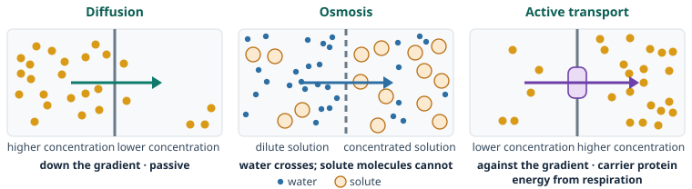
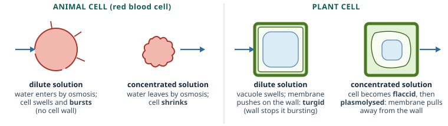
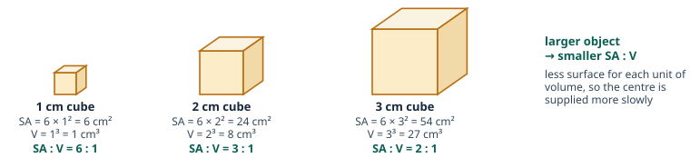
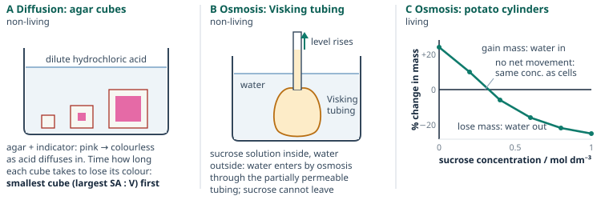

# Movement of substances into and out of cells

## Specification coverage

| Point | Section |
| --- | --- |
| 2.15 diffusion, osmosis, active transport | §1 (Fig. 1), §2 (Fig. 2) |
| 2.16 factors: SA:V, distance, temperature, concentration gradient | §3 (Fig. 3) |
| 2.17 practical: diffusion and osmosis in living and non-living systems | §4 (Fig. 4) |

## 1. Three ways substances cross membranes

::: definition
**Diffusion** — the net movement of particles from a region of **higher concentration** to a
region of **lower concentration**, down a concentration gradient. It is **passive**: no energy
from respiration is needed.

**Osmosis** — the net movement of **water** molecules from a **dilute** solution (higher water
concentration) to a more **concentrated** solution (lower water concentration) through a
**partially permeable membrane**.

**Active transport** — the movement of substances from a region of **lower** concentration to a
region of **higher** concentration, **against** a concentration gradient, using **energy from
respiration**.
:::

*Figure 1. Osmosis is the special case of water diffusing through a partially permeable membrane.
Active transport uses carrier proteins in the membrane.*

Examples: oxygen and carbon dioxide diffuse across alveoli and leaves; water enters root hair
cells by osmosis; mineral ions enter root hair cells, and glucose is absorbed in the small
intestine, by active transport.

## 2. Osmosis and cells

*Figure 2. The cell membrane is partially permeable, so cells gain or lose water by osmosis.*

Turgid cells press against each other and **support** non-woody plants; when cells become flaccid
the plant **wilts**.

## 3. Factors affecting the rate of movement

*Figure 3. Surface area (SA) to volume (V) ratio falls as size increases.*

| Factor | Faster when… | Why |
| --- | --- | --- |
| **Surface area to volume ratio** | SA:V is **larger** | more membrane for each unit of volume to be supplied |
| **Distance** | the distance is **shorter** (thin membranes, thin walls) | particles have less far to travel |
| **Temperature** | temperature is **higher** | particles have more kinetic energy and move faster |
| **Concentration gradient** | the gradient is **steeper** | a bigger difference means greater net movement |

## 4. Practicals: diffusion and osmosis

*Figure 4. A and B use non-living systems; C uses living tissue.*

**A — Diffusion in agar (SA:V).** Measure the time for each cube to become colourless. Control:
the concentration and volume of acid, temperature, and the starting colour of the agar.

**C — Potato cylinders in sucrose solutions.**

1. Cut cylinders of equal length and diameter from the same potato with a cork borer.
2. Blot, then weigh each one.
3. Place one in each sucrose solution (e.g. 0, 0.2, 0.4 … 1.0 mol dm⁻³) for the same time
   (e.g. 30 minutes) at the same temperature.
4. Remove, **blot dry** (so surface solution is not weighed) and reweigh.
5. Calculate **% change in mass = (final − initial) ÷ initial × 100**. Using % change allows
   cylinders of different starting mass to be compared.

**Interpreting.** Gain in mass: the solution was more dilute than the cell contents, so water
entered by osmosis. Loss: the solution was more concentrated, so water left. Where the line
crosses zero, there is no net movement — the solution has the same concentration as the cell
contents.

**Evaluation.** Blot each cylinder the same way; repeat each concentration and take a mean; use
more concentrations near the crossing point to find it more precisely.

## Common misunderstandings

| Wrong | Right |
| --- | --- |
| Osmosis is the movement of solute | Osmosis is the movement of **water** only |
| Particles stop moving at equilibrium | They keep moving; there is just **no net** movement |
| Active transport goes down the gradient | It moves substances **against** the gradient, using energy |
| Plant cells burst in water | The **cell wall** stops them bursting; they become turgid |
