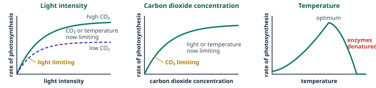
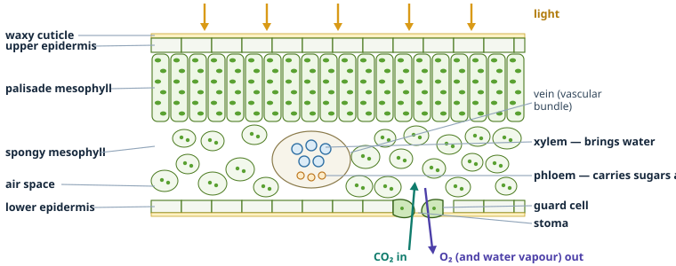
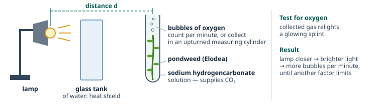
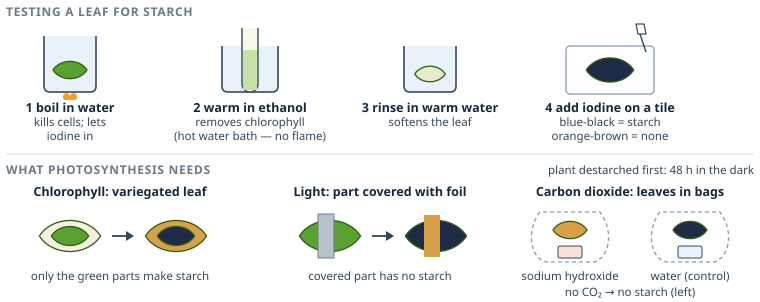
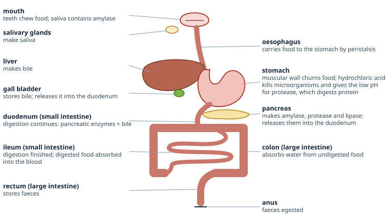
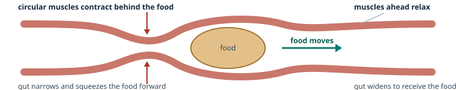
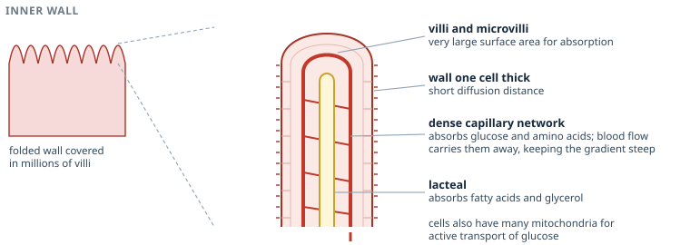
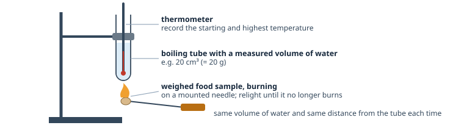

# Nutrition

## Specification coverage

| Point | Section |
| --- | --- |
| 2.18 photosynthesis; light energy → chemical energy | §1 |
| 2.19 word and balanced symbol equations | §1 |
| 2.20 effect of CO₂ concentration, light intensity, temperature on rate | §2 (Fig. 1) |
| 2.21 leaf structure and adaptations for photosynthesis | §3 (Fig. 2) |
| 2.22 mineral ions: magnesium, nitrate | §4 |
| 2.23 practical: oxygen evolution, starch production, need for light, CO₂, chlorophyll | §5 (Figs 3–4) |
| 2.24 balanced diet | §6 |
| 2.25 sources and functions of nutrients | §6 (table) |
| 2.26 energy requirements: activity, age, pregnancy | §7 |
| 2.27 alimentary canal: structure and function | §8 (Fig. 5) |
| 2.28 peristalsis | §9 (Fig. 6) |
| 2.29 digestive enzymes | §10 (table) |
| 2.30 bile made in liver, stored in gall bladder | §11 |
| 2.31 bile neutralises acid, emulsifies lipids | §11 |
| 2.32 small intestine adapted for absorption; villus | §12 (Fig. 7) |
| 2.33B practical: energy content of food | §13 (Fig. 8) |

## 1. Photosynthesis

Green plants make their own food. **Chlorophyll** in chloroplasts absorbs **light energy**, which
is used to make **glucose** from carbon dioxide and water; oxygen is released. Light energy is
converted into **chemical energy** stored in glucose. Glucose is used in respiration or turned into
starch (storage), sucrose (transport), cellulose and proteins — so this stored energy supports the
plant and, through food chains, almost all other organisms.

::: note | Equations
carbon dioxide + water → glucose + oxygen  *(light, chlorophyll)*

6CO₂ + 6H₂O → C₆H₁₂O₆ + 6O₂
:::

## 2. Factors affecting the rate of photosynthesis

*Figure 1. Light intensity and CO₂ are limiting factors; temperature has an optimum.*

::: definition
**Limiting factor** — the factor in shortest supply, which limits the rate of a process.
:::

- **Light intensity** and **CO₂ concentration**: increasing the factor increases the rate while it
  is the limiting factor. When the graph levels off, another factor is limiting; increasing that
  factor raises the plateau (higher CO₂ curve in Figure 1).
- **Temperature**: photosynthesis is controlled by **enzymes**. Rate rises up to the optimum as
  collisions increase, then falls as the enzymes are **denatured** (→ 2.11).

## 3. Leaf structure and adaptations

*Figure 2. Transverse section of a leaf.*

| Feature | How it helps photosynthesis |
| --- | --- |
| broad, flat leaf | large surface area to absorb light |
| thin leaf | short diffusion distance for CO₂ to reach mesophyll cells |
| waxy cuticle and epidermis transparent | light passes through to the mesophyll |
| palisade cells near the upper surface, tightly packed, full of chloroplasts | absorb as much light as possible |
| air spaces in spongy mesophyll | CO₂ diffuses quickly to all cells |
| stomata | let CO₂ in (and O₂ out) |
| xylem in veins | brings water |
| phloem in veins | carries sugars made in the leaf away |

## 4. Mineral ions

Plants absorb mineral ions from the soil through root hair cells (active transport, → 2.15).

| Ion | Needed for | Deficiency |
| --- | --- | --- |
| **Magnesium** | making **chlorophyll** | yellow leaves, less photosynthesis |
| **Nitrate** | making **amino acids** (→ proteins) for growth | poor, stunted growth |

## 5. Practical: investigating photosynthesis

### Oxygen evolution from a water plant

*Figure 3. Rate of photosynthesis measured by oxygen production.*

- **Independent:** light intensity, changed by the distance of the lamp (moving it closer increases
  light intensity). **Dependent:** bubbles per minute (or volume of gas collected).
- **Controlled:** temperature (glass tank of water absorbs heat from the lamp), CO₂ concentration
  (same sodium hydrogencarbonate solution), same piece of pondweed. Leave 5 minutes at each
  distance before counting.
- **Evaluation:** bubbles vary in size — collecting the gas and measuring its volume is more
  accurate; background light should be excluded (darkened room).

### Starch production and the requirements for photosynthesis

*Figure 4. Starch in a leaf shows that photosynthesis has taken place.*

- **Destarch** the plant first (48 hours in the dark) so that any starch found must have been made
  during the experiment.
- Each experiment has a **control** that has the requirement: the green part of the variegated
  leaf, the uncovered part of the leaf, and the leaf in the bag with water. Sodium hydroxide
  absorbs CO₂.
- Ethanol is flammable: heat it in a water bath, never over a flame.

## 6. A balanced diet

::: definition
**Balanced diet** — a diet containing carbohydrate, protein, lipid, vitamins, minerals, water and
dietary fibre in the right proportions, and enough energy for the person's needs.
:::

| Component | Good sources | Function |
| --- | --- | --- |
| **Carbohydrate** | bread, rice, pasta, potatoes | main source of **energy** (respiration) |
| **Protein** | meat, fish, eggs, beans | **growth and repair** of tissues; making enzymes |
| **Lipid** (fats and oils) | butter, oil, cheese, nuts | **energy store** (more per gram than carbohydrate); insulation; cell membranes |
| **Vitamin A** | carrots, liver, green vegetables | good **vision** (especially in dim light); healthy skin |
| **Vitamin C** | citrus fruit, green vegetables | healthy **skin, gums** and blood vessels (lack → scurvy) |
| **Vitamin D** | oily fish, eggs; made in skin in sunlight | helps **absorb calcium** → strong bones and teeth (lack → rickets) |
| **Calcium** | milk, cheese | strong **bones and teeth**; blood clotting |
| **Iron** | red meat, liver, spinach | making **haemoglobin** in red blood cells (lack → anaemia) |
| **Water** | drinks, food | **solvent** for chemical reactions and transport in blood; cooling by sweat |
| **Dietary fibre** | vegetables, wholemeal bread, cereals | adds **bulk** so peristalsis can move food through the gut; prevents constipation |

## 7. Energy requirements

Energy is needed for respiration. Requirements are higher when more energy is used:

- **Activity:** more active people (and manual jobs, sport) respire more to fuel muscle
  contraction.
- **Age:** children and teenagers need a lot for **growth** — teenagers most in total; older adults
  usually need less (less active, no growth).
- **Pregnancy:** extra energy for the growth of the **fetus** and placenta and the mother's
  greater body mass.

## 8. The human alimentary canal

**Digestion** breaks large, insoluble food molecules into small, soluble molecules that can be
**absorbed** into the blood. Chewing and churning are mechanical; enzymes do the chemical digestion.

*Figure 5. Food passes mouth → oesophagus → stomach → small intestine → large intestine. The liver,
gall bladder and pancreas add secretions but food does not pass through them.*

## 9. Peristalsis

*Figure 6. Muscles in the gut wall move food along in waves.*

Waves of contraction push food along the whole canal, from the oesophagus to the rectum.

## 10. Digestive enzymes

| Enzyme | Digests | Into | Made in | Acts in |
| --- | --- | --- | --- | --- |
| **Amylase** | starch | maltose | salivary glands, pancreas | mouth, duodenum |
| **Maltase** | maltose | glucose | wall of small intestine | small intestine |
| **Protease** | proteins | amino acids | stomach, pancreas, small intestine | stomach, small intestine |
| **Lipase** | lipids | fatty acids and glycerol | pancreas | small intestine |

## 11. Bile

Bile is **produced by the liver**, **stored in the gall bladder** and released into the duodenum.
It is **not** an enzyme.

- **Neutralises stomach acid.** Bile is alkaline, so the acidic food leaving the stomach is
  neutralised, giving the higher pH at which the enzymes in the small intestine work best.
- **Emulsifies lipids.** Bile breaks large fat drops into many small droplets. This gives a much
  **larger surface area** for lipase to act on, so lipids are digested faster.

## 12. Absorption in the small intestine

*Figure 7. Adaptations of a villus for absorption.*

The small intestine is also **very long**, giving more time and area for absorption.

## 13. Practical: energy content of food — Paper 2 only

*Figure 8. Energy released by burning food is used to heat water.*

::: note | Calculation
energy released (J) = mass of water (g) × 4.2 × temperature rise (°C)

energy per gram (J/g) = energy released ÷ mass of food (g)

1 cm³ of water has a mass of 1 g.
:::

Example: 0.5 g of bread heats 20 cm³ of water from 20 °C to 35 °C.
Energy = 20 × 4.2 × 15 = 1260 J; per gram = 1260 ÷ 0.5 = **2520 J/g**.

**Evaluation.** The result is **lower** than the true value: heat is lost to the air, the tube and
the needle; some food does not burn completely. Improve by insulating the tube, keeping the food
close under it, stirring the water, and relighting until the food will not burn.

## Common misunderstandings

| Wrong | Right |
| --- | --- |
| Plants get their food from the soil | They make glucose by photosynthesis; the soil provides water and mineral ions |
| Bile digests fat | Bile **emulsifies** fat; **lipase** digests it |
| Food passes through the liver and pancreas | They pour secretions into the gut; food does not enter them |
| Amylase digests starch to glucose | Amylase → **maltose**; **maltase** → glucose |
| Moving the lamp further away raises light intensity | Light intensity **falls** as distance increases |
