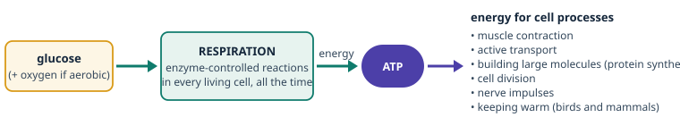
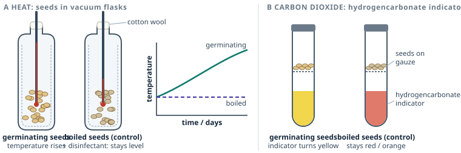

# Respiration

## Specification coverage

| Point | Section |
| --- | --- |
| 2.34 respiration produces ATP | §1 (Fig. 1) |
| 2.35 ATP provides energy for cells | §1 (Fig. 1) |
| 2.36 differences between aerobic and anaerobic respiration | §2 (table) |
| 2.37 aerobic word and balanced symbol equations | §2 |
| 2.38 anaerobic word equations, plants and animals | §2 |
| 2.39 practical: CO₂ and heat from respiring seeds | §3 (Fig. 2) |

## 1. Respiration and ATP

::: definition
**Respiration** — a series of enzyme-controlled reactions in cells that break down glucose to
release energy, which is used to make **ATP**.
:::

*Figure 1. ATP carries the energy released by respiration to the processes that need it.*

Respiration is **not** breathing: it is a chemical process in every living cell, happening day and
night in plants and animals.

## 2. Aerobic and anaerobic respiration

::: note | Aerobic respiration
glucose + oxygen → carbon dioxide + water

C₆H₁₂O₆ + 6O₂ → 6CO₂ + 6H₂O
:::

::: note | Anaerobic respiration
**Animals** (e.g. muscles during hard exercise): glucose → lactic acid

**Plants** (and yeast): glucose → ethanol + carbon dioxide
:::

| | Aerobic | Anaerobic |
| --- | --- | --- |
| Oxygen | needed | **not** needed |
| Glucose broken down | completely | incompletely |
| Products | carbon dioxide + water | lactic acid (animals); ethanol + carbon dioxide (plants, yeast) |
| Energy (ATP) released per glucose | **much more** | much less |
| Where in the cell | mostly in **mitochondria** | cytoplasm |

In muscles, anaerobic respiration tops up energy supply when oxygen cannot be delivered fast
enough. Lactic acid builds up and causes fatigue; oxygen is needed afterwards to break it down,
which is why breathing stays fast after exercise (→ 2.50).

## 3. Practical: carbon dioxide and heat from respiring seeds

*Figure 2. Germinating seeds respire rapidly; boiled seeds are dead and cannot respire.*

- **Heat (A).** Vacuum flasks reduce heat loss, so heat released by respiration raises the
  temperature. Record the temperature daily for several days.
- **Carbon dioxide (B).** Hydrogencarbonate indicator changes colour with CO₂ concentration:
  **yellow** (more CO₂) ← **red/orange** (air) → **purple** (less CO₂). Limewater (turns **cloudy**)
  can be used instead.
- **Control.** Boiled seeds, which cannot respire. They are washed in **disinfectant** to kill
  microorganisms on their surface, whose respiration would also release heat and CO₂.
- **Controlled variables.** Same type and mass/number of seeds, same volume of indicator, same
  starting temperature and time.
- Other living organisms, e.g. maggots or woodlice on gauze, can replace the seeds in B.

## Common misunderstandings

| Wrong | Right |
| --- | --- |
| Respiration is breathing | Respiration is a chemical reaction in cells; breathing is ventilation of the lungs |
| Plants photosynthesise instead of respiring | Plants respire all the time, day and night |
| Respiration makes energy | It **releases** energy from glucose and transfers it to ATP |
| Anaerobic respiration in animals makes CO₂ | Animals make **lactic acid** only; plants and yeast make ethanol + CO₂ |
