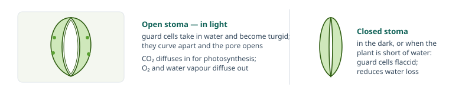
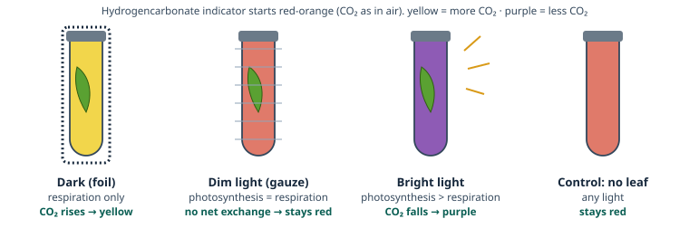
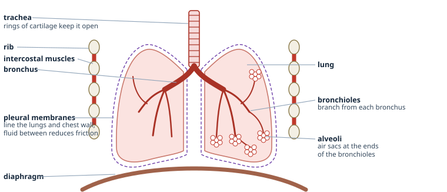
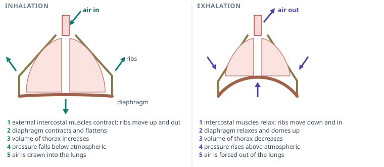
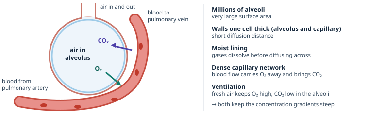
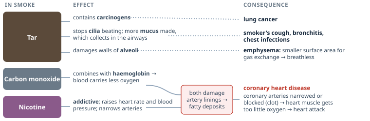
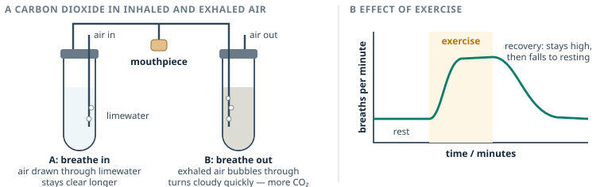

# Gas exchange

## Specification coverage

| Point | Section |
| --- | --- |
| 2.40B role of diffusion in gas exchange | §1 |
| 2.41B gas exchange in relation to respiration and photosynthesis | §1 |
| 2.42B leaf structure adapted for gas exchange | §1 (→ Nutrition Fig. 2) |
| 2.43B role of stomata | §1 (Fig. 1) |
| 2.44B respiration day and night; net exchange depends on light intensity | §2 (Fig. 2) |
| 2.45B practical: light and net gas exchange, hydrogencarbonate indicator | §2 (Fig. 2) |
| 2.46 structure of the thorax | §3 (Fig. 3) |
| 2.47 intercostal muscles and diaphragm in ventilation | §4 (Fig. 4) |
| 2.48 alveoli adapted for gas exchange | §5 (Fig. 5) |
| 2.49 smoking: lungs, circulatory system, CHD | §6 (Fig. 6) |
| 2.50 practical: breathing — CO₂ release and effect of exercise | §7 (Fig. 7) |

## 1. Gas exchange in leaves — Paper 2 only

Gases enter and leave a leaf by **diffusion**, down concentration gradients: through the stomata,
through the air spaces, and across the moist walls of mesophyll cells. No energy is used.

| Process | Uses | Releases | When |
| --- | --- | --- | --- |
| Photosynthesis | CO₂ | O₂ | only in light |
| Respiration | O₂ | CO₂ | all the time, day and night |

**Leaf adaptations for gas exchange** (leaf section: Nutrition, Figure 2): large surface area
(broad, flat); thin, so gases diffuse only a short distance; many **stomata**, mainly on the lower
surface; **air spaces** in the spongy mesophyll, giving a large internal surface of moist cell
walls.

*Figure 1. Guard cells control the size of the stomatal pore.*

## 2. Net gas exchange and light — Paper 2 only

Respiration continues day and night; photosynthesis only in light. The **net** exchange depends on
which is faster, and that depends on **light intensity**:

- **Dark:** respiration only → the leaf takes in O₂ and gives out CO₂.
- **Dim light:** photosynthesis rate = respiration rate → no net exchange.
- **Bright light:** photosynthesis faster than respiration → net uptake of CO₂, net release of O₂.

*Figure 2. Practical (2.45B): leaves in sealed tubes of hydrogencarbonate indicator at different
light intensities.*

Method: put the same number of similar leaves in tubes with the same volume of indicator, seal
them, and leave at the same temperature for the same time (e.g. 1 hour). The tube with no leaf
is the control: it shows the colour change is caused by the leaf. Keep lamps at a distance, or
use a heat shield, so temperature is not a variable.

## 3. The thorax

*Figure 3. Air passes trachea → bronchi → bronchioles → alveoli.*

## 4. Ventilation

*Figure 4. The intercostal muscles and diaphragm change the volume, and so the pressure, of the
thorax.*

## 5. Alveoli

*Figure 5. Gas exchange between air in the alveoli and blood in the capillaries is by diffusion.*

## 6. Smoking

*Figure 6. The harmful substances in tobacco smoke and their consequences.*

**Coronary heart disease (CHD):** the coronary arteries supply the heart muscle with blood. Fatty
deposits narrow them, and a blood clot may block them; heart muscle beyond the blockage is
starved of oxygen and cannot respire, so it may die — a heart attack. Other risk factors: 2.67.

## 7. Practical: breathing in humans

*Figure 7. Exhaled air contains more CO₂; exercise increases breathing rate.*

**Effect of exercise.** Count breaths per minute at rest, then immediately after a set exercise
(e.g. 2 minutes of step-ups), then every minute until the rate returns to resting.

- **Result:** breathing rate and depth increase during exercise, supplying more **oxygen** for
  aerobic respiration in the muscles and removing more **CO₂**. The rate stays high after exercise
  while lactic acid is broken down (→ 2.36).
- **Control:** same person, same exercise for the same time; rest until the rate is back to
  resting before repeating. Repeat and calculate a mean.

## Common misunderstandings

| Wrong | Right |
| --- | --- |
| Plants respire only at night | Plants respire day and night; in the day photosynthesis usually hides it |
| The lungs pull air in | Muscles increase thorax volume; lower pressure lets air flow in |
| The diaphragm moves up when you breathe in | It **contracts and flattens** (moves down) |
| Alveoli walls are thin to let blood through | They are thin to give a **short diffusion distance** for gases |
| Nicotine causes lung cancer | **Tar** contains the carcinogens; nicotine is addictive and affects the heart and arteries |
