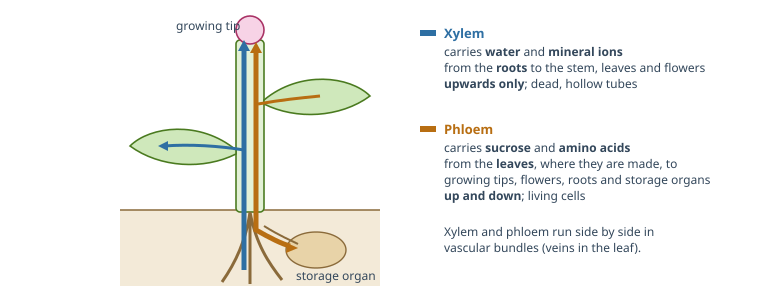
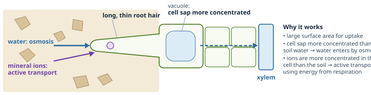
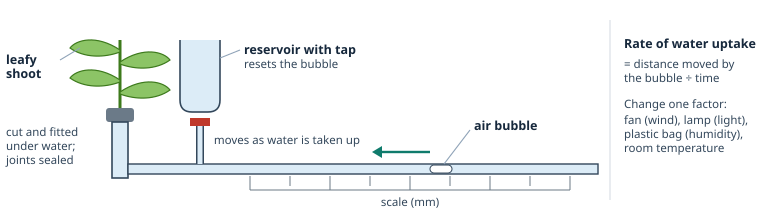
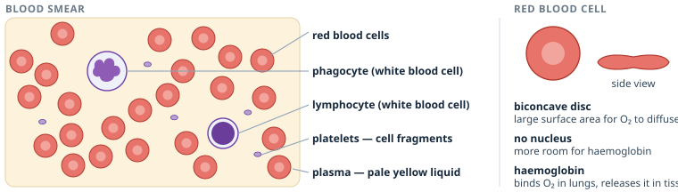
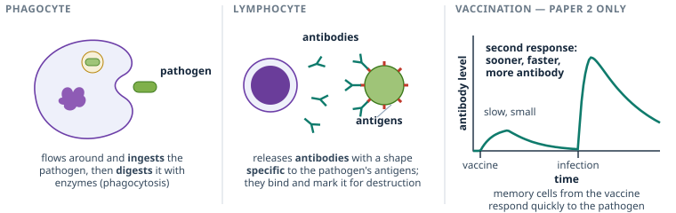
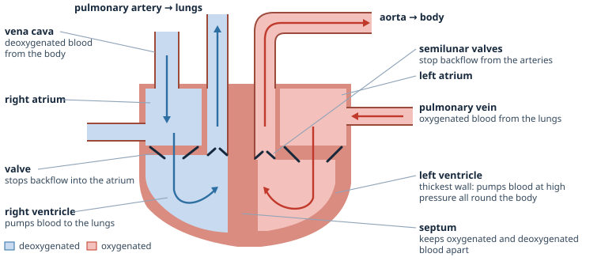
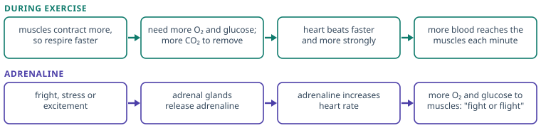
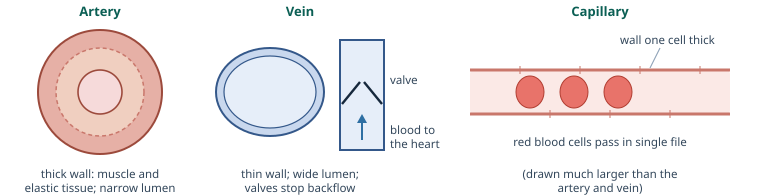
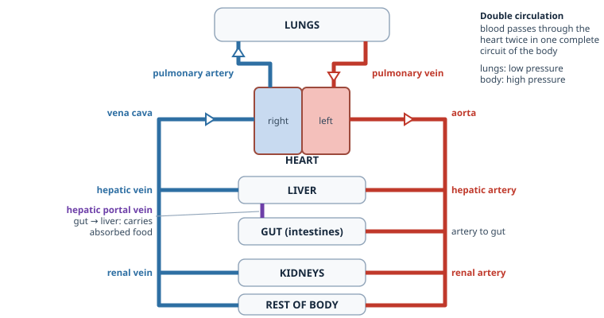

# Transport

## Specification coverage

| Point | Section |
| --- | --- |
| 2.51 unicellular organisms rely on diffusion | §1 |
| 2.52 need for a transport system in multicellular organisms | §1 |
| 2.53 phloem: sucrose and amino acids | §2 (Fig. 1) |
| 2.54 xylem: water and mineral ions | §2 (Fig. 1) |
| 2.55B water absorption by root hair cells | §3 (Fig. 2) |
| 2.56B transpiration = evaporation from the plant surface | §4 |
| 2.57B humidity, wind speed, temperature, light intensity | §4 (table) |
| 2.58B practical: environmental factors and transpiration rate | §4 (Fig. 3) |
| 2.59 composition of blood | §5 (Fig. 4) |
| 2.60 plasma transports CO₂, digested food, urea, hormones, heat | §5 |
| 2.61 red blood cell adaptations | §5 (Fig. 4) |
| 2.62 immune response: phagocytes, lymphocytes, antibodies | §6 (Fig. 5) |
| 2.63B vaccination and memory cells | §6 (Fig. 5) |
| 2.64B platelets and clotting | §7 |
| 2.65 structure and function of the heart | §8 (Fig. 6) |
| 2.66 heart rate: exercise, adrenaline | §9 (Fig. 7) |
| 2.67 risk factors for coronary heart disease | §10 |
| 2.68 arteries, veins, capillaries: structure and function | §11 (Fig. 8, table) |
| 2.69 circulation: vessels to/from heart, lungs, liver, kidneys | §12 (Fig. 9) |

## 1. Why transport systems are needed

- **Unicellular organisms** (e.g. *Amoeba*) have a **large surface area to volume ratio** and every
  part of the cell is a **short distance** from the surface, so diffusion across the membrane
  supplies oxygen and removes waste fast enough (→ 2.16).
- **Multicellular organisms** have a **small SA:V** and many cells lie far from the surface.
  Diffusion over these distances is far too slow, so they need **exchange surfaces** (lungs, gut,
  leaves, roots) and a **transport system** that carries substances quickly between those surfaces
  and every cell.

## 2. Transport in flowering plants: xylem and phloem

*Figure 1. Xylem moves water up; phloem moves the products of photosynthesis to where they are
used or stored.*

## 3. Water uptake by root hair cells — Paper 2 only

*Figure 2. Root hair cells absorb water by osmosis and mineral ions by active transport.*

## 4. Transpiration — Paper 2 only

::: definition
**Transpiration** — the evaporation of water from the surface of a plant, mostly from the leaves.
:::

Water evaporates from the moist walls of mesophyll cells into the air spaces, then **diffuses out
through the stomata**. This loss pulls water up the xylem from the roots — the **transpiration
stream** — carrying mineral ions with it.

| Factor increases | Rate of transpiration | Why |
| --- | --- | --- |
| **Humidity** | **decreases** | more water vapour outside the leaf → smaller concentration gradient for diffusion |
| **Wind speed** | increases | water vapour is blown away from the leaf surface → steeper gradient |
| **Temperature** | increases | water molecules have more kinetic energy → faster evaporation and diffusion |
| **Light intensity** | increases | stomata open wider in light, so more water vapour can escape |

### Practical: a potometer (2.58B)

*Figure 3. The rate of water uptake is used as a measure of the rate of transpiration.*

1. Cut the shoot **under water** and assemble the apparatus under water, so no air enters the
   xylem; seal the joints with petroleum jelly.
2. Introduce an air bubble and let the shoot adjust for 5 minutes.
3. Measure the distance the bubble moves in a set time; reset with the reservoir and repeat.
4. Change one factor at a time; keep the others constant (same shoot, same temperature etc.).

A potometer measures **water uptake**, not water loss: a little of the water taken up is used in
photosynthesis or stays in the cells.

## 5. Blood

*Figure 4. Blood is red blood cells, white blood cells and platelets carried in plasma.*

**Plasma** is mainly water and transports dissolved substances around the body:

| Substance | From | To |
| --- | --- | --- |
| carbon dioxide | respiring cells | lungs |
| digested food (glucose, amino acids) | small intestine | all cells |
| urea | liver | kidneys |
| hormones | glands | target organs |
| heat energy | muscles and liver | the whole body; skin |

**Red blood cells** carry **oxygen**: haemoglobin combines with oxygen in the lungs to form
**oxyhaemoglobin**, which releases the oxygen in respiring tissues.

## 6. The immune response

*Figure 5. White blood cells defend the body against pathogens.*

**Vaccination — Paper 2 only.** A vaccine contains a dead or weakened pathogen, or its antigens,
which cannot cause disease. Lymphocytes respond by making antibodies and **memory cells**. If the
real pathogen enters later, memory cells enable antibodies to be made **sooner, faster and in
greater quantity**, so the pathogen is destroyed before it causes illness — the person is
**immune**.

## 7. Blood clotting — Paper 2 only

At a wound, **platelets** release chemicals that turn soluble **fibrinogen** in the plasma into
insoluble **fibrin** fibres. The fibres form a mesh that traps red blood cells, forming a **clot**
(a scab on the skin). The clot **prevents blood loss** and stops **micro-organisms entering**.

## 8. The heart

*Figure 6. The right side pumps deoxygenated blood to the lungs; the left side pumps oxygenated
blood to the body.*

**How it works.** The **atria** contract, pushing blood into the ventricles; then the
**ventricles** contract, pushing blood into the arteries. Valves close to stop blood flowing
backwards. The heart muscle itself is supplied with oxygen and glucose by the **coronary
arteries**.

## 9. Heart rate

*Figure 7. Both raise heart rate so that muscles receive more oxygen and glucose.*

After exercise the heart rate stays raised for a while, supplying extra oxygen to break down
lactic acid (→ 2.36), then returns to resting.

## 10. Coronary heart disease: risk factors

CHD is the narrowing or blocking of the coronary arteries by fatty deposits (→ 2.49). Factors that
increase the risk:

- **diet high in saturated fat / cholesterol** — more fatty deposits in artery walls;
- **smoking** — nicotine and carbon monoxide damage artery linings, raise blood pressure;
- **high blood pressure** (e.g. from a high-salt diet or **stress**) — damages artery walls;
- **lack of exercise** and **obesity** — raise blood pressure and cholesterol;
- **genes**, increasing **age**, and being **male** — cannot be changed.

## 11. Arteries, veins and capillaries

*Figure 8. Each vessel's structure suits the pressure of the blood it carries and its job.*

| | Artery | Vein | Capillary |
| --- | --- | --- | --- |
| Carries blood | **away from** the heart, at **high pressure** | **to** the heart, at **low pressure** | through tissues, between arteries and veins |
| Wall | **thick, muscular and elastic**: withstands high pressure; stretches and recoils with each beat | **thin**: pressure is low | **one cell thick**: short diffusion distance for exchange with cells |
| Lumen | narrow | **wide**: less resistance to slow-moving blood | very narrow: red blood cells pass in single file, close to the wall |
| Valves | none (except at the heart) | **yes**: stop backflow | none |

## 12. The circulation system

*Figure 9. The main blood vessels to and from the heart, lungs, liver and kidneys.*

The double circulation keeps oxygenated and deoxygenated blood separate and lets the body circuit
run at **high pressure**, so blood reaches all organs quickly.

## Common misunderstandings

| Wrong | Right |
| --- | --- |
| Phloem carries water | **Xylem** carries water and mineral ions; phloem carries sucrose and amino acids |
| Arteries always carry oxygenated blood | Arteries carry blood **away from** the heart; the pulmonary artery carries deoxygenated blood |
| Veins have thick walls to cope with pressure | Veins have **thin** walls — their pressure is low; they have valves |
| Antibodies eat pathogens | **Phagocytes** ingest pathogens; lymphocytes release antibodies |
| Vaccines contain antibodies | Vaccines contain **antigens** (dead or weakened pathogen); the body makes its own antibodies and memory cells |
| A potometer measures transpiration directly | It measures **water uptake** |
