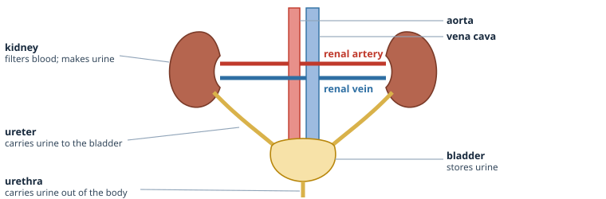
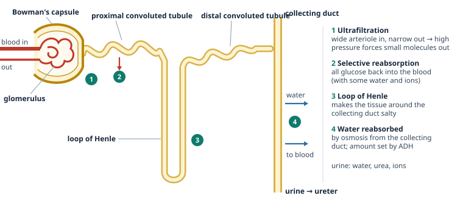
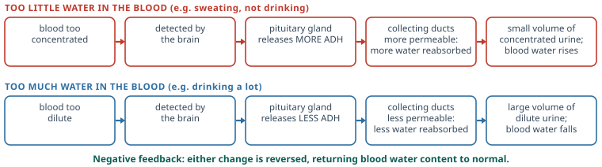

# Excretion

## Specification coverage

| Point | Section |
| --- | --- |
| 2.70 CO₂ and O₂ as waste products in plants; lost through stomata | §1 |
| 2.71 excretory products of lungs, kidneys, skin | §2 (table) |
| 2.72B kidney: excretion and osmoregulation | §3 |
| 2.73B urinary system: kidneys, ureters, bladder, urethra | §3 (Fig. 1) |
| 2.74B nephron: Bowman's capsule, glomerulus, convoluted tubules, loop of Henle, collecting duct | §4 (Fig. 2) |
| 2.75B ultrafiltration; composition of glomerular filtrate | §4, §5 (table) |
| 2.76B water reabsorbed from the collecting duct | §4 |
| 2.77B why glucose is selectively reabsorbed at the proximal convoluted tubule | §4 |
| 2.78B role of ADH | §6 (Fig. 3) |
| 2.79B urine: water, urea, ions | §5 (table) |

::: definition
**Excretion** — the removal from the body of the waste products of metabolism (chemical reactions
in cells), toxic substances and substances in excess.
:::

## 1. Excretion in plants

Plant cells make two gaseous waste products:

- **Carbon dioxide** from **respiration** — a waste product when it is not used in photosynthesis
  (in the dark, or dim light).
- **Oxygen** from **photosynthesis** — a waste product when more is made than respiration uses
  (in bright light).

Both leave the leaf by **diffusion through the stomata** (→ 2.44B).

## 2. Organs of excretion in humans

| Organ | Excretory products |
| --- | --- |
| **Lungs** | carbon dioxide (and water vapour) |
| **Kidneys** | urea, excess water and excess ions, as **urine** |
| **Skin** | **sweat**: water, ions (salts) and a little urea |

Faeces are **not** excretion: undigested food never took part in metabolism (it is egested).

## 3. The kidneys and urinary system — Paper 2 only

The kidneys have two roles:

- **Excretion** — removing **urea** (made in the liver from excess amino acids) from the blood.
- **Osmoregulation** — controlling the **water content** (and ion content) of the blood by
  changing the volume and concentration of urine.

*Figure 1. The urinary system.*

## 4. The nephron — Paper 2 only

Each kidney contains about a million **nephrons** (kidney tubules).

*Figure 2. A nephron and the processes along it.*

1. **Ultrafiltration (2.75B).** The arteriole entering the glomerulus is wider than the one leaving,
   so blood in the glomerulus is at **high pressure**. Small molecules — water, glucose, urea,
   ions — are forced out through the capillary wall into the Bowman's capsule, forming the
   **glomerular filtrate**. Blood cells and proteins are too large and stay in the blood.
2. **Selective reabsorption of glucose (2.77B).** Glucose is useful — the body needs it for
   respiration — so **all** of it is reabsorbed into the blood in the proximal convoluted tubule,
   by active transport. Normally there is no glucose in urine.
3. The loop of Henle makes the tissue around the collecting duct very salty (concentrated).
4. **Water reabsorption (2.76B).** As filtrate passes down the collecting duct, water moves out by
   **osmosis** into the concentrated surrounding tissue and back into the blood. How much depends
   on ADH (§6).

## 5. Filtrate and urine — Paper 2 only

| Substance | Blood plasma | Glomerular filtrate | Urine |
| --- | --- | --- | --- |
| Protein | yes | **no** — too large to be filtered | no |
| Glucose | yes | yes | **no** — all reabsorbed |
| Urea | yes | yes | yes — more concentrated |
| Ions | yes | yes | yes — the excess |
| Water | yes | yes | yes — the amount depends on ADH |

**Urine** contains **water, urea and ions**. It flows from the collecting ducts to the ureter and
is stored in the bladder.

## 6. ADH and the water content of the blood — Paper 2 only

**ADH** (antidiuretic hormone) is released by the **pituitary gland**. It makes the walls of the
collecting ducts **more permeable to water**, so more water is reabsorbed.

*Figure 3. ADH keeps the water content of the blood constant (→ homeostasis, 2.81).*

## Common misunderstandings

| Wrong | Right |
| --- | --- |
| Urea is made in the kidneys | Urea is made in the **liver**; the kidneys remove it |
| Getting rid of faeces is excretion | That is **egestion**; excretion removes products of metabolism |
| Glucose is filtered out of the blood and lost | It is filtered, then **all reabsorbed** in the proximal convoluted tubule |
| ADH makes more urine | More ADH → **less**, more concentrated urine |
| Proteins pass into the filtrate | Proteins are too large; they stay in the blood |
