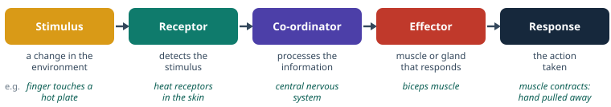
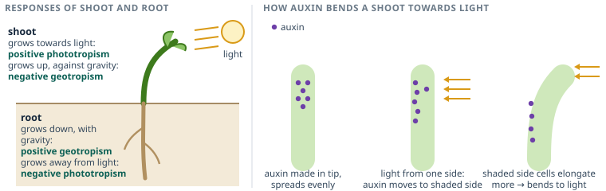
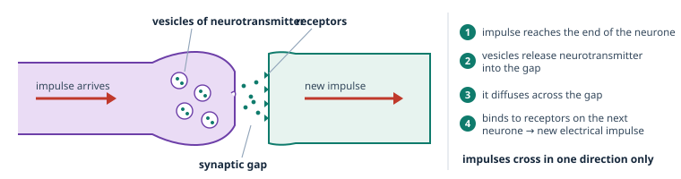
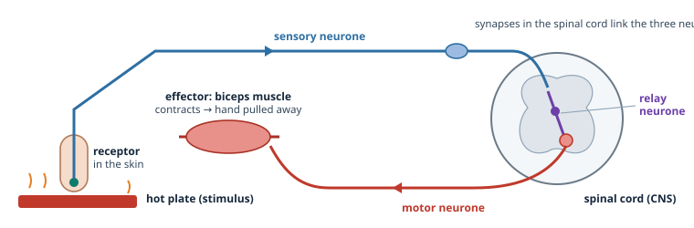
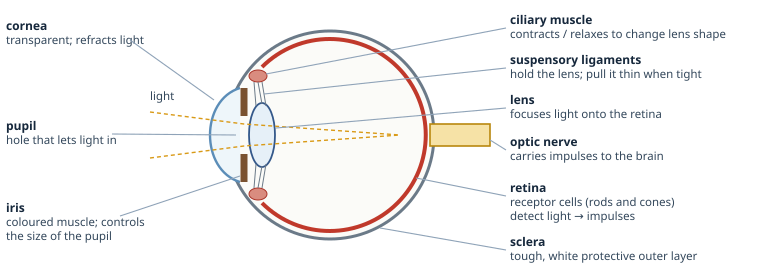
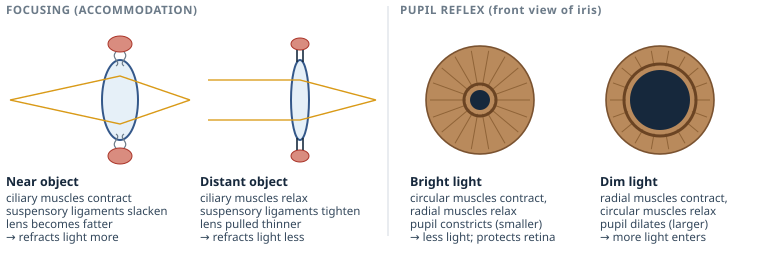
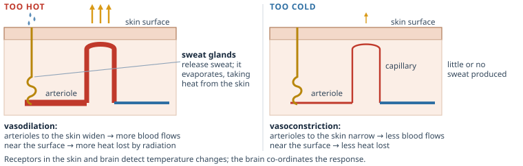

# Co-ordination and response

## Specification coverage

| Point | Section |
| --- | --- |
| 2.80 organisms respond to changes in their environment | §1 |
| 2.81 homeostasis; body water content and temperature as examples | §1 |
| 2.82 stimulus, receptor, effector | §1 (Fig. 1) |
| 2.83 plants respond to stimuli | §2 |
| 2.84 geotropic and phototropic responses of roots and stems | §2 (Fig. 2) |
| 2.85 auxin in phototropism of stems | §2 (Fig. 2) |
| 2.86 nervous and hormonal communication; differences | §3 (table) |
| 2.87 CNS = brain + spinal cord, linked to sense organs by nerves | §4 |
| 2.88 receptors → electrical impulses → rapid responses | §4 |
| 2.89 neurotransmitters at synapses | §5 (Fig. 3) |
| 2.90 reflex arc: finger withdrawn from hot object | §6 (Fig. 4) |
| 2.91 structure and function of the eye | §7 (Fig. 5) |
| 2.92 focusing near/distant; response to light intensity | §7 (Fig. 6) |
| 2.93 skin in temperature regulation: sweating, vasoconstriction, vasodilation | §8 (Fig. 7) |
| 2.94 adrenaline, insulin, testosterone, progesterone, oestrogen | §9 (table) |
| 2.95B ADH, FSH, LH | §9 (table) |

## 1. Responding to change

Organisms detect changes in their surroundings (**stimuli**) and respond so that they survive —
moving towards food or light, away from danger, and keeping conditions inside the body steady.

::: definition
**Homeostasis** — the maintenance of a constant internal environment. Examples: **body water
content** (→ ADH, 2.78B) and **body temperature** (→ §8).
:::

*Figure 1. A co-ordinated response needs a stimulus, a receptor and an effector.*

## 2. Plant responses

Plants respond to stimuli such as light and gravity by **growth responses** called **tropisms**:
growth towards the stimulus is positive, growth away from it is negative. These responses put
shoots in the light (for photosynthesis) and roots in the soil (for water, mineral ions and
anchorage).

*Figure 2. Phototropism and geotropism; auxin causes a shoot to bend towards light.*

**Auxin** is a plant hormone made in the shoot tip. It diffuses down the shoot and makes cells
**elongate**. Light from one side causes auxin to collect on the **shaded side**, so the shaded
side grows longer and the shoot bends **towards the light**.

## 3. Nervous and hormonal communication

In the **nervous system**, receptors send electrical impulses along neurones to the CNS, which
sends impulses to effectors. In the **hormonal (endocrine) system**, glands secrete **hormones**
into the blood; the blood carries them to **target organs**, which respond.

| | Nervous | Hormonal |
| --- | --- | --- |
| Signal | electrical **impulses** | chemical **hormones** |
| Carried by | neurones | blood (plasma) |
| Speed | **very fast** | slower |
| Duration of effect | short | **longer-lasting** |
| Area affected | precise, localised | often widespread (target organs) |

## 4. The nervous system

The **central nervous system (CNS)** is the **brain** and **spinal cord**. It is linked to the
sense organs by **nerves**. Stimulation of receptors in a sense organ sends **electrical
impulses** along nerves into the CNS, and out along other nerves to effectors, producing
**rapid responses**.

- **Sensory neurones** carry impulses from receptors to the CNS.
- **Relay neurones** carry impulses within the CNS.
- **Motor neurones** carry impulses from the CNS to effectors (muscles or glands).

## 5. Synapses

*Figure 3. A neurotransmitter carries the signal across the gap between neurones.*

## 6. The reflex arc

*Figure 4. Withdrawing a finger from a hot object.*

A **reflex** is a rapid, **automatic** response that does not involve conscious thought: the
impulse goes through the spinal cord (a short route), not via the conscious part of the brain.
This protects the body from damage.

## 7. The eye

*Figure 5. The eye is a sense organ: the retina contains the light receptors.*

*Figure 6. The eye changes lens shape to focus and changes pupil size to control how much light
enters.*

## 8. Temperature regulation by the skin

*Figure 7. Sweating and changes in blood flow near the skin surface control heat loss.*

Vasodilation and vasoconstriction happen in the **arterioles** that supply the skin capillaries;
the capillaries themselves do not move.

## 9. Hormones

| Hormone | Source | Role and effects |
| --- | --- | --- |
| **Adrenaline** | adrenal glands | prepares the body for "fight or flight": increases **heart rate** and breathing rate, raises **blood glucose**, diverts blood to muscles |
| **Insulin** | pancreas | **lowers blood glucose**: liver and muscles convert glucose to **glycogen**; cells take up more glucose |
| **Testosterone** | testes | male secondary sexual characteristics (→ 3.13); sperm production |
| **Oestrogen** | ovaries | female secondary sexual characteristics (→ 3.13); builds up the uterus lining (→ 3.9) |
| **Progesterone** | ovaries | maintains the uterus lining (→ 3.9), including in pregnancy |
| **ADH** — Paper 2 only | pituitary gland | increases **water reabsorption** in the kidney collecting ducts (→ 2.78B) |
| **FSH** — Paper 2 only | pituitary gland | stimulates an **egg to mature** in the ovary and the ovary to make oestrogen (→ 3.10B) |
| **LH** — Paper 2 only | pituitary gland | triggers **ovulation** — release of the egg (→ 3.10B) |

## Common misunderstandings

| Wrong | Right |
| --- | --- |
| Auxin moves towards the light | Auxin collects on the **shaded** side; that side grows more |
| Nerves carry hormones | Nerves carry **electrical impulses**; hormones travel in the **blood** |
| Blood vessels move closer to the skin surface when hot | **Arterioles dilate**, so more blood flows through surface capillaries |
| Sweating cools because sweat is cold | Sweat **evaporating** takes heat energy from the skin |
| To focus on a near object the ciliary muscles relax | They **contract**; ligaments slacken; the lens gets fatter |
| Insulin turns glucose into glycogen in the pancreas | Insulin is **made** in the pancreas; the conversion happens in the **liver** and muscles |
