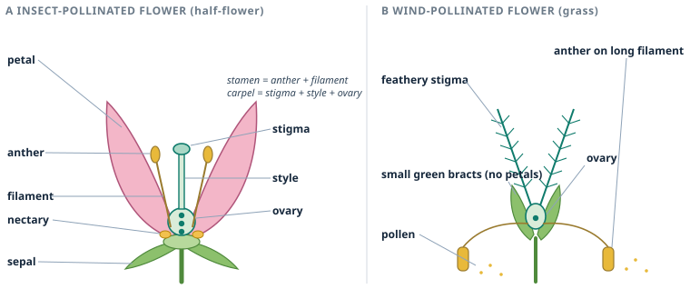
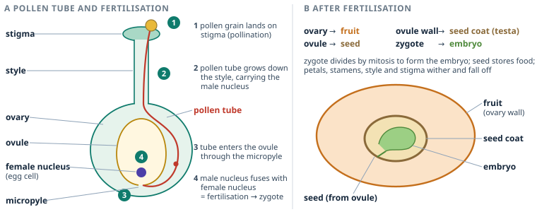
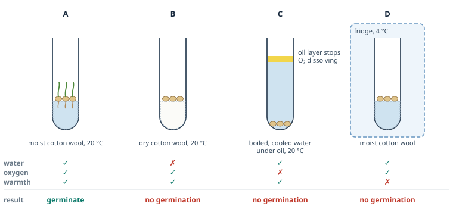
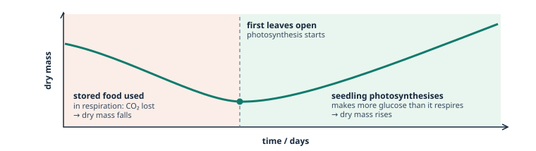
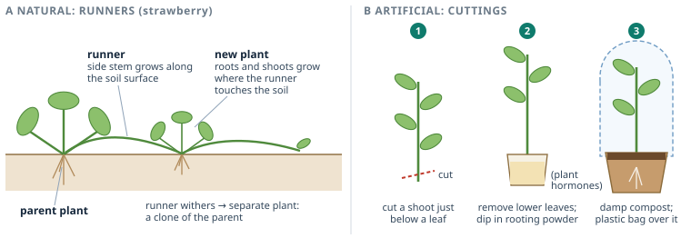
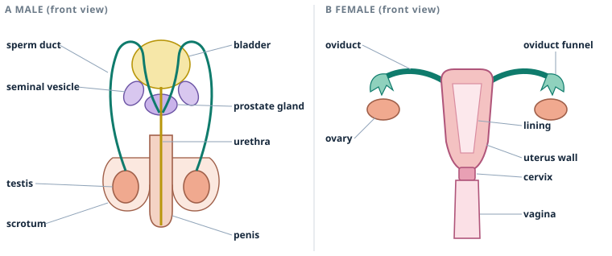
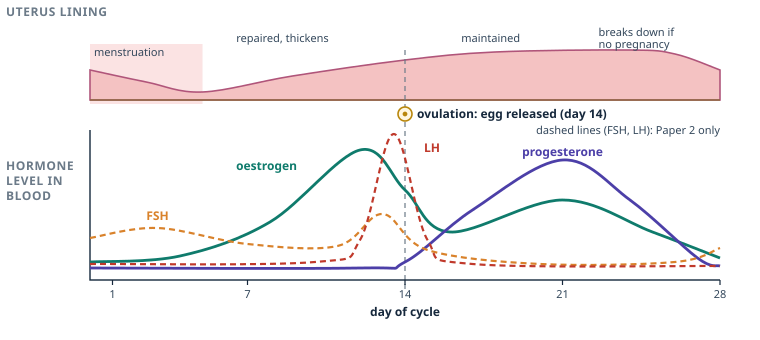
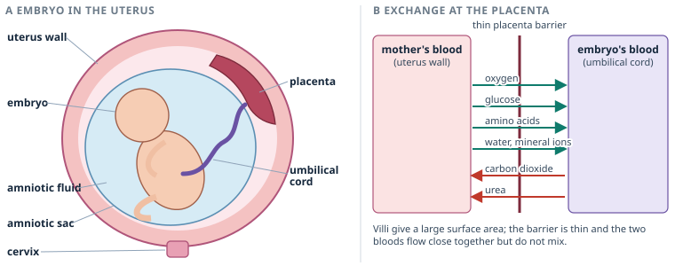

# Reproduction

## Specification coverage

| Point | Section |
| --- | --- |
| 3.1 sexual vs asexual reproduction | §1 (table) |
| 3.2 fertilisation → zygote → embryo | §1 |
| 3.3 insect- and wind-pollinated flowers | §2 (Fig. 1, table) |
| 3.4 pollen tube, fertilisation, seed and fruit | §3 (Fig. 2) |
| 3.5 practical: conditions for germination | §4 (Fig. 3) |
| 3.6 food reserves in germinating seeds | §5 (Fig. 4) |
| 3.7 runners and cuttings | §6 (Fig. 5) |
| 3.8 male and female reproductive systems | §7 (Fig. 6, tables) |
| 3.9 oestrogen and progesterone in the menstrual cycle | §8 (Fig. 7) |
| 3.10B FSH and LH in the menstrual cycle | §9 |
| 3.11 placenta and nutrition of the embryo | §10 (Fig. 8) |
| 3.12 amniotic fluid | §10 |
| 3.13 oestrogen, testosterone and secondary sexual characteristics | §11 |

## 1. Sexual and asexual reproduction

::: definition
**Fertilisation** — the fusion of a male gamete and a female gamete to produce a **zygote**.
:::

Gametes are sex cells with **half** the normal number of chromosomes (→ 3.30).

::: note | Sexual reproduction
male gamete + female gamete → **fertilisation** → zygote → cell division (mitosis) → embryo
:::

| | Sexual | Asexual |
| --- | --- | --- |
| Parents | usually two | one |
| Gametes and fertilisation | yes | no |
| Offspring | genetically **different** from each other and from the parents (variation) | genetically **identical** to the parent (clones) |
| Speed | slower; may need a mate or pollinator | fast; many offspring from one parent |
| Main advantage | variation: some offspring may survive a new disease or a change in conditions | no mate needed; a successful parent's features are kept |
| Main disadvantage | slower, uses more energy | no variation: one disease or change can kill them all |

## 2. Flowers and pollination

::: definition
**Pollination** — the transfer of pollen from an anther to a stigma.
:::

*Figure 1. The male parts (stamens) make pollen; the female part (carpel) receives it and holds
the ovules.*

| Feature | Insect-pollinated | Wind-pollinated |
| --- | --- | --- |
| Petals | large, brightly coloured, scented, with **nectar** — attract insects | small, green or absent — no insects to attract |
| Anthers | **inside** the flower, firm — insects brush against them | **hang outside** on long filaments — wind shakes pollen out |
| Stigma | inside the flower, **sticky** — pollen on the insect's body sticks to it | large, **feathery**, hangs outside — catches pollen from the air |
| Pollen | fewer, larger grains, sticky or spiky — stick to insects | **huge amounts** (most is wasted), small, light, smooth — carried far by wind |

## 3. Fertilisation, seeds and fruits

*Figure 2. Pollination only delivers the pollen; fertilisation happens when the male nucleus
reaches the ovule through the pollen tube.*

The seed contains the embryo and a food store; the fruit protects the seeds and helps to disperse
them.

## 4. Practical: conditions needed for germination

*Figure 3. Each tube lacks one condition; tube A, with all three, is the control.*

- **Water** — activates the enzymes that digest the food store and lets the seed swell and split
  its coat. **Oxygen** — for aerobic respiration, which releases energy for growth.
  **Warmth** — enzymes work too slowly in the cold.
- Boiling removes dissolved oxygen from the water in tube C.
- **Independent variable:** the condition removed. **Dependent variable:** number (or %) of
  seeds germinated after a few days. **Controlled:** same type and number of seeds, same time.
- Use at least 10 seeds per tube and repeat, so a few dead seeds do not distort the result.
- Light is **not** needed: seeds germinate in a dark cupboard as well as in light.

## 5. Food reserves in germinating seeds

A seed stores starch, protein and lipid (e.g. in its cotyledons). During germination **enzymes** digest
them to soluble sugars, amino acids, and fatty acids and glycerol, which are transported to the
growing root and shoot. There the sugars are used in **respiration** to release energy for growth
and to build cell walls; amino acids build proteins for new cells.

*Figure 4. The seedling depends on its food store until its leaves can photosynthesise.*

## 6. Asexual reproduction in plants

*Figure 5. Both methods produce clones of the parent, by mitosis (→ 3.29).*

In a cutting, rooting powder contains plant hormones that make roots grow. The cutting has no roots
yet, so lower leaves are removed and a plastic bag keeps the air humid, both reducing water loss
by transpiration. Growers use cuttings to produce many identical plants with the parent's desired
features quickly and cheaply.

## 7. Human reproductive systems

| Male | Function and adaptation |
| --- | --- |
| Testes | make **sperm** and **testosterone**; held outside the body in the scrotum, where it is slightly cooler — best for sperm production |
| Sperm ducts | carry sperm from the testes to the urethra |
| Seminal vesicles, prostate gland | add fluid to the sperm (making **semen**) that gives nutrients and a liquid to swim in |
| Urethra | carries semen (and, at other times, urine) through the penis |
| Penis | becomes erect to place semen in the vagina, near the cervix |

| Female | Function and adaptation |
| --- | --- |
| Ovaries | contain eggs; release one mature egg each month (**ovulation**); make **oestrogen** and **progesterone** |
| Oviducts | the funnel catches the egg; cilia move it towards the uterus; **site of fertilisation** |
| Uterus | lining rich in blood vessels where the embryo **implants** and the placenta forms; thick muscular wall pushes the baby out at birth |
| Cervix | ring of muscle that holds the baby in the uterus during pregnancy; widens at birth |
| Vagina | receives the penis and sperm; the birth canal |

The gametes are adapted too: a sperm has a tail to swim, many mitochondria to release energy and
enzymes in its head to get into the egg; the egg has a large food store in its cytoplasm.

*Figure 6. Simplified front views.*

## 8. The menstrual cycle: oestrogen and progesterone

*Figure 7. A 28-day cycle. The lining is built up by oestrogen and kept by progesterone.*

| Hormone | Made by | Role |
| --- | --- | --- |
| **Oestrogen** | ovaries | **repairs and thickens** the uterus lining after menstruation |
| **Progesterone** | ovaries, after ovulation | **maintains** the thick lining, ready for implantation |

If the egg is not fertilised, progesterone falls, the lining breaks down and is lost
(**menstruation**, days 1–5). If an embryo implants, progesterone stays high, so the lining is
kept and there is no menstruation.

## 9. FSH and LH — Paper 2 only

Both are made by the **pituitary gland**.

::: note | Order of events
**FSH** makes an egg mature in the ovary and stimulates the ovary to make oestrogen →
rising **oestrogen** thickens the lining, inhibits FSH and triggers an **LH surge** →
**LH** causes **ovulation** (day 14) → **progesterone** keeps the lining and inhibits FSH and LH,
so no further egg matures → if no pregnancy, progesterone falls and the cycle restarts.
:::

## 10. The placenta and amniotic fluid

*Figure 8. The placenta is the embryo's only supply of food and oxygen and its route for removing
waste.*

- **Placenta and nutrition.** Glucose, amino acids, water, mineral ions and oxygen pass from the
  mother's blood into the embryo's blood and reach the embryo through the umbilical cord; carbon
  dioxide and urea pass the other way. Adaptations: **villi** give a large surface area; a
  **thin** barrier gives a short diffusion distance; a rich blood supply on both sides keeps
  concentration gradients steep.
- **Amniotic fluid.** The embryo develops inside the fluid-filled amniotic sac. The fluid
  **cushions** it against knocks and pressure (liquids cannot be compressed), supports it and
  lets it move.

## 11. Secondary sexual characteristics

At puberty, **testosterone** (from the testes) and **oestrogen** (from the ovaries) cause:

| | Testosterone — males | Oestrogen — females |
| --- | --- | --- |
| Reproductive | penis and testes grow; sperm production starts | menstrual cycle and ovulation start |
| Hair | facial, body, pubic and underarm hair | pubic and underarm hair |
| Body shape | muscles develop | breasts develop; hips widen; fat deposited on hips and thighs |
| Voice | deepens | — |

## Common misunderstandings

| Wrong | Right |
| --- | --- |
| Pollination is fertilisation | Pollination moves pollen to the stigma; fertilisation is fusion of the male and female nuclei in the ovule |
| The ovule becomes the fruit | Ovule → **seed**; ovary → **fruit** |
| Seeds need light to germinate | They need water, oxygen and warmth; light is needed only once leaves photosynthesise |
| Dry mass rises as soon as a seed germinates | It **falls** (stored food respired, CO₂ lost) until the leaves photosynthesise |
| Oestrogen maintains the lining | Oestrogen **builds** it; progesterone **maintains** it |
