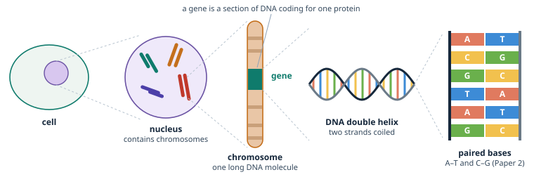
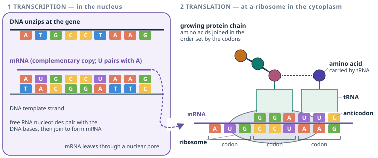
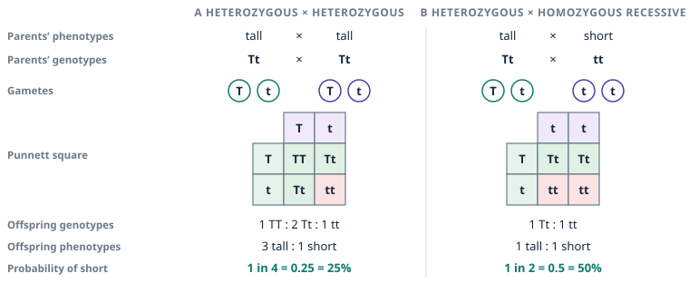
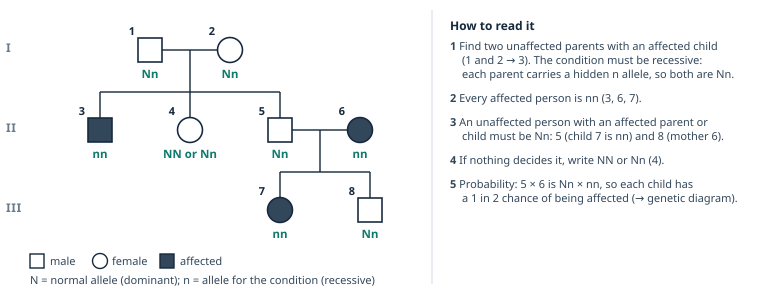
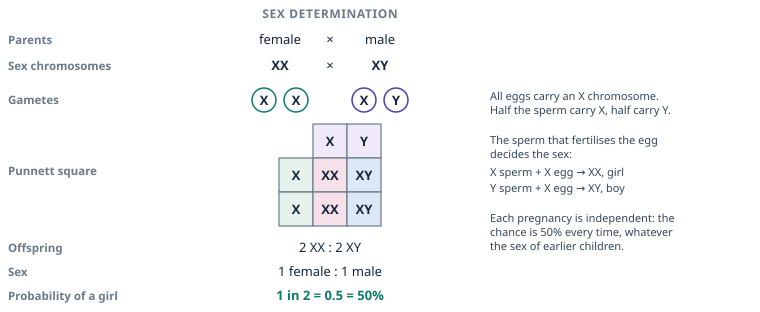
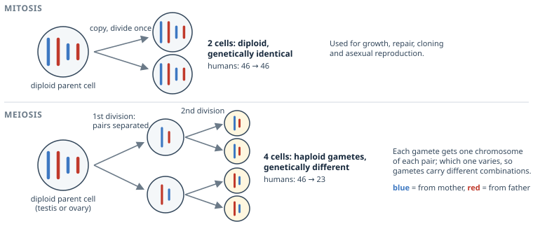
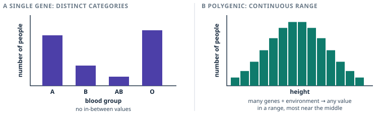
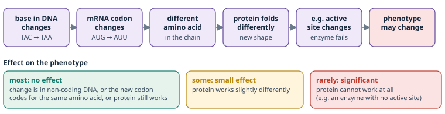
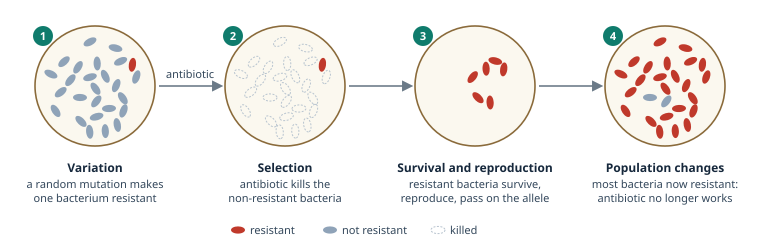

# Inheritance

## Specification coverage

| Point | Section |
| --- | --- |
| 3.14 genome, gene | §1 (Fig. 1) |
| 3.15 chromosomes in the nucleus carry genes | §1 (Fig. 1) |
| 3.16B DNA double helix, base pairs | §2 |
| 3.17B RNA single-stranded, uracil | §2 (table) |
| 3.18B protein synthesis: transcription, translation | §3 (Fig. 2) |
| 3.19 alleles | §4 |
| 3.20 dominant, recessive, homozygous, heterozygous, phenotype, genotype | §4 (table) |
| 3.21B codominance | §5 |
| 3.22 polygenic inheritance | §10 (Fig. 7) |
| 3.23 monohybrid genetic diagrams | §6 (Fig. 3) |
| 3.24 family pedigrees | §7 (Fig. 4) |
| 3.25 probabilities from monohybrid crosses | §6 |
| 3.26 XX and XY | §8 |
| 3.27 sex determination genetic diagram | §8 (Fig. 5) |
| 3.28 mitosis → two identical cells | §9 (Fig. 6) |
| 3.29 uses of mitosis | §9 |
| 3.30 meiosis → four different haploid gametes | §9 (Fig. 6) |
| 3.31 random fertilisation and variation | §9 |
| 3.32 human diploid 46, haploid 23 | §9 |
| 3.33 genetic and environmental variation | §10 |
| 3.34 mutation | §11 |
| 3.35B mutation → amino acid sequence → phenotype | §12 (Fig. 8) |
| 3.36B most mutations have no effect | §12 (Fig. 8) |
| 3.37B ionising radiation and chemical mutagens | §12 |
| 3.38 Darwin's theory of natural selection | §13 |
| 3.39 antibiotic resistance | §14 (Fig. 9) |

## 1. Genome, chromosomes and genes

::: definition
**Genome** — the entire DNA of an organism.

**Gene** — a section of a molecule of DNA that codes for a specific protein.
:::

*Figure 1. The nucleus contains chromosomes; each chromosome is one long DNA molecule carrying
many genes. Chromosomes come in pairs, one of each pair from each parent.*

## 2. DNA and RNA — Paper 2 only

A DNA molecule is **two strands coiled to form a double helix**, linked by a series of **paired
bases**: adenine (**A**) always pairs with thymine (**T**), and cytosine (**C**) with guanine
(**G**). So one strand's sequence fixes the other's: ATGC pairs with TACG.

| | DNA | RNA |
| --- | --- | --- |
| Strands | two (double helix) | **one** |
| Bases | A, T, C, G | A, **U** (uracil), C, G — uracil replaces thymine |

## 3. Protein synthesis — Paper 2 only

*Figure 2. The base sequence of a gene decides the order of amino acids in the protein.*

1. **Transcription** (nucleus). The DNA of the gene unzips. Free RNA nucleotides pair with the
   bases on one DNA strand and join, making **mRNA** — a complementary copy of the gene (U pairs
   with A).
2. The mRNA leaves the nucleus through a nuclear pore and attaches to a **ribosome**.
3. **Translation** (ribosome). Each **codon** — a sequence of three mRNA bases — codes for one
   amino acid. A **tRNA** molecule with the complementary **anticodon** pairs with the codon and
   brings its specific amino acid.
4. The ribosome moves along the mRNA; the amino acids are joined into a chain in the order of the
   codons. The chain folds into the protein.

::: note | Worked example
DNA template strand TAC GGA → mRNA codons **AUG CCU** → tRNA anticodons **UAC GGA**
:::

## 4. Alleles and genetic terms

::: definition
**Allele** — an alternative form of a gene. Different alleles of the same gene give different
versions of a characteristic, e.g. tall or short pea plants.
:::

Each body cell has **two** alleles of each gene, one on each chromosome of a pair. Example:
T = tall, t = short.

| Term | Meaning | Example |
| --- | --- | --- |
| Genotype | the alleles an organism has | Tt |
| Phenotype | the characteristic that results (with the environment) | tall |
| Dominant | allele expressed whenever it is present; capital letter | T |
| Recessive | allele expressed only when no dominant allele is present (two copies) | t |
| Homozygous | two **identical** alleles | TT or tt |
| Heterozygous | two **different** alleles | Tt |

## 5. Codominance — Paper 2 only

::: definition
**Codominance** — both alleles in a heterozygote are expressed in the phenotype.
:::

Cattle coat colour: CRCR red, CWCW white,
CRCW **roan** — red **and** white hairs. Codominant alleles are written as a
capital letter with different superscripts. CRCW × CRCW
gives 1 red : 2 roan : 1 white.

## 6. Monohybrid crosses and probability

*Figure 3. Always set out every row: parents' phenotypes and genotypes, gametes (circled), Punnett
square, offspring genotypes and phenotypes. Each gamete carries one allele.*

- A **monohybrid** cross follows one gene.
- Give a probability as **1 in 4, ¼, 0.25 or 25%** — never as a ratio like 1 : 4.
- Each fertilisation is independent: every child of Tt × Tt has a 1 in 4 chance of being tt,
  whatever earlier children were like. Ratios are predictions; small families rarely match them.
- A dominant phenotype (TT or Tt) is identified by crossing with **tt**: if any offspring show
  the recessive phenotype, the parent is Tt (Fig. 3B).

## 7. Family pedigrees

*Figure 4. Pedigree for a recessive condition, with each person's deduced genotype.*

## 8. Sex determination

One pair of chromosomes, the **sex chromosomes**, controls sex: **XX female**, **XY male**.

*Figure 5. The father's sperm decides the sex of the child.*

## 9. Mitosis and meiosis

::: definition
**Diploid** — having two sets of chromosomes (pairs). **Haploid** — having one set (one of each
pair).
:::

| | Mitosis | Meiosis |
| --- | --- | --- |
| Divisions | one | two |
| Cells produced | 2, diploid | 4, haploid |
| Genetically | identical to each other and the parent | different from each other and the parent |
| Where / used for | growth, repair, cloning, asexual reproduction | making gametes (testes, ovaries; anthers, ovules) |
| Humans | 46 → 46 | 46 → 23 |

*Figure 6. Mitosis copies a cell; meiosis halves the chromosome number and shuffles the pairs.*

Human body cells have **46** chromosomes (23 pairs); gametes have **23**. Fertilisation restores 46. **Random fertilisation** — any of millions of genetically different
sperm can fuse with any of many different eggs — produces a new combination of alleles in every
offspring, so offspring vary.

## 10. Variation and polygenic inheritance

Variation within a species can be:

| Cause | Examples |
| --- | --- |
| Genetic only | blood group, cystic fibrosis |
| Environmental only | scars, language spoken |
| Both | height, body mass, plant height (genes set the potential; food, light, water decide how much is reached) |

Most phenotypic features are **polygenic** — controlled by **many genes** rather than a single
gene — so they vary continuously, with no distinct categories.

*Figure 7. A single gene gives a few distinct phenotypes; many genes (plus the environment) give a
continuous range.*

## 11. Mutation

::: definition
**Mutation** — a rare, random change in genetic material that can be inherited.
:::

Mutations are the original source of new alleles. A mutation in a gamete can be passed to
offspring.

## 12. How mutations affect the phenotype — Paper 2 only

*Figure 8. A mutation changes the phenotype only if it changes the protein enough to change what
the protein does.*

Most mutations have **no effect** on the phenotype, some have a **small effect**, and rarely one
has a **significant effect**.

The incidence of mutations is increased by **ionising radiation** (gamma rays, X-rays,
ultraviolet rays) and some **chemical mutagens** (e.g. chemicals in tobacco).

## 13. Evolution by natural selection

Darwin's theory:

1. **Variation.** Individuals in a population vary, because of genetic variation (new alleles
   arise by mutation).
2. **Competition.** More offspring are produced than can survive; they compete for food,
   mates and space, and face predators and disease.
3. **Survival of the fittest.** Individuals with alleles giving an advantageous characteristic are
   better adapted, so are more likely to survive.
4. **Reproduction.** They reproduce and pass the advantageous alleles to their offspring.
5. **Over many generations** the advantageous allele becomes more common in the population —
   the species **evolves**.

## 14. Antibiotic resistance

*Figure 9. Natural selection in action: the antibiotic selects the resistant bacteria.*

Bacteria reproduce very quickly, so a resistant population builds up fast. Infections become
**difficult to control**: the antibiotic no longer kills the bacteria, resistant strains (e.g.
MRSA) spread between people, and new antibiotics are slow to develop. Resistance spreads less if
antibiotics are used only when needed (not for viral infections) and each course is finished.

## Common misunderstandings

| Wrong | Right |
| --- | --- |
| A gene and an allele are the same | A gene codes for a protein; alleles are different versions of it |
| The dominant allele is the most common one | Dominant means it is expressed when present, not that it is common |
| 3 : 1 means a 1 in 3 chance of the recessive phenotype | 3 : 1 means 1 in **4** (¼, 25%) |
| After two affected children the next is less likely to be affected | Each fertilisation is independent: same probability every time |
| The mother decides the sex of the child | All eggs carry X; the sperm (X or Y) decides |
| Mitosis makes gametes | **Meiosis** makes gametes; mitosis makes identical body cells |
| Bacteria become resistant because they are exposed to antibiotics | Resistance arises by random mutation; the antibiotic only **selects** it |
| Every mutation is harmful | Most have no effect; few are significant |
