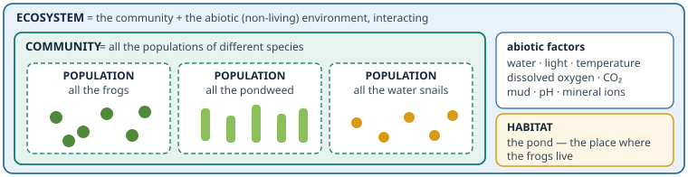
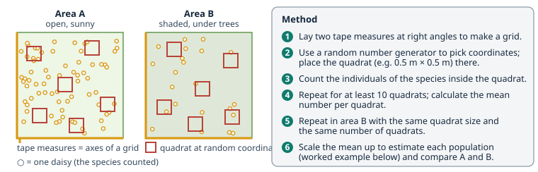
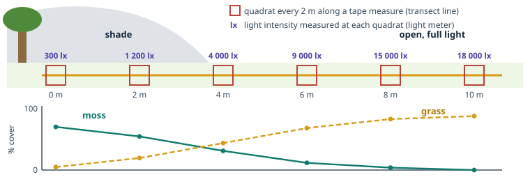
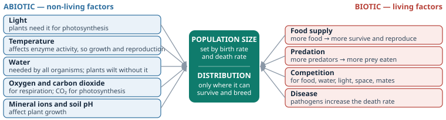
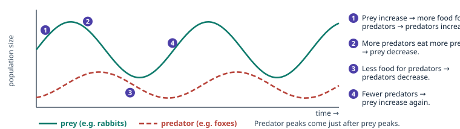

# The organism in the environment

## Specification coverage

| Point | Section |
| --- | --- |
| 4.1 population, community, habitat, ecosystem | §1 (Fig. 1) |
| 4.2 practical: population size in two areas using quadrats | §2 (Fig. 2) |
| 4.3B biodiversity | §3 |
| 4.4B practical: distribution and biodiversity using quadrats | §3 (Fig. 3) |
| 4.5 abiotic and biotic factors → population size and distribution | §4 (Figs 4, 5) |

## 1. Ecological terms

::: definition
**Population** — all the organisms of **one species** living in the same area at the same time.

**Community** — all the populations of **different species** living in the same area at the same time.

**Habitat** — the place where an organism lives.

**Ecosystem** — a community of organisms **and** the non-living (abiotic) parts of their
environment, interacting with each other.
:::

*Figure 1. Each term contains the one before it. The habitat is a place, not a group of organisms.*

## 2. Practical: population size in two areas using quadrats

A **quadrat** is a square frame of known area (e.g. 0.5 m × 0.5 m = 0.25 m²). It suits plants and
slow-moving animals, which stay put while they are counted.

*Figure 2. Random sampling: the same method, quadrat size and number of quadrats in both areas.*

- **Independent variable:** the area (A or B). **Dependent variable:** number of the species per
  quadrat.
- **Control variables:** quadrat size, number of quadrats, the same species, the same time of year,
  the same counting rule (e.g. count a plant only if more than half of it is inside the frame).
- **Random placement** avoids bias (choosing spots that look full or empty), so the sample is
  representative of the whole area.
- **More quadrats** give a more reliable mean.

::: note | Estimating population size
population = mean number per quadrat × (total area ÷ area of one quadrat)

Mean = 6 daisies per 0.25 m² quadrat; field = 20 m × 30 m = 600 m².
Population = 6 × (600 ÷ 0.25) = 6 × 2400 = **14 400 daisies**.
:::

To **explain** a difference between the two areas, link it to a measured abiotic factor (§4), e.g.
fewer daisies in the shade because there is less light for photosynthesis.

## 3. Biodiversity and the distribution practical — Paper 2 only

::: definition
**Biodiversity** — the variety of different species of organisms living in an area.
:::

Measure it as the **number of different species** found in the quadrats; compare two habitats by
sampling both the same way.

**Distribution** is where organisms are found. To see how it changes across a habitat, use a
**transect**: a tape measure laid across the habitat where conditions change (e.g. from shade to
open ground), with quadrats placed **at regular intervals** along it (systematic, not random,
sampling).

*Figure 3. At each quadrat record every species and its abundance, and measure an abiotic factor.*

- **Abundance:** count individuals, or estimate **percentage cover** when plants cannot be counted
  (e.g. grass, moss): use a quadrat divided into 100 small squares and count the squares more than
  half covered.
- **Abiotic factor:** light meter (light intensity), thermometer, soil moisture or pH meter.
- **Reliability:** repeat with several parallel transects and use the means.
- **Conclusion:** a pattern such as Figure 3 shows a **correlation** between distribution and light
  intensity; it does not prove light is the cause, as other factors (e.g. soil moisture) also
  change along the transect.

## 4. Abiotic and biotic factors

**Abiotic factors** are the non-living parts of the environment; **biotic factors** are the effects
of other living organisms.

*Figure 4. Factors change birth and death rates (size) and where organisms can live (distribution).*

Competition is **between** species (e.g. plants for light) and **within** a species (e.g. for mates).
A species that competes better increases; the other decreases or is excluded from that area.

*Figure 5. Predator and prey numbers rise and fall in linked cycles.*

## Common misunderstandings

| Wrong | Right |
| --- | --- |
| A population is all the organisms in an area. | A population is **one species**; all species together form the community. |
| An ecosystem is just the organisms. | Ecosystem = community **+ abiotic environment**. |
| Put the quadrat where the organism grows. | **Random** coordinates to estimate population size; **regular intervals** along a transect for distribution. |
| The quadrat count is the population. | It is a sample: **scale the mean up** by area. |
| A transect correlation proves the cause. | It only shows a **link**; other factors also vary. |
