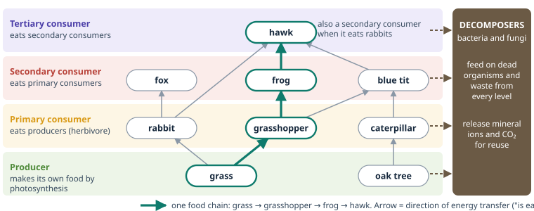
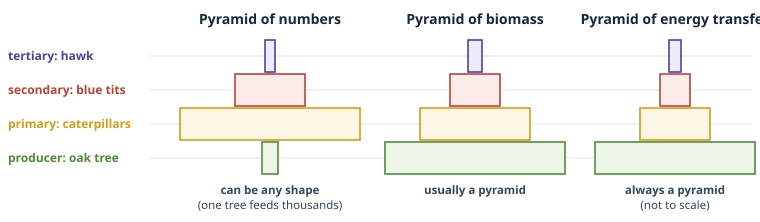
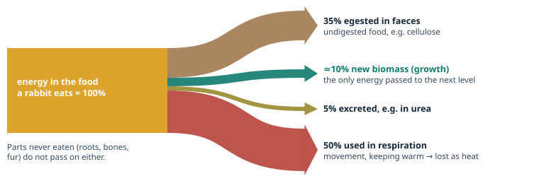

# Feeding relationships

## Specification coverage

| Point | Section |
| --- | --- |
| 4.6 trophic level names, incl. decomposers | §1 (Fig. 1) |
| 4.7 food chains, food webs | §1 (Fig. 1) |
| 4.7 pyramids of number, biomass, energy transfer | §2 (Fig. 2, table) |
| 4.8 transfer of substances and energy along a food chain | §3 |
| 4.9 why only about 10% of energy passes to the next level | §3 (Fig. 3) |

## 1. Trophic levels, food chains and food webs

::: definition
**Trophic level** — the feeding position of an organism in a food chain.

**Food chain** — a sequence showing how energy is transferred from one organism to the next by
feeding, starting with a producer.

**Food web** — a network of interlinked food chains in an ecosystem.
:::

*Figure 1. Producers are always at the bottom. Arrows point from the organism eaten to the organism
that eats it.*

**Interpreting a food web.** When one population changes, follow every arrow into and out of it.
If frogs died out in Figure 1: grasshoppers would **increase** (fewer predators); hawks would eat
**more blue tits and rabbits**, so those could fall — although blue tits also gain food (more
grasshoppers). Give a reason for every change you predict.

## 2. Pyramids of number, biomass and energy transfer

Each bar is one trophic level, producers at the bottom; bar width is proportional to the quantity.

*Figure 2. Oak tree → caterpillars → blue tits → hawk.*

| Pyramid | Each bar shows | Limitation |
| --- | --- | --- |
| Numbers | number of organisms | ignores size: one large tree counts the same as one caterpillar |
| Biomass | dry mass of organisms per unit area (e.g. g/m²) | a single sample may miss seasonal change; drying kills the organisms |
| Energy transfer | energy passed on per unit area per year (e.g. kJ/m²/year) | hard to measure — but it is never inverted |

## 3. Transfer of substances and energy

**Energy** enters the food chain when producers trap light energy in photosynthesis and store it as
chemical energy in glucose and other organic substances. Feeding passes this chemical energy up the
chain. Energy **flows** through the ecosystem and is finally lost as heat; it is not recycled.

**Substances** (carbon compounds such as carbohydrates, proteins and fats, and mineral ions) pass
along the chain when organisms are eaten, digested and built into new biomass. Decomposers return
them to the soil and air, so substances are **recycled** (→ 4.10–4.11B).

*Figure 3. Only about 10% of the energy a level receives becomes new biomass that the next level
can eat.*

Only about 10% is transferred because:

- not all of an organism is eaten (roots, bones, fur);
- not all that is eaten is digested and absorbed — it is **egested** in faeces;
- some is lost in **excretion** (e.g. urea);
- most is used in **respiration** for movement and keeping warm, and is lost to the surroundings as
  **heat**.

Consequences: each level has less energy, so less biomass (the pyramid shape); food chains rarely
have more than four or five levels because too little energy is left to support another level.

::: note | Efficiency of energy transfer
efficiency (%) = energy transferred to the next level ÷ energy in the level below × 100

Grass 20 000 kJ/m²/year; rabbits 1 800 kJ/m²/year → 1 800 ÷ 20 000 × 100 = **9%**.
:::

## Common misunderstandings

| Wrong | Right |
| --- | --- |
| The arrow means "eats". | The arrow points **to the eater**: the direction energy is transferred. |
| Energy is recycled like carbon. | Energy flows through and is **lost as heat**; substances are recycled. |
| Energy is "used up" or "made" by respiration. | Respiration **transfers** energy; it ends up as heat in the surroundings. |
| Pyramids of number are always pyramid-shaped. | Only **energy** pyramids are always pyramid-shaped. |
