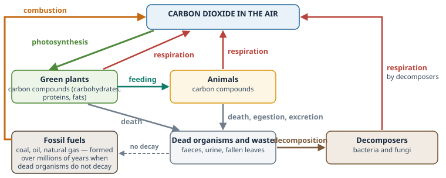
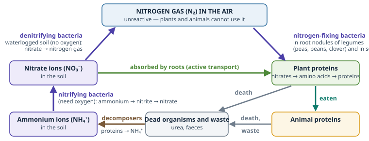

# Cycles within ecosystems

## Specification coverage

| Point | Section |
| --- | --- |
| 4.10 carbon cycle: respiration, photosynthesis, decomposition, combustion | §1 (Fig. 1) |
| 4.11B nitrogen cycle: nitrogen-fixing bacteria, decomposers, nitrifying and denitrifying bacteria | §2 (Fig. 2) |

## 1. The carbon cycle

*Figure 1. Carbon moves between the air (as CO₂) and organisms (as carbon compounds).*

- **Photosynthesis** is the only process that **removes** CO₂ from the air.
- **Respiration** (by plants, animals and decomposers) and **combustion** return CO₂ to the air.
- **Decomposition:** decomposers feed on dead organisms and waste and respire, releasing the carbon
  as CO₂. If decay cannot happen (e.g. no oxygen), the carbon is locked in fossil fuels for millions
  of years until they are burned.

## 2. The nitrogen cycle — Paper 2 only

Plants and animals need nitrogen to make **amino acids and proteins**, but cannot use nitrogen gas.
Plants absorb **nitrate ions** from the soil by active transport; animals get nitrogen by eating
proteins.

Nitrogen-fixing bacteria in the **root nodules of legumes** pass nitrogen compounds straight to the
plant; free-living ones add them to the soil. **Nitrifying** bacteria need oxygen, while
**denitrifying** bacteria thrive in waterlogged, anaerobic soil and make it less fertile — so
farmers plough and drain soil to aerate it and keep nitrate in the soil.

*Figure 2. Four groups of microorganisms move nitrogen between the air, the soil and organisms.*

## Common misunderstandings

| Wrong | Right |
| --- | --- |
| Plants take in nitrogen gas from the air. | Plants absorb **nitrate ions** from soil; only nitrogen-fixing bacteria use N₂. |
| Nitrifying and nitrogen-fixing bacteria do the same job. | Fixing: **N₂ → nitrogen compounds**. Nitrifying: **ammonium → nitrite → nitrate**. |
| Denitrifying bacteria make nitrates. | They **remove** nitrate, turning it into N₂. |
| Decomposition releases CO₂ directly. | Decomposers **respire**; their respiration releases the CO₂. |
