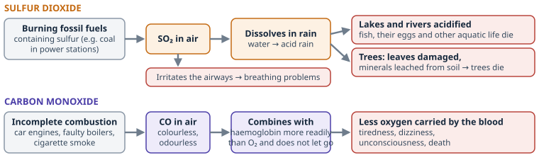
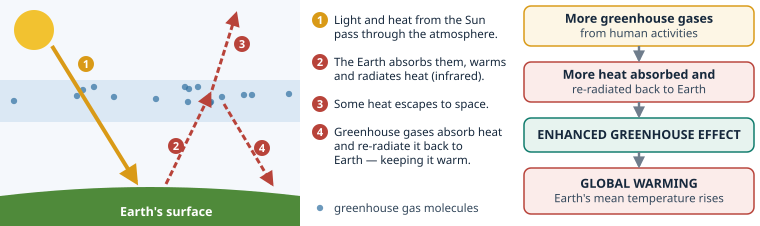
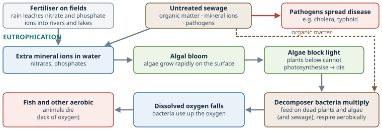
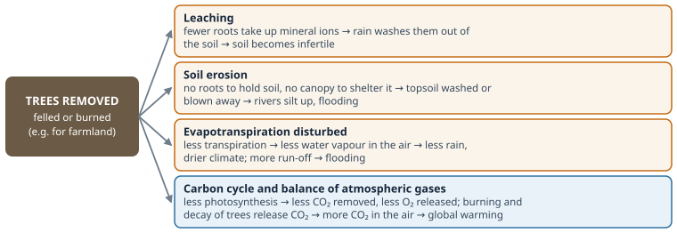

# Human influences on the environment

## Specification coverage

| Point | Section |
| --- | --- |
| 4.12 sulfur dioxide and carbon monoxide | §1 (Fig. 1) |
| 4.13 the greenhouse gases | §2 (table) |
| 4.14 human activities that add greenhouse gases | §2 (table) |
| 4.15 enhanced greenhouse effect, global warming and its consequences | §3 (Fig. 2) |
| 4.16 water pollution by sewage | §4 (Fig. 3) |
| 4.17 eutrophication from leached fertiliser | §4 (Fig. 3) |
| 4.18B deforestation | §5 (Fig. 4) |

## 1. Air pollution: sulfur dioxide and carbon monoxide

*Figure 1. Sulfur dioxide acts mainly through acid rain; carbon monoxide acts on the blood.*

## 2. Greenhouse gases and their sources

| Gas | Human activities that add it |
| --- | --- |
| Carbon dioxide | burning fossil fuels (power stations, vehicles); deforestation (trees burned, fewer to photosynthesise) |
| Methane | cattle and other ruminants (released during digestion); rice paddy fields; decaying waste in landfill sites |
| Nitrous oxide | nitrogen fertilisers (released from the soil by bacteria); vehicle exhausts |
| CFCs | old aerosol sprays, refrigerators and air-conditioning units (now banned) |
| Water vapour | mainly natural evaporation; a warmer climate increases it |

## 3. The enhanced greenhouse effect and global warming

The natural **greenhouse effect** keeps the Earth warm enough for life. Human activities increase
the concentration of greenhouse gases, which **enhances** it.

*Figure 2. More greenhouse gases → more heat kept in → global warming.*

Global warming **may** lead to (the effects are predicted, so use "may"):

- melting ice caps and glaciers and expanding sea water → **rising sea levels** → flooding of
  low-lying land and loss of habitats;
- **climate change**: changed rainfall patterns, more droughts, floods and storms;
- species **migrating** to cooler areas, or becoming **extinct** where they cannot adapt → less
  biodiversity;
- changes in **crop yields**, and pests and disease-carrying insects spreading to new areas.

## 4. Water pollution: sewage and fertiliser

::: definition
**Eutrophication** — the enrichment of water with mineral ions (nitrates and phosphates), which
leads to rapid algal growth and then a fall in dissolved oxygen.
:::

*Figure 3. Fertiliser and sewage both cause eutrophication. Sewage also harms in two more ways: its
organic matter feeds bacteria that use up oxygen even without an algal bloom, and its pathogens
spread disease.*

## 5. Deforestation — Paper 2 only

*Figure 4. Each effect follows from losing the trees' roots, canopy, transpiration or photosynthesis.*

## Common misunderstandings

| Wrong | Right |
| --- | --- |
| Carbon monoxide causes acid rain. | **Sulfur dioxide** (dissolved in rain) causes acid rain; CO binds to haemoglobin. |
| The greenhouse effect is harmful. | It is natural and needed; the **enhanced** effect causes global warming. |
| In eutrophication fish die because algae use up the oxygen. | **Decomposing bacteria** respiring aerobically use up the oxygen. |
| Fertiliser poisons the fish. | Fertiliser causes an algal bloom; the fish die from **lack of oxygen**. |
