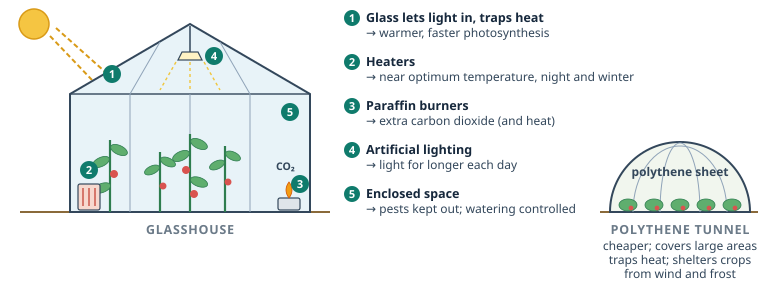
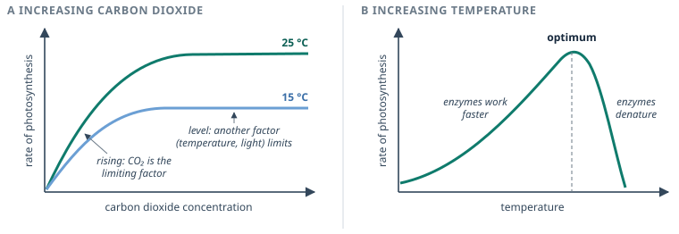
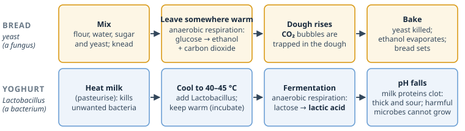
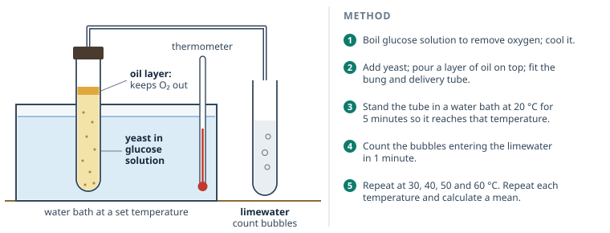
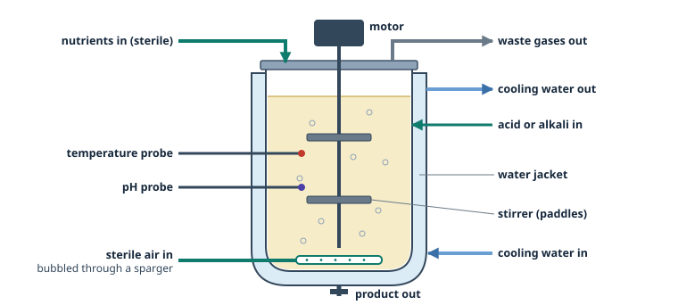

# Food production

## Specification coverage

| Point | Section |
| --- | --- |
| 5.1 glasshouses and polythene tunnels increase yield | §1 (Fig. 1) |
| 5.2 effect of increased CO₂ and temperature on yield | §1 (Fig. 2) |
| 5.3 fertiliser increases yield | §2 |
| 5.4 reasons for pest control; pesticides vs biological control | §3 (table) |
| 5.5 yeast in bread | §4 (Fig. 3) |
| 5.6 practical: anaerobic respiration by yeast | §5 (Fig. 4) |
| 5.7 Lactobacillus in yoghurt | §4 (Fig. 3) |
| 5.8 industrial fermenter and its conditions | §6 (Fig. 5) |
| 5.9B fish farming methods | §7 |

## 1. Glasshouses and polythene tunnels

Crop yield depends on how fast the plants photosynthesise, because the glucose made is used for
growth (→ 2.18–2.20). Glasshouses and polythene tunnels let the grower control the conditions
that limit photosynthesis, and keep out things that damage the crop.

*Figure 1. Each controlled factor keeps photosynthesis fast or protects the crop. The result is a
higher yield and a longer growing season, so crops such as tomatoes and lettuces can be grown
out of season.*

**Increasing carbon dioxide and temperature.** Both are limiting factors of photosynthesis.

- **More carbon dioxide** — CO₂ is a raw material of photosynthesis, so the rate rises, more glucose
  is made and the plants grow more.
- **Higher temperature** — the enzymes of photosynthesis work faster, up to an optimum. Above it,
  the enzymes denature and the rate falls.
- Raising one factor only helps while it is the limiting factor. Once another factor (light, or the
  other of CO₂/temperature) limits the rate, yield stops rising — so growers raise CO₂ **and**
  temperature together.
- Extra CO₂ and heat cost money; they are worth adding only up to the point where the value of the
  extra yield exceeds the cost.

*Figure 2. Rate of photosynthesis, which sets growth and so yield. A: at 25 °C, extra CO₂ keeps
raising the rate for longer than at 15 °C.*

## 2. Fertiliser

Harvesting removes the crop, so the minerals it took up are not returned to the soil when it
decays. Fertiliser replaces them (→ 2.22):

- **nitrate** ions → used to make **amino acids** → **proteins** → growth;
- **magnesium** ions → used to make **chlorophyll** → more light absorbed for photosynthesis.

More minerals → more growth → higher yield. Fertiliser that is washed into rivers causes
eutrophication (→ 4.17).

## 3. Pest control

**Reasons.** Pests reduce yield and quality: insects eat the crop, weeds **compete** with it for
light, water and minerals, and fungi and other pathogens cause disease.

| | Pesticides | Biological control |
| --- | --- | --- |
| **Method** | spray chemicals: insecticides, herbicides, fungicides | introduce a natural **predator**, **parasite** or **pathogen** of the pest, e.g. ladybirds to eat aphids |
| **Advantages** | act **quickly**; kill most of the pests; easy to apply to a whole crop | **specific** to the pest; no chemical residues on food or in the environment; pests do not become resistant; the agent reproduces, so it need not be reapplied |
| **Disadvantages** | also kill **non-target** species (e.g. pollinating insects, predators of the pest); can **accumulate along food chains**; residues on food; pests become **resistant**; must be reapplied | **slow**; never removes the pest completely; the agent may become a pest itself or feed on other species; works best in an enclosed glasshouse |

## 4. Micro-organisms in food: bread and yoghurt

*Figure 3. Yeast (a single-celled fungus) and Lactobacillus (a bacterium) both respire
anaerobically; the product of that respiration is what changes the food.*

- **Bread.** Carbon dioxide is the useful product. The dough is kept warm because the yeast's
  enzymes work best at a warm temperature.
- **Yoghurt.** Lactic acid is the useful product; its low pH also preserves the yoghurt. The milk is
  heated first so that other bacteria cannot compete with Lactobacillus or spoil the product.

## 5. Practical: anaerobic respiration by yeast in different conditions

*Figure 4. The rate of CO₂ production measures the rate of anaerobic respiration.*

- **Anaerobic conditions.** Boiling removes dissolved oxygen and the oil stops it returning. The
  solution is cooled before the yeast is added, because heat would kill the yeast.
- **Variables.** Independent: temperature (other "conditions" can be tested the same way, e.g.
  type or concentration of sugar). Dependent: number of bubbles per minute. Controlled: mass of
  yeast, volume and concentration of glucose, time left to adjust to each temperature.
- **Control.** A tube with **boiled yeast** (dead) — no bubbles, showing live yeast produces the gas.
  Limewater turning cloudy confirms the gas is CO₂.
- **Expected results.** The rate increases to an optimum (about 35–40 °C), then falls because the
  yeast's enzymes denature.
- **Evaluation.** Bubbles vary in size and are easy to miscount — collect the gas in a **gas syringe**
  or inverted measuring cylinder and measure its volume. Repeat each temperature and calculate a
  mean.

## 6. The industrial fermenter

A fermenter grows very large numbers of micro-organisms in controlled conditions so that they
make a useful product, e.g. human insulin from genetically modified bacteria (→ 5.14).

*Figure 5. An industrial fermenter.*

Each condition is kept at the level that gives the fastest growth of the micro-organisms:

- **Aseptic precautions** — the vessel is sterilised with steam, and nutrients and air are sterile.
  Contaminating microbes would **compete** for nutrients, could make **toxins** and spoil the product.
- **Nutrients** — a carbon source such as glucose for respiration, and a nitrogen source (e.g.
  amino acids) to make proteins for growth.
- **Optimum temperature** — respiration releases heat, so cooling water flows through the
  **water jacket**; too hot would denature the microbes' enzymes, too cold slows growth.
- **Optimum pH** — monitored by a probe and corrected with acid or alkali, because enzymes work
  best at their optimum pH and the microbes' waste changes the pH.
- **Oxygenation** — sterile air is bubbled in, supplying oxygen for **aerobic respiration**.
- **Agitation** — the stirrer mixes microbes, nutrients and oxygen evenly and spreads heat evenly,
  so all cells get what they need.

## 7. Fish farming — Paper 2 only

Large numbers of fish are kept in tanks or in net cages in lakes or the sea to provide a source of
**protein**. Each method increases the mass of fish produced:

- **Maintaining water quality** — water is filtered and aerated, and oxygen, temperature and pH are
  monitored: fish need oxygen for respiration, and poor water slows growth and spreads disease.
- **Controlling intraspecific predation** (fish eating their own species) — fish are **kept apart
  by size and age** so larger fish cannot eat smaller ones.
- **Controlling interspecific predation** (other species eating the fish) — **nets** over tanks and
  cages keep out birds and seals; each tank holds one species.
- **Controlling disease** — crowding spreads disease quickly, so water is kept clean, sick fish are
  removed, and fish are treated with **antibiotics**, vaccines or pesticides against parasites
  (e.g. sea lice).
- **Removing waste products** — faeces and uneaten food are filtered out or flushed away; left in,
  they release toxic ammonia and their decay by bacteria uses up oxygen.
- **Controlling the quality and frequency of feeding** — high-protein food given in small, frequent
  amounts so it is all eaten: fast growth, no waste food polluting the water.
- **Selective breeding** — breeding from the fish that grow fastest or resist disease (→ 5.11).

## Common misunderstandings

| Wrong | Right |
| --- | --- |
| More CO₂ always means more yield | Only while CO₂ is the limiting factor |
| Higher temperature always increases yield | Only up to the optimum; then enzymes denature |
| Fertiliser gives plants energy / food | It supplies **mineral ions**; energy comes from photosynthesis |
| Bread rises because of ethanol | It rises because of **carbon dioxide** bubbles |
| Lactobacillus makes lactic acid from glucose added to milk | It ferments the milk's own sugar (lactose) |
| The fermenter is stirred to add oxygen | Air adds oxygen; stirring **mixes** nutrients, oxygen and heat evenly |
