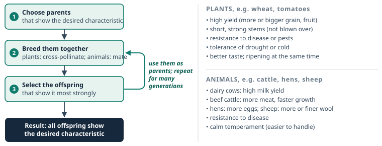

# Selective breeding

## Specification coverage

| Point | Section |
| --- | --- |
| 5.10 selective breeding of plants | §1 (Fig. 1), §2 |
| 5.11 selective breeding of animals | §1 (Fig. 1), §2 |

## 1. The process

::: definition
**Selective breeding** — humans choose which organisms with a desired characteristic are allowed
to breed, so that the characteristic becomes more common and stronger over many generations.
:::

*Figure 1. The same steps apply to plants and animals; only the way they are bred differs.*

**Why it works.** The desired characteristic is controlled by genes (→ 3.33). Breeding only from
the individuals that show it passes on their alleles, so each generation more offspring carry the
alleles for it, until all of them do.

- **Plants:** pollen from one chosen plant is transferred with a brush to the stigma of another
  chosen plant; covering the flowers stops pollen from other plants reaching them.
- **Animals:** a chosen male is mated with a chosen female.
- Two parents with different useful characteristics can be crossed to combine them, e.g. a
  high-yield wheat with a disease-resistant wheat.

## 2. Drawbacks

- **Less genetic variation.** All the individuals are closely related and share similar alleles,
  so a new disease or a change in the environment can affect all of them.
- **Inbreeding** makes it more likely that harmful recessive alleles are inherited from both parents,
  causing health problems.
- It is **slow**: many generations are needed.

## Common misunderstandings

| Wrong | Right |
| --- | --- |
| Selective breeding changes an organism's genes directly | It only chooses **which** organisms breed; no genes are inserted (compare GM, → 5.12) |
| One generation of breeding is enough | It takes **many** generations |
| Selective breeding is natural selection | Humans choose the characteristic; in natural selection the environment does (→ 3.38) |
