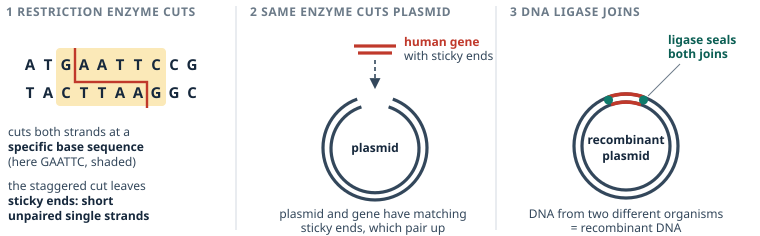
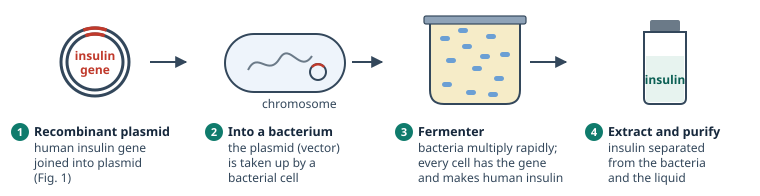

# Genetic modification (genetic engineering)

## Specification coverage

| Point | Section |
| --- | --- |
| 5.12 restriction enzymes cut DNA at specific sites; ligase joins DNA | §1 (Fig. 1) |
| 5.13 plasmids and viruses as vectors; recombinant DNA | §2 |
| 5.14 human insulin from GM bacteria in a fermenter | §3 (Fig. 2) |
| 5.15 GM plants improve food production | §4 |
| 5.16 transgenic | §1 (definition) |

## 1. Cutting and joining DNA

Genetic modification transfers a gene from one organism into another, so the receiving organism
makes the protein the gene codes for (→ 3.14).

::: definition
**Transgenic** — describes the transfer of genetic material from one species to a different
species; an organism that has received such a gene is a transgenic organism.
:::

*Figure 1. Using the same restriction enzyme on both pieces of DNA gives matching sticky ends.*

- **Restriction enzymes** cut DNA at a **specific base sequence**. Each enzyme recognises only its
  own sequence, so it cuts the same place every time and can cut out a chosen gene.
- **Ligase** enzymes **join** pieces of DNA together, sealing the gene into the plasmid.

**Recombinant DNA** is DNA made by joining DNA from two different sources.

## 2. Vectors

A **vector** takes up a piece of DNA and then inserts this recombinant DNA into another cell.

- **Plasmids** — small circles of DNA found in bacteria (→ 1.3). A plasmid carrying the gene is taken
  up by a bacterial cell; when the bacterium divides, the plasmid and gene are copied too.
- **Viruses** — the gene is inserted into the virus's DNA. The virus infects a cell and injects its
  DNA, carrying the gene into that cell.

## 3. Human insulin from genetically modified bacteria

*Figure 2. Stages 1–4. Stage 1 is Fig. 1: the insulin gene is cut from human DNA and the plasmid
with the same restriction enzyme, then joined by ligase.*

Large amounts are made because bacteria **reproduce very rapidly** and a fermenter grows huge
numbers of them in optimum conditions (→ 5.8); every bacterium carries the gene and makes insulin.
The insulin is used to treat people with diabetes (→ 2.94).

## 4. Genetically modified plants and food production

Genes from other species are inserted into crop plants to give characteristics that increase
yield or food value:

- **Herbicide resistance** — the field can be sprayed to kill weeds without harming the crop, so
  weeds do not compete with it for light, water and minerals.
- **Pest resistance** — a gene from a bacterium makes the plant produce a toxin that kills insects
  eating it, so less crop is lost and less insecticide is needed.
- **Resistance to disease, drought or salty soil** — the crop grows where it otherwise would fail.
- **Improved nutritional value** — e.g. rice modified to make a substance the body converts into
  vitamin A.

::: note | Concerns
Genes may spread by pollen to wild plants (e.g. herbicide-resistant weeds); toxins may harm
harmless insects; long-term effects on health and food chains are uncertain; GM seed is expensive.
:::

## Common misunderstandings

| Wrong | Right |
| --- | --- |
| Restriction enzymes cut DNA randomly | They cut at a **specific base sequence** |
| Ligase cuts DNA | Ligase **joins** DNA; restriction enzymes cut |
| The bacteria are given insulin | They are given the **gene**; they make the insulin |
| Different enzymes can be used on the gene and the plasmid | Use the **same** restriction enzyme so the sticky ends match |
