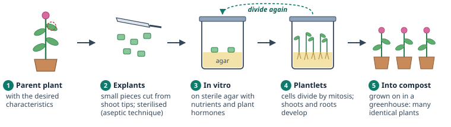
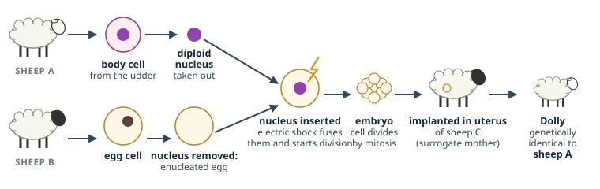
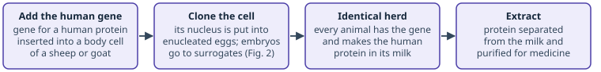

# Cloning

## Specification coverage

| Point | Section |
| --- | --- |
| 5.17B micropropagation: explants grown in vitro | §1 (Fig. 1) |
| 5.18B commercial quantities of identical plants | §1 |
| 5.19B cloning mammals: diploid nucleus into enucleated egg; Dolly | §2 (Fig. 2) |
| 5.20B cloned transgenic animals make human proteins | §3 (Fig. 3) |

::: definition
**Clones** — genetically identical organisms. They are produced by mitosis, which copies the
chromosomes exactly (→ 3.28–3.29).
:::

## 1. Micropropagation (tissue culture) — Paper 2 only

**Explants** are small pieces of tissue cut from a plant; **in vitro** means grown in glass or plastic
containers in a laboratory, outside the organism.

*Figure 1. Everything is kept sterile: microorganisms would grow on the nutrient agar and kill the
explants. Plant hormones make the cells divide and form shoots and roots.*

**Commercial use.** Every plantlet comes from the parent by mitosis, so all are genetically identical
and all have the parent's **desirable characteristics** (e.g. flower colour, high yield, disease
resistance). Plantlets can be divided again and again, so **very large numbers** are produced
quickly from one parent, **all year round**, in a small space, and **free of disease**. The
drawback: with **no genetic variation**, one disease or change in conditions can affect them all.

## 2. Cloning a mammal: Dolly the sheep — Paper 2 only

*Figure 2. The diploid nucleus holds a full set of sheep A's chromosomes, so no fertilisation is
needed. The egg donor and surrogate give no chromosomes: Dolly has sheep A's white face.*

## 3. Cloned transgenic animals and human proteins — Paper 2 only

*Figure 3. The animal's mammary glands make the human protein, e.g. a blood-clotting protein, and
secrete it into the milk.*

**Why clone rather than breed?** Producing a transgenic animal is difficult and rarely works. If it
reproduced sexually, only some of its offspring would inherit the gene. Cloning copies an animal
that is known to make the protein, so **every** clone carries the gene and a whole herd can make
large amounts of the protein; milking collects it without harming the animals.

## Common misunderstandings

| Wrong | Right |
| --- | --- |
| Dolly is identical to the egg donor or the surrogate | Identical to the **nucleus donor** (sheep A) |
| Micropropagation involves sexual reproduction | Only **mitosis**; no gametes |
| Cloning is the same as genetic modification | Cloning copies an organism; GM adds a gene. They are combined in 5.20B |
