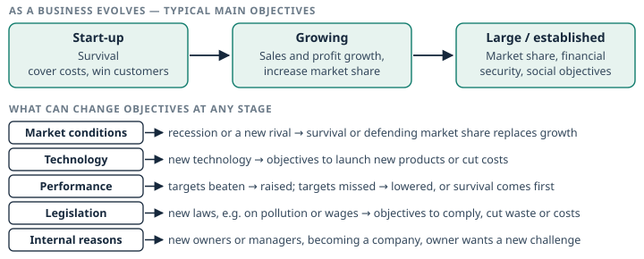

# Business objectives

## Specification coverage

| Point | Section |
| --- | --- |
| 1.1.1 Businesses can have several objectives — financial and non-financial | §1 |
| 1.1.2 Why business aims and objectives change as businesses evolve | §2 |

## 1. Financial and non-financial objectives (1.1.1)

::: definition
**Aim** — the long-term goal a business wants to achieve.

**Objective** — a specific, measurable target set to help the business achieve its aim.
:::

A business usually has several objectives at the same time.

:::: grid
::: card | Financial objectives — measured in money
- **Survival** — to keep trading by covering costs and paying bills; the main objective of a new business or in difficult times.
- **Profit** — to make revenue greater than total costs, and to increase profit.
- **Sales** — to increase the value or volume of goods or services sold.
- **Market share** — to increase the business's sales as a percentage of total sales in its market.
- **Financial security** — to have enough money to meet costs, so the owner has a secure, reliable income.
:::
::: card | Non-financial objectives — not measured in money
- **Social objectives** — to benefit society or the environment, e.g. using sustainable materials or supporting the local community.
- **Personal satisfaction** — the owner's enjoyment and pride in doing work they value.
- **Challenge** — the owner wants to test themselves by building something difficult.
- **Independence and control** — being your own boss and making your own decisions.
:::
::::

:::: grid
::: advantages | Social objectives — advantages
- Attract customers who care about ethics → more sales and loyalty.
- Good reputation → easier to recruit and keep staff.
:::
::: disadvantages | Social objectives — disadvantages
- Often raise costs (e.g. sustainable materials) → higher prices or lower profit.
- Can conflict with profit and growth objectives.
:::
::::

## 2. Why objectives change (1.1.2)

*Figure 1. Objectives are changed so that they stay realistic and relevant as the business grows and its circumstances change.*
