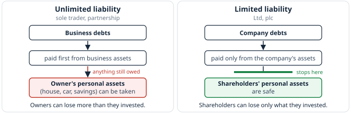
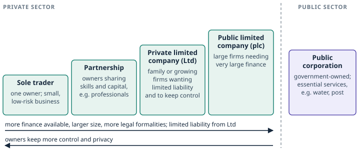
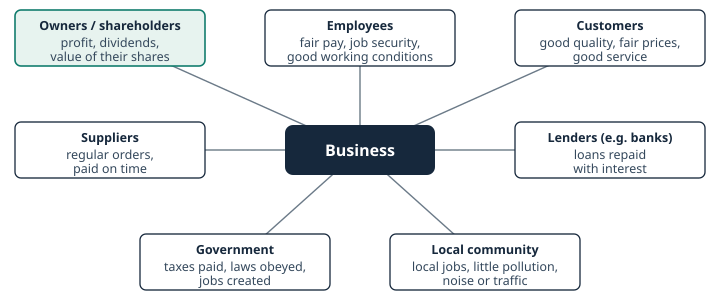
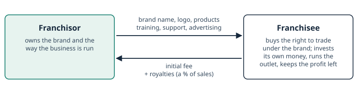

# Types of organisations

## Specification coverage

| Point | Section |
| --- | --- |
| 1.2.1 Main types of business ownership: sole trader, partnerships, limited companies (private and public), public corporations | §1, §3, §4 |
| 1.2.2 Risk, ownership and limited liability | §2 |
| 1.2.2 Public corporations — reasons for and against public ownership | §5 |
| 1.2.2 Ownership, control, sources of finance, use of profits | §3 |
| 1.2.2 Stakeholders and shareholders | §6 |
| 1.2.2 Appropriateness of different forms of ownership | §4 |
| 1.2.3 Franchises, social enterprises, multinationals | §7 |

## 1. Types of business ownership (1.2.1)

The **private sector** is businesses owned by individuals or groups of private investors; the **public sector** is organisations owned by the government.

::: definition
**Sole trader** — a business owned by one person.

**Partnership** — a business owned by two or more people (partners), who usually sign a deed of partnership setting out how profits are shared.

**Private limited company (Ltd)** — a company whose shares are sold privately, with the agreement of the other shareholders; they cannot be offered to the public.

**Public limited company (plc)** — a company whose shares can be bought and sold by the public on the stock exchange.

**Public corporation** — a business owned and run by the government on behalf of the public.
:::

## 2. Risk, ownership and limited liability (1.2.2)

::: definition
**Risk** — the chance that the owners lose the money they have put into the business.

**Unlimited liability** — the owners are personally responsible for all the debts of the business, so their personal possessions can be taken to pay them.

**Limited liability** — the owners (shareholders) can lose only the money they invested in the business; their personal possessions are safe.
:::

Companies (Ltd and plc) have limited liability because a company has its own legal identity, separate from its owners. Sole traders and partnerships do not, so the owner *is* the business.

*Figure 1. With unlimited liability the owner's personal assets are at risk; with limited liability they are protected.*

## 3. Ownership, control, finance and profits (1.2.1–1.2.2)

| | Sole trader | Partnership | Private limited company (Ltd) | Public limited company (plc) | Public corporation |
| --- | --- | --- | --- | --- | --- |
| **Owned by** | one person | two or more partners | shareholders, often family and friends | shareholders — anyone can buy shares | the government, on behalf of the public |
| **Controlled by** | the owner | the partners | directors, often the owners themselves | a board of directors elected by shareholders; managers run it day to day | managers appointed by the government |
| **Liability** | unlimited | unlimited | limited | limited | not applicable — government-owned |
| **Main sources of finance** (→ 3.1) | owner's savings, bank loans, retained profit | partners' capital, bank loans | shares sold privately, bank loans | shares sold to the public on the stock exchange, bank loans | government funding from taxation, sales revenue |
| **Use of profits** | kept by the owner | shared between partners as agreed | paid as dividends to shareholders or retained | paid as dividends or retained | reinvested or paid to the government |

## 4. Advantages, disadvantages and appropriateness (1.2.1–1.2.2)

| Form | Advantages | Disadvantages |
| --- | --- | --- |
| **Sole trader** | full control → quick decisions; keeps all the profit; cheap and easy to set up, accounts kept private | unlimited liability → personal assets at risk; limited finance → hard to expand; long hours, no one to share the workload |
| **Partnership** | more capital, as each partner invests; skills, workload and decisions are shared; easy to set up | unlimited liability, including for other partners' decisions; disagreements slow decisions; profit is shared |
| **Ltd** | limited liability → investors more willing to buy shares; owners keep control as shares are not sold to the public | finance limited, as shares cannot be sold to the public; more legal formalities and set-up costs; some accounts must be published |
| **plc** | can raise very large sums by selling shares to the public; limited liability; size makes bank loans easier to get | risk of takeover, as anyone can buy shares; original owners lose control; full accounts must be published; costly to set up |

*Figure 2. Which form is appropriate depends on how much finance is needed, the risk the owners will accept and how much control they want to keep.*

## 5. Public corporations: for and against public ownership (1.2.2)

:::: grid
::: advantages | Reasons for public ownership
- Essential services (e.g. water, post, rail) are provided even where they are unprofitable, e.g. rural areas.
- Stops a private monopoly exploiting customers with high prices.
- Protects jobs and industries important to the country.
:::
::: disadvantages | Reasons against public ownership
- No profit motive → may be inefficient and slow to innovate.
- Losses are paid for by taxpayers → less money for other public services.
- Political interference in decisions; little competition → less customer choice.
:::
::::

## 6. Stakeholders and shareholders (1.2.2)

::: definition
**Stakeholder** — any individual or group with an interest in, or affected by, the activities of a business.

**Shareholder** — a person or organisation that owns shares in a company and so owns part of it. Shareholders are one group of stakeholders.
:::

*Figure 3. Stakeholders' interests can conflict, e.g. higher wages for employees mean less profit for shareholders.*

## 7. Franchises, social enterprises and multinationals (1.2.3)

::: definition
**Franchise** — an agreement in which a business (the **franchisor**) allows another business (the **franchisee**) to trade using its name, brand and products in return for a fee and royalties.

**Royalty** — a regular payment, usually a percentage of sales, from the franchisee to the franchisor.
:::

*Figure 4. The franchise relationship.*

| Party | Advantages | Disadvantages |
| --- | --- | --- |
| **Franchisee** | trusted brand → lower risk of failure; training and support from the franchisor; national advertising and bulk-bought supplies | initial fee and royalties reduce profit; must follow the franchisor's rules → little independence; reputation harmed if other franchisees perform badly |
| **Franchisor** | fast expansion paid for with franchisees' money; steady income from fees and royalties; franchisees are owners → motivated to run outlets well | less control over quality → brand reputation at risk; shares profit with franchisees |

::: definition
**Social enterprise** — a business whose main objectives are social or environmental, and which reinvests most of its profits in that purpose rather than paying them to its owners. It can take any legal form, e.g. a limited company.
:::

:::: grid
::: advantages | Social enterprise — advantages
- Attracts customers, staff and volunteers who share its values → sales and loyalty.
- May receive grants, donations and good publicity.
:::
::: disadvantages | Social enterprise — disadvantages
- Harder to raise finance, as investors expect a return.
- Profits are reinvested in the cause → less for owners or expansion.
:::
::::

::: definition
**Multinational** — a business with production or service operations in more than one country. Its benefits and drawbacks are in 1.5.2.
:::

::: traps
- A **public limited company** is in the **private** sector; a **public corporation** is in the **public** sector.
- **Stakeholder** ≠ **shareholder**: shareholders own the company; stakeholders are everyone affected by it.
- Define *franchise* as an agreement to use another business's name and products — "a chain with the same logo" is not a definition.
- Limited liability protects the **owners'** personal assets, not the business: a company can still fail and lose its own assets.
:::
