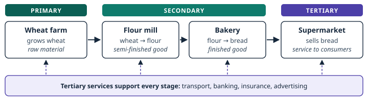

# Classification of businesses

## Specification coverage

| Point | Section |
| --- | --- |
| 1.3.1 Primary, secondary and tertiary activities | §1 |

## 1. Primary, secondary and tertiary sectors (1.3.1)

::: definition
**Primary sector** — businesses that extract raw materials from the earth, e.g. farming, fishing, mining, forestry, oil extraction.

**Secondary sector** — businesses that convert raw materials into finished or semi-finished goods, e.g. manufacturing, food processing, construction.

**Tertiary sector** — businesses that provide a wide variety of services, e.g. retail, banking, transport, tourism, hairdressing.
:::

A **semi-finished good** has been partly processed and is used to make something else (e.g. flour, steel, car parts).

*Figure 1. A product passes through all three sectors; tertiary services also support every stage.*

Classify a business by what it **does**. One business can work in more than one sector: a farm that makes cheese and sells it in its own shop is primary, secondary and tertiary.
