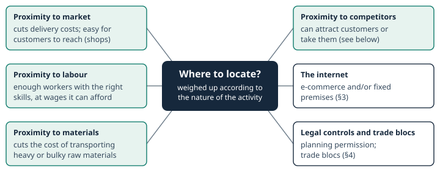

# Decisions on location

## Specification coverage

| Point | Section |
| --- | --- |
| 1.4.1 Proximity to market, labour, materials and competitors | §1 |
| 1.4.1 Nature of the business activity | §2 |
| 1.4.1 Impact of the internet — e-commerce and/or fixed premises | §3 |
| 1.4.1 Legal controls and trade blocs | §4 |
| 1.4.1 Relocation of a business | §5 |

## 1. Location factors (1.4.1)

A business chooses the location that best balances its **costs** against its access to **customers**.

*Figure 1. Location factors. Which one matters most depends on the nature of the business activity (§2).*

:::: grid
::: advantages | Near competitors — advantages
- Customers visit the area to compare, e.g. shoe shops in one shopping centre → more passing trade.
- Suppliers and skilled workers are already there.
:::
::: disadvantages | Near competitors — disadvantages
- Customers are shared → price competition, lower sales per business.
- Rivals compete for the same staff → higher wages.
:::
::::

## 2. Nature of the business activity (1.4.1)

| Activity | Usually located near | Why |
| --- | --- | --- |
| **Primary** (farming, mining, fishing) | the natural resource | it can only be extracted where it is found |
| **Secondary** — heavy or bulky raw materials | materials | cuts the cost of transporting inputs |
| **Secondary** — bulky, fragile or perishable products (e.g. drinks, bread) | the market | cuts delivery costs and damage |
| **Secondary** — high-tech or skilled work | skilled labour | needs workers with specialist skills |
| **Tertiary** — customers visit (shops, hairdressers, hotels) | the market, busy areas | customers must reach it easily |
| **Tertiary** — online or by phone | low-cost areas | customers never visit |

## 3. The internet: e-commerce and/or fixed premises (1.4.1)

::: definition
**E-commerce** — buying and selling goods and services online.
:::

**Fixed premises** are a physical site customers visit, such as a shop or office. Many businesses use both.

| Method | Advantages | Disadvantages |
| --- | --- | --- |
| **E-commerce** | can locate where rent and wages are low → lower costs; reaches customers nationally and worldwide, 24 hours a day | delivery and returns costs; customers cannot see or try products; strong online price competition |
| **Fixed premises** | customers can see and try products and get personal service; attracts passing trade | high rent in busy areas; only reaches customers who can visit; limited opening hours |

## 4. Legal controls and trade blocs (1.4.1)

- **Legal controls** — businesses need **planning permission** to build or change the use of a site, and environmental laws keep activities such as noisy or polluting factories away from homes. Laws, taxes and wage rules also differ between countries.
- **Trade blocs** (→ 1.6.2) — a factory **inside** a trade bloc can sell to every member country without paying tariffs, so multinationals often locate inside the blocs where they want to sell.

## 5. Relocation (1.4.1)

::: definition
**Relocation** — moving all or part of a business to a new location.
:::

A business relocates when its current site no longer suits it: costs such as rent or wages have risen, it needs more space, or it wants to be nearer new markets or materials, or inside a trade bloc.

:::: grid
::: advantages | Relocation — advantages
- Lower costs → higher profit or lower prices.
- Access to new markets, materials or labour.
- Larger, better premises → more output.
:::
::: disadvantages | Relocation — disadvantages
- One-off moving costs and disruption to production.
- Experienced staff may not move → recruitment and training costs.
- Bad publicity from job losses at the old site.
:::
::::
