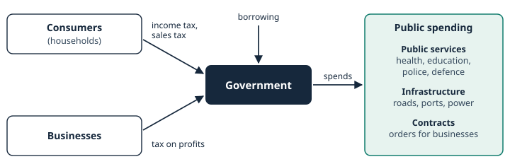
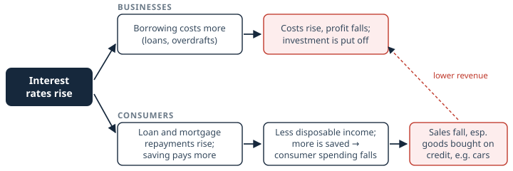

# Government objectives and policies

## Specification coverage

| Point | Section |
| --- | --- |
| 1.6.1 Government spending to provide public services | §1 |
| 1.6.1 Taxation and constraints on public spending | §1 |
| 1.6.2 Infrastructure provision | §2 |
| 1.6.2 Legislation | §3 |
| 1.6.2 Trade policy — membership of trading blocs, tariffs | §4 |
| 1.6.3 Effect of interest rates on businesses and consumer spending | §5 |

## 1. Government spending and taxation (1.6.1)

::: definition
**Public services** — services provided by the government for everyone, e.g. healthcare, education, police, defence.

**Taxation** — money the government charges on incomes, profits and spending to pay for its spending.
:::

*Figure 1. Where government money comes from and what it pays for.*

**Constraints on public spending:** the government can only spend what it raises in tax or borrows. Borrowing must be repaid with interest, and higher taxes are unpopular and reduce what consumers and businesses can spend — so spending often has to be limited or cut.

| Change | Effect on businesses |
| --- | --- |
| **Higher tax on profits** | less profit left to reinvest or pay to owners |
| **Higher income tax** | consumers have less **disposable income** (income after tax) → lower demand |
| **Higher sales tax** (e.g. VAT) | prices rise → lower demand. Adding 20% tax to £6.50: 6.50 × 1.2 = £7.80 |
| **More government spending** | more orders for businesses that supply the government (e.g. building firms); healthier, better-educated workers |
| **Cuts in government spending** | fewer government contracts → lower sales for suppliers |

## 2. Infrastructure provision (1.6.2)

::: definition
**Infrastructure** — the basic facilities a country needs to function: transport (roads, railways, ports, airports), power and water supplies, and telecommunications and internet networks.
:::

Good infrastructure cuts transport costs, speeds up deliveries and makes supplies reliable, so it attracts businesses to an area (→ 1.4). Poor infrastructure causes delays and raises costs.

## 3. Legislation (1.6.2)

::: definition
**Legislation** — laws passed by the government.
:::

Governments pass laws to protect **consumers** (safe, correctly described products), **employees** (health and safety, minimum wage, equal opportunities → 2.2), the **environment** (pollution, waste) and **public health** (e.g. limits on sugar in food), and to keep **competition** fair.

:::: grid
::: advantages | Legislation — benefits to businesses
- All rivals must follow the same rules → fair competition.
- Safer staff and trusted products → better reputation.
:::
::: disadvantages | Legislation — costs to businesses
- Cost of complying (new equipment, training, higher wages) → higher prices or lower profit.
- Fines, legal action and bad publicity if the law is broken.
:::
::::

## 4. Trade policy: trading blocs and tariffs (1.6.2)

::: definition
**Trading bloc** — a group of countries that agree to reduce or remove barriers to trade, such as tariffs, between themselves, e.g. the EU, ASEAN.

**Tariff** — a tax on imported goods.
:::

:::: grid
::: advantages | Trading bloc membership — advantages
- Sell to all member countries without tariffs → bigger market, more exports.
- Materials imported from members are cheaper.
- Attracts multinationals to locate in the country → jobs.
:::
::: disadvantages | Trading bloc membership — disadvantages
- More competition from businesses in other member countries.
- Must meet the bloc's shared rules and standards → compliance costs.
:::
::::

:::: grid
::: advantages | Tariffs — advantages
- Imports become dearer → domestic businesses are more competitive and gain sales.
- Raise tax revenue for the government.
:::
::: disadvantages | Tariffs — disadvantages
- Businesses that import materials face higher costs → higher prices or less profit.
- Consumers pay more and have less choice.
- Other countries may put tariffs on our exports in return → exporters lose sales.
:::
::::

## 5. The effect of interest rates (1.6.3)

::: definition
**Interest rate** — the cost of borrowing money, and the reward for saving, shown as a percentage of the amount per year.
:::

*Figure 2. A rise in interest rates. A fall has the opposite effects: borrowing is cheaper, investment and consumer spending rise.*

Businesses with large loans or overdrafts, and those selling goods that people buy on credit, are affected most.

::: card | Calculating interest
Interest for one year = amount borrowed × interest rate. A $50 000 loan at 6%: interest = 50 000 × 0.06 = **$3 000**; total repaid after one year = **$53 000**.
:::
