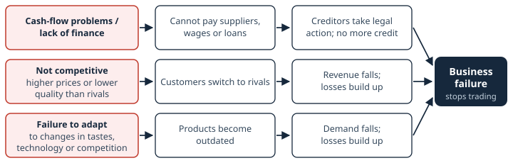

# What makes a business successful?

## Specification coverage

| Point | Section |
| --- | --- |
| 1.8.1 Measuring success: revenue, market share, customer satisfaction, profit, growth, owner/shareholder satisfaction, employee satisfaction | §1 |
| 1.8.2 Reasons for business failure: cash flow problems/lack of finance, not competitive, failure to adapt to changes in the market | §2 |

## 1. Measuring success (1.8.1)

::: definition
**Revenue** — the money a business receives from selling its goods or services: price × quantity sold.

**Profit** — revenue minus total costs (→ 3.3).
:::

| Measure | How it is measured | Limitation |
| --- | --- | --- |
| **Revenue** | value of sales, compared with previous years | rising revenue does not mean rising profit if costs rise faster |
| **Market share** | the business's sales as a % of total market sales (→ 4.2) | may be won by cutting prices, which reduces profit |
| **Customer satisfaction** | surveys, reviews and ratings, repeat purchases, complaints | opinions are subjective and hard to measure accurately |
| **Profit** | revenue − total costs; profit margins (→ 3.5) | may be low while a business invests for the future |
| **Growth** | increase in sales, outlets, employees or market share | growing too fast can raise costs and cause cash-flow problems |
| **Owner / shareholder satisfaction** | dividends, a rising share price, the owner meeting personal objectives | shareholders may want short-term profit at the expense of the long term |
| **Employee satisfaction** | staff surveys, labour turnover, absence rates | hard to measure; keeping staff happy can raise costs |

The right measure depends on the business's **objectives** (→ 1.1): a new business may judge success by survival, a social enterprise by its social impact, a plc by profit and dividends.

## 2. Reasons for business failure (1.8.2)

*Figure 1. The three reasons for business failure and how each leads to it.*

::: traps
- A **profitable** business can still fail if it runs out of **cash** to pay its bills (→ 3.2).
:::
