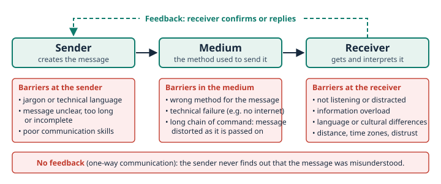

# Internal and external communication

## Specification coverage

| Point | Section |
| --- | --- |
| 2.1.1 Importance of good communication and problems of ineffective communication | 1 |
| 2.1.1 Communication methods, including IT; benefits and limitations of each | 2 |
| 2.1.2 How communication barriers arise | 3 |
| 2.1.2 Problems of ineffective communication and how they can be removed | 1 (problems), 3 (removal) |

## 1. Why good communication matters

**Definition — Communication:** passing a message from a sender to a receiver through a
medium, so that the receiver understands it.

- **Internal communication** — between people *inside* the business: employees, managers,
  departments, branches.
- **External communication** — between the business and people *outside* it: customers,
  suppliers, banks, shareholders, government.

| Who is involved | Good communication | Ineffective communication (the problem) |
| --- | --- | --- |
| Employees | know exactly what to do → fewer mistakes, higher productivity; feel involved → better motivation | instructions misunderstood → mistakes, waste, higher costs; low morale, conflict, staff leave |
| Managers / departments | right information in time → better, faster decisions | poor or slow decisions, departments working against each other |
| Customers | correct information and orders → satisfaction, repeat sales, good reputation | complaints, lost sales, damaged reputation |
| Suppliers | right materials ordered on time | wrong or late deliveries → production delays |

## 2. Communication methods

Choose the method by: how urgent the message is, whether a written record is needed, how many
receivers there are and where they are, whether feedback is needed, and cost.

| Method | Benefits | Limitations |
| --- | --- | --- |
| **Face-to-face** (meetings, one-to-one, presentations) | instant two-way feedback; tone and body language help understanding | no permanent record unless notes are taken; hard when people are in different places |
| **Telephone** | quick and two-way over long distances | no written record; no body language; time zones |
| **Written: letters, memos, notices, reports** | permanent record that can be checked again; can be detailed and formal (e.g. contracts, job offers) | slow to produce and deliver; one-way, no instant feedback; may not be read |
| **Email** (IT) | fast and cheap; one message to many people; files attached; record kept | information overload; tone easily misread; can be ignored; needs IT |
| **Text / instant messaging** (IT) | very fast; reaches mobile staff wherever they are | only short messages; easily misread; no formal record |
| **Video conferencing** (IT) | face-to-face contact across countries; saves travel time and cost | needs reliable internet and equipment; technical failures; time zones |
| **Intranet** (IT) — the business's private internal website | all staff see the same up-to-date information (policies, notices) | staff must choose to check it; cost to set up and maintain |
| **Website and social media** (IT) | reach large numbers of customers cheaply, 24 hours a day; customers can reply | negative comments are public → reputation damage; must be kept up to date |

## 3. Barriers to communication

**Definition — Barrier to communication:** anything that stops a message being received or
understood as the sender intended.

*Figure 1. A barrier can arise at any stage of the communication process. The result is
ineffective communication and the problems in section 1.*

**How barriers are removed**

- **Sender:** keep messages short and clear; avoid jargon; use the receiver's language
  (translation for staff or customers abroad); train staff in communication skills.
- **Medium:** match the method to the message (urgent → phone or face-to-face; detailed or legal →
  written); maintain IT systems; shorten the chain of command so messages pass through fewer
  people *(→ 2.5)*.
- **Receiver:** send only relevant information to the people who need it (less overload); use
  video conferencing at times that suit different time zones; build trust by keeping staff
  informed.
- **Feedback:** use two-way methods — ask the receiver to confirm or ask questions.

::: traps
A **barrier** is the cause (e.g. jargon, time zones); a **problem** is the consequence (e.g.
mistakes, lost customers). "State one barrier" and "State one problem" need different answers.
:::
