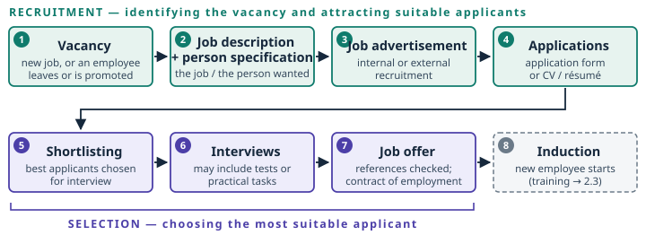

# Recruitment and selection process

## Specification coverage

| Point | Section |
| --- | --- |
| 2.2.1 Types of employment: full-time, part-time, job share, casual/seasonal/temporary | 1 |
| 2.2.2 Recruitment documents: job description, person specification, application form, CV/résumé | 3 |
| 2.2.3 Internal and external recruitment: job advertisement, shortlisting, interviewing | 2, 4 |
| 2.2.4 Legal controls: equal opportunities (gender, race, disability, religion, sexual preference, age); minimum wage laws; their effects | 5 |

## 1. Types of employment

| Type | Meaning | Advantages to the business | Disadvantages to the business |
| --- | --- | --- | --- |
| **Full-time** | works the business's full working week (often 35–40 hours) | available all week → continuity for customers; usually more committed; fewer staff to train and manage | highest wage cost; hard to reduce hours when demand falls |
| **Part-time** | works fewer hours than full-time (e.g. mornings or weekends only) | staff cover busy periods only → lower wage cost, more flexible; attracts people who cannot work full-time | more people to recruit, train and manage; less continuity; may be less committed |
| **Job share** | one full-time job split between two part-time employees | two people's skills and ideas; one can cover if the other is absent; keeps skilled staff who want fewer hours | sharers must communicate well or work is inconsistent; two sets of recruitment and training costs |
| **Casual / seasonal / temporary** | employed only when needed: *casual* — as and when required; *seasonal* — for busy seasons (summer tourism, harvest, festivals); *temporary* — for a fixed period, e.g. covering maternity leave (a *permanent* contract has no end date) | staff numbers match demand → no wages to pay in quiet periods; no long-term commitment; can try out a worker | less trained and experienced → lower quality or service; recruitment and training repeated each season; less loyal and motivated |

## 2. The recruitment and selection process

*Figure 1. Recruitment (steps 1–4) and selection (steps 5–7).*

## 3. Recruitment documents

| Document | Written by | Contains | Used to |
| --- | --- | --- | --- |
| **Job description** | business | job title, duties and responsibilities, who the job holder reports to, pay, hours, place of work | tell applicants what the job involves; basis of the advert |
| **Person specification** | business | qualifications, skills, experience and personal qualities needed — *essential* and *desirable* | set the standard applicants are judged against when shortlisting |
| **Application form** | business designs it; applicant fills it in | the same questions for every applicant: personal details, qualifications, experience, reasons for applying | compare applicants quickly and fairly |
| **CV / résumé** | applicant | personal details, education and qualifications, work experience, skills, interests, referees | summarise the applicant; sent with or instead of an application form |

| Asking applicants for | Advantages | Disadvantages |
| --- | --- | --- |
| **Application form** | same information in the same order → quick, fair comparison; asks exactly what the business needs | time to design; a long form may put good applicants off |
| **CV** | no cost to the business; shows how the applicant presents themselves | every CV is different → slower to compare; applicants include only what suits them |

## 4. Internal and external recruitment

**Internal recruitment** fills a vacancy with someone who already works for the business
(promotion or transfer). **External recruitment** fills it with someone from outside.

| Method | Advantages | Disadvantages |
| --- | --- | --- |
| **Internal** | cheaper and quicker (advertised on the intranet or notice board; shorter induction); applicant's skills and record already known → less risk; chance of promotion motivates staff | no new ideas or skills; leaves another vacancy to fill; small pool of applicants; unsuccessful colleagues may resent it |
| **External** | large pool of applicants → better chance of the best person; brings new ideas and skills | more expensive (adverts, agency fees) and slower; applicant unknown → more risk; full induction needed; may demotivate internal staff |

**Job advertisement** — contains the job title, main duties, pay and benefits, hours and type of
employment, location, the qualifications and skills required, how to apply and the closing date.
*Internal* adverts: notice board, intranet, email, staff newsletter. *External* adverts: the
business's website, job websites, social media, newspapers, job centres, recruitment agencies.
A clear advert attracts suitable applicants and puts off unsuitable ones → fewer applications to
sift, lower recruitment cost.

**Shortlisting** — comparing applications with the person specification and choosing a small
number of the most suitable applicants to interview. It saves time and cost (only suitable people
are interviewed) and makes selection fair and consistent.

**Interviewing** — questioning shortlisted applicants face-to-face or online, sometimes with
tests, a presentation or a practical task. References from a previous employer or teacher are
checked before the job is offered.

:::: grid
::: advantages | Interviews — advantages
- See personality, confidence and communication skills → better judgement of fit.
- Can check and ask about details in the application or CV.
- Applicant learns about the job → less likely to leave early.
:::
::: disadvantages | Interviews — disadvantages
- Time-consuming and costly (managers' time away from their work).
- Some people interview well but do the job badly → wrong choice.
- Interviewer bias → best applicant may be missed; tests reduce this.
:::
::::

## 5. Legal controls over employment

**Equal opportunities** — laws making it illegal to discriminate against (treat less fairly) a
job applicant or employee because of **gender, race, disability, religion, sexual preference or
age**. They apply to recruitment, pay, training, promotion and dismissal, so adverts, job
descriptions and person specifications must not exclude these groups and selection must be on
ability.

:::: grid
::: advantages | Effects on the business — positive
- Wider pool of applicants → best person chosen on merit.
- Diverse workforce → more ideas; better understanding of different customers.
- Staff feel fairly treated → motivation; good reputation with customers and applicants.
:::
::: disadvantages | Effects on the business — negative
- Costs of adapting premises and equipment for disabled employees.
- Costs of training managers and checking recruitment procedures.
- Breaking the law → fines, compensation payments, bad publicity.
:::
::::

**Minimum wage** — the lowest hourly rate of pay that employers are legally allowed to pay,
set by the government.

:::: grid
::: advantages | Effects on the business — positive
- Workers better motivated → higher productivity, lower labour turnover.
- Easier to attract applicants.
- Low-paid workers have more to spend → higher demand for businesses.
:::
::: disadvantages | Effects on the business — negative
- Higher wage costs, especially where many staff are low-paid (hotels, restaurants, shops, farms).
- Business must raise prices (less competitive), accept lower profit, cut staff or hours, or
  replace workers with machines.
:::
::::

Many businesses pay **above** the minimum wage to attract and keep better staff, raise
motivation and productivity, match competitors' pay or protect their reputation.

::: traps
The **job description** describes the *job*; the **person specification** describes the *person*
wanted. A **CV** is written by the applicant; an **application form** is designed by the business.
:::
