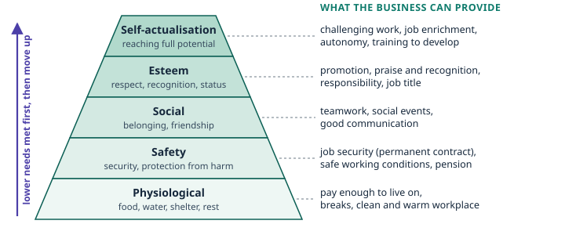
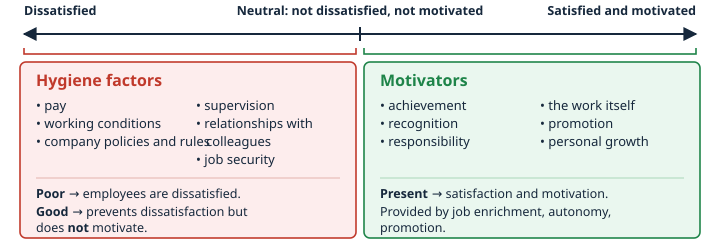

# Motivation and rewards

## Specification coverage

| Point | Section |
| --- | --- |
| 2.4.1 Importance of motivation: attracting employees, retaining employees, productivity | 1 |
| 2.4.1 Motivational theories of Herzberg, Maslow and Taylor | 2 |
| 2.4.2 Financial methods: remuneration, bonus, commission, promotion, fringe benefits | 3 |
| 2.4.2 Non-financial methods: job rotation, job enrichment, autonomy | 4 |

## 1. Why motivation matters

**Definition — Motivation:** the reasons that make employees want to work hard and achieve
their goals and the business's goals.

- **Attracting employees** — a reputation as a good place to work → more and better applicants
  → easier, cheaper recruitment.
- **Retaining employees** — motivated staff stay → lower **labour turnover** (the rate at which
  staff leave and must be replaced) → lower recruitment and training costs; experience kept.
- **Productivity** — motivated staff produce more output per worker, with fewer mistakes and
  less absence → lower cost per unit, better quality and customer service.

## 2. Motivation theories

### Taylor — scientific management

- Workers are motivated mainly by **money**.
- Managers study each job to find the most efficient way of doing it, split it into simple,
  repetitive tasks, train workers in them and supervise them closely.
- Workers are **paid by results** (piece rate: pay per item produced), so they work harder to
  earn more.
- Business use: piece rate, bonuses, commission, output targets. Weakness: ignores
  non-financial needs — repetitive work becomes boring and morale falls.

### Maslow — hierarchy of needs

People have five levels of need. The lowest unmet need motivates; once a need is met it no
longer motivates, and the next level up does.

*Figure 1. Maslow's hierarchy of needs and how a business can meet each level.*

### Herzberg — two-factor theory

*Figure 2. Herzberg: hygiene factors only remove dissatisfaction; motivators create motivation.*

## 3. Financial methods

| Method | Meaning | Advantages | Disadvantages |
| --- | --- | --- | --- |
| **Remuneration** | the payment for work: a **wage** (paid per hour worked, or per item — piece rate) or a **salary** (fixed yearly amount paid monthly) | competitive pay attracts and retains staff; meets basic needs | pay rises are costly and permanent; motivation from a rise is short-lived (Herzberg) |
| **Bonus** | extra lump sum on top of pay for meeting a target | rewards good performance; can be paid only when the business does well | costly; missing a target demotivates; may favour speed over quality |
| **Commission** | payment based on the value or number of sales made (sales staff) | cost linked to sales revenue; encourages selling | pressure selling annoys customers; uncertain income; unsuitable for non-sales jobs |
| **Promotion** | moving to a higher-level job with more pay, responsibility and status | rewards and keeps good staff; meets esteem needs | few senior jobs → those not promoted may be demotivated; good workers are not always good managers |
| **Fringe benefits** | extra non-cash rewards, e.g. staff discount, company car, health insurance, pension, free meals | help attract and retain staff; staff feel valued | cost; not every employee values every benefit; hard to remove once given |

## 4. Non-financial methods

| Method | Meaning | Advantages | Disadvantages |
| --- | --- | --- | --- |
| **Job rotation** | employees move between different tasks **at the same level** at regular intervals | variety reduces boredom; multi-skilled staff can cover absence | no extra responsibility → may not motivate for long; training cost; output falls while each task is learned |
| **Job enrichment** | giving employees more challenging tasks and **more responsibility** (e.g. planning or checking their own work) | provides Herzberg's motivators and Maslow's esteem / self-actualisation → lasting motivation; develops skills for promotion | training needed; not everyone wants responsibility → stress; staff may expect more pay |
| **Autonomy** | freedom for employees to decide how to do their work and to make decisions | shows trust → motivation, creativity, faster decisions; less supervision needed | mistakes if staff lack skills; work less consistent; unsuitable where strict rules are needed (e.g. safety) |

| | Financial methods | Non-financial methods |
| --- | --- | --- |
| **Cost** | high, often ongoing | lower (mainly training and management time) |
| **How long motivation lasts** | often short-term (pay is a hygiene factor) | longer-lasting (motivators; esteem and self-actualisation) |
| **Suits** | staff motivated by money; jobs with measurable output (sales, production) — Taylor | staff who want responsibility and development — Maslow, Herzberg |

::: traps
**Job rotation** = *different* tasks at the *same* level; **job enrichment** = *more challenging*
tasks and *more responsibility*. A **bonus** rewards meeting a target; **commission** is paid per
sale. For Herzberg, **pay is a hygiene factor**, not a motivator.
:::
