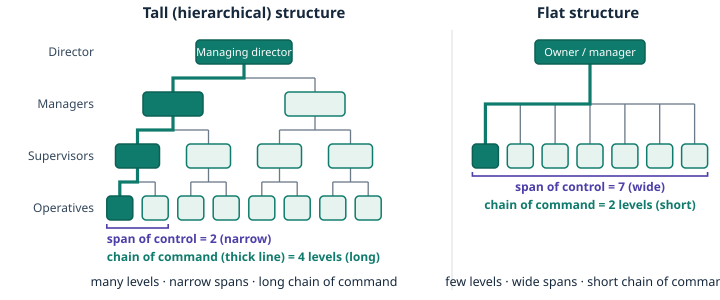
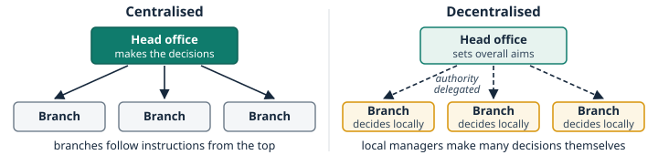
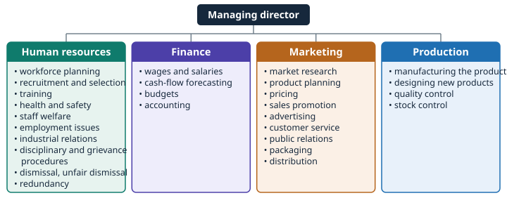

# Organisation structure and employees

## Specification coverage

| Point | Section |
| --- | --- |
| 2.5.1 Organisational charts: hierarchical and flat | 1 |
| 2.5.1 Organisational charts: centralised and decentralised | 3 |
| 2.5.2 Roles and responsibilities: compliance and accountability; span of control, chain of command | 1, 2 |
| 2.5.2 Delegation | 2 |
| 2.5.3 Functional areas: human resources, finance, marketing, production | 4 |

## 1. Organisational charts: hierarchical and flat

**Definition — Organisational chart:** a diagram showing the structure of a business: its job
roles, who is responsible to whom, and the lines of authority and communication.

- **Chain of command** — the line of authority from the top of the business to the bottom,
  through which instructions pass down and information passes up.
- **Span of control** — the number of employees who report directly to one manager. A *narrow*
  (small, short) span means few; a *wide* span means many.

*Figure 1. Tall and flat organisational charts.*

| | Tall (hierarchical) | Flat |
| --- | --- | --- |
| **Advantages** | close supervision and control (narrow spans); clear lines of authority; many promotion opportunities → motivation | fast communication and decisions (messages pass through few people); fewer managers → lower salary costs; employees have more responsibility → motivation |
| **Disadvantages** | slow communication, messages distorted through many levels; many managers → high costs; senior managers remote from staff and customers | wide spans → managers overloaded, less supervision; few promotion opportunities; needs skilled, trusted employees |
| **Typical of** | large businesses, e.g. multinationals | small businesses; large businesses that remove management levels |

## 2. Roles, compliance, accountability and delegation

- **Compliance** — following laws, the business's rules and procedures, and instructions from
  superiors (e.g. health and safety rules).
- **Accountability** — being answerable to the person above for your work and decisions.

| Role | Responsibility | Accountable to |
| --- | --- | --- |
| **Directors** | set objectives and strategy for the whole business | shareholders (owners) |
| **Managers** | plan, organise and control a department; make sure its staff comply | directors |
| **Supervisors / team leaders** | organise and check the day-to-day work of a team | managers |
| **Operatives** (other employees) | carry out tasks; comply with instructions, procedures and laws | supervisor or manager |

**Definition — Delegation:** passing authority to a subordinate to carry out a task or make a
decision. The manager remains accountable for the result.

:::: grid
::: advantages | Delegation — advantages
- Frees managers' time for important decisions.
- Employees gain responsibility → motivation and skills for promotion.
- Faster decisions by the people closest to the work.
:::
::: disadvantages | Delegation — disadvantages
- Mistakes if the employee lacks skills or training — the manager is still accountable.
- Can overload employees.
- Manager has less control; work may be less consistent.
:::
::::

## 3. Centralised and decentralised structures

**Centralised** — most decisions are made by senior managers at the top (head office).
**Decentralised** — authority is delegated to lower levels, e.g. regional or branch managers.

*Figure 2. Where decisions are made.*

| | Centralised | Decentralised |
| --- | --- | --- |
| **Advantages** | consistent decisions, products and brand in every branch; experienced senior managers decide; tight control of costs | decisions suit local customers and conditions; faster decisions; local managers motivated; senior managers freed for strategy |
| **Disadvantages** | slow decisions; may not suit local conditions; lower-level staff less motivated | less consistency between branches; local managers may make poor decisions or act against the overall aims; harder to control |
| **Typical of** | small businesses where the owner decides; businesses needing an identical product everywhere | multinationals operating in many countries with different markets |

## 4. Functional areas

*Figure 3. The four functional areas and their activities.*

| Term | Meaning |
| --- | --- |
| **Workforce planning** | working out how many employees, with which skills, the business will need in future |
| **Staff welfare** | looking after employees' well-being, e.g. health, support, facilities |
| **Employment issues** | contracts of employment, pay, hours, holidays and employment law |
| **Industrial relations** | the relationship between managers and employees (and their trade unions), including negotiations over pay and conditions |
| **Disciplinary procedure** | formal steps when an employee breaks rules or performs badly: verbal warning → written warning → final written warning → dismissal |
| **Grievance procedure** | the formal way for an employee to make a complaint about their treatment at work |
| **Dismissal** | ending an employee's contract for a fair reason, e.g. gross misconduct (theft, violence), repeated poor performance |
| **Unfair dismissal** | dismissal without a fair reason or without following the correct procedure — the employee can claim compensation |
| **Redundancy** | the job is no longer needed (e.g. falling demand, new technology, closure) — not the employee's fault; redundancy pay is usually given |
| **Budget** | a financial plan of expected income and spending for a future period |
| **Stock control** | keeping enough stock to meet demand without holding too much |

Cash-flow forecasting *(→ 3.2)*, marketing activities *(→ Topic 4)* and quality *(→ Topic 5)*
are taught in their own topics.

The functional areas depend on each other: e.g. marketing's sales forecast tells production how
much to make, finance how much money is needed and human resources how many staff to recruit.

::: traps
A **narrow** span of control goes with a **tall** structure; a **wide** span with a **flat**
structure. Delegation passes **authority**, not accountability. **Redundancy** is about the
job; **dismissal** is about the employee.
:::
