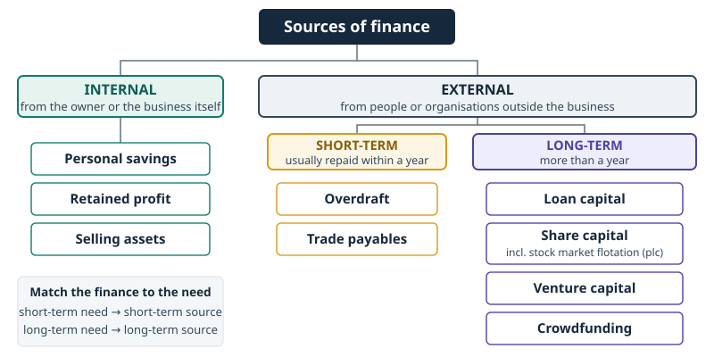

# Business finance – sources

## Specification coverage

| Point | Section |
| --- | --- |
| 3.1.1 The need for finance: short-term, long-term, to start up or expand | §1, §4 |
| 3.1.2 Internal sources: personal savings, retained profit, selling assets | §2 |
| 3.1.3 External sources: overdraft, trade payables, loan capital, share capital incl. stock market flotation, venture capital, crowdfunding | §3 |

## 1. The need for finance

::: definition
**Short-term finance** — finance needed for up to one year: day-to-day costs (suppliers, wages)
and cash-flow gaps.

**Long-term finance** — finance needed for more than one year: non-current assets, starting up
or expanding (premises, equipment and inventory are paid for before they bring in revenue).
:::

## 2. Internal sources

::: definition
**Personal savings** — the owner's own money put into the business.

**Retained profit** — profit kept in the business and reinvested instead of being paid out to the
owners.

**Selling assets** — raising cash by selling things the business owns, such as unused machinery,
vehicles or property.
:::

| Source | Advantages | Disadvantages |
| --- | --- | --- |
| Personal savings | • No interest or repayments → no extra costs • Owner keeps full control • Shows commitment → lenders more willing to lend | • Usually a limited amount → may not be enough • Owner risks losing their own money |
| Retained profit | • No interest or repayments → no extra costs • No new owners → control not diluted • Available quickly, no application | • Only exists if the business made a profit — new businesses have none • Owners/shareholders receive less profit (lower dividends) • Leaves less money for emergencies |
| Selling assets | • No interest or repayments; no debt • Turns unused assets into cash | • Asset is lost → may reduce what the business can produce • May take time to find a buyer, or sell for less than its value • Only possible if the business has spare assets |

## 3. External sources

::: definition
**Overdraft** — the bank lets a business take out more than is in its account, up to an agreed
limit.

**Trade payables** — money owed to suppliers for goods or services received but not yet paid for
(buy now, pay later).

**Loan capital** — a sum borrowed from a bank or other lender, repaid with interest in
instalments over an agreed period.

**Share capital** — money raised by selling shares (part-ownership) in a limited company.

**Stock market flotation** — when a company first sells shares to the public on a stock exchange,
as a plc.

**Venture capital** — investment in a new or small, high-risk business in return for a share of
the ownership.

**Crowdfunding** — raising money from a large number of people, each giving a small amount,
usually online.
:::

| Source | Advantages | Disadvantages |
| --- | --- | --- |
| Overdraft | • Flexible: borrow only what is needed, when needed • Quick to arrange • Interest paid only on the amount overdrawn | • High interest rate → expensive if used for long • Bank can reduce it or ask for repayment at short notice • Only for small, short-term needs |
| Trade payables | • Free if paid on time → no interest • Goods can be sold before they are paid for → helps cash flow | • Late payment → penalties, supplier may refuse future credit • May lose discounts for paying quickly • New businesses may not be offered credit |
| Loan capital | • Large sums available • Fixed repayments → easy to plan • No loss of ownership or control | • Interest increases costs • Usually needs security (collateral) → assets lost if not repaid • Repayments due even when sales are low |
| Share capital | • Very large sums possible, especially by flotation • No interest; never repaid • Dividends paid only if there is profit | • Ownership and control shared with shareholders • Shareholders expect dividends → less retained profit • Flotation is costly and slow; a plc risks takeover |
| Venture capital | • Available to risky new businesses that banks refuse • Investors bring expertise and contacts • No interest or fixed repayments | • Owners give up part of the business and its profits • Investors may want a say in decisions • Hard to obtain; investors expect high returns |
| Crowdfunding | • Can raise money when banks refuse • Publicity → tests demand, builds a customer base • Often no interest | • Platform fees; may receive nothing if the target is not met • Idea made public → can be copied • If shares are offered, ownership is diluted |

## 4. Choosing a source

Match the length of the finance to the need, then compare **cost** (interest, fees, dividends),
**control** (shares and venture capital give away ownership), **availability** (a new business has
no retained profit and may be refused a loan) and **risk**.

## Common traps

- Share capital is **not a loan**: it is never repaid and pays no interest.
- A sole trader or partnership cannot sell shares; only a **public limited company** can sell
  shares on a stock market.
