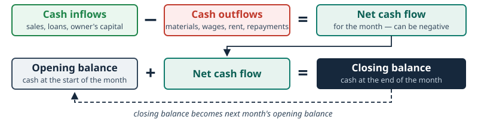

# Cash flow forecasting

## Specification coverage

| Point | Section |
| --- | --- |
| 3.2.1 Importance of cash: pay suppliers, overheads, employees; prevent insolvency; cash vs profit | §1, §4 |
| 3.2.2 Cash-flow forecasts: inflows, outflows, net cash flow, opening and closing balances; interpretation | §2, §3 |

## 1. Why cash matters

::: definition
**Cash flow** — the movement of money into and out of a business over a period of time.

**Insolvency** — when a business cannot pay its debts when they are due.
:::

A business needs cash to:

- **pay suppliers** — otherwise they stop supplying or giving credit, and production stops;
- **pay overheads** such as rent, electricity and insurance — otherwise it can lose its premises
  or services;
- **pay employees** — otherwise staff become demotivated or leave;
- **prevent business failure (insolvency)** — the people an insolvent business owes can force it to close.

## 2. The cash-flow forecast

::: definition
**Cash-flow forecast** — a prediction of the cash inflows and cash outflows of a business over a
future period, usually month by month.

**Net cash flow** — cash inflows minus cash outflows for a period.
:::

::: card | Worked example
| ($) | Jan | Feb | Mar |
| --- | ---: | ---: | ---: |
| Cash sales | 8,000 | 6,000 | 9,000 |
| Bank loan received | – | 5,000 | – |
| **Total cash inflows** | **8,000** | **11,000** | **9,000** |
| Raw materials | 3,000 | 4,000 | 3,500 |
| Wages and rent | 4,500 | 4,500 | 4,500 |
| New machinery | – | 6,000 | – |
| **Total cash outflows** | **7,500** | **14,500** | **8,000** |
| **Net cash flow** | **500** | **(3,500)** | **1,000** |
| Opening balance | 2,000 | 2,500 | (1,000) |
| **Closing balance** | **2,500** | **(1,000)** | **0** |

Brackets = negative. February: 11,000 − 14,500 = (3,500); 2,500 − 3,500 = (1,000) → March's
opening balance.
:::

## 3. Interpreting and using a forecast

- **Negative net cash flow** — more cash leaves than arrives that month.
- **Negative closing balance** — the business will be overdrawn: it must arrange an overdraft or
  loan in advance (→ 3.1) or act, e.g. delay a large purchase, cut costs, ask customers to pay
  sooner or suppliers for longer credit. In the example, February's (1,000) is caused by buying the
  machinery.

:::: grid
::: advantages
- Shows **when** cash shortages will happen → finance arranged in advance
- Helps plan the timing of large payments
- Banks ask for one before lending → helps obtain finance
- Actual figures can be compared with the forecast → problems spotted early
:::
::: disadvantages
- Based on **estimates** → actual figures may differ (demand falls, prices rise, customers pay
  late, unexpected events)
- Less accurate the further ahead it looks; takes time to prepare
:::
::::

## 4. Cash is not the same as profit

**Profit** (revenue − total costs) is counted when a sale is made, even if the customer pays later;
**cash** is counted only when money actually changes hands. Loans, new share capital and selling
assets bring in cash but are not revenue, so they add no profit.

So a **profitable business can run out of cash** — customers buy on credit and pay later, or cash
is tied up in inventory or new machinery. A loss-making business can still have cash for a while,
from a loan or from selling assets.
