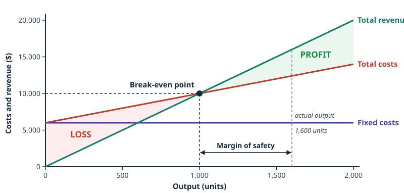
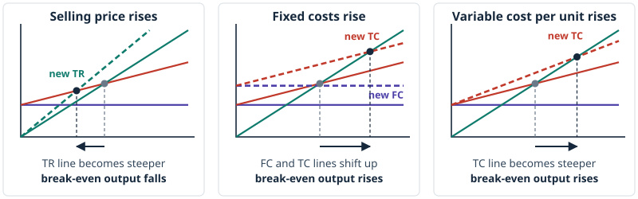

# Costs and break-even analysis

## Specification coverage

| Point | Section |
| --- | --- |
| 3.3.1 Revenue, fixed and variable costs, total costs, profit and loss | §1 |
| 3.3.2 Break-even: concept, calculation from formula or diagram | §2, §3 |
| 3.3.3 Break-even charts: impact of changes in revenue and costs; limitations | §3, §4, §5 |

## 1. Revenue, costs and profit

::: definition
**Revenue** — the money a business receives from selling its goods or services.

**Fixed costs** — costs that do not change with the level of output, e.g. rent, salaries,
insurance.

**Variable costs** — costs that change directly with the level of output, e.g. raw materials,
packaging.

**Profit** — the amount by which revenue is greater than total costs. If total costs are greater
than revenue, the business makes a **loss**.
:::

::: note | Formulae
- Revenue = selling price × quantity sold
- Total variable costs = variable cost per unit × output
- Total costs = fixed costs + total variable costs
- Profit (or loss) = revenue − total costs
:::

*Worked example (used throughout): fixed costs $6,000, variable cost $4 per unit, price $10.
At 1,500 units: revenue = 10 × 1,500 = $15,000; total costs = 6,000 + (4 × 1,500) = $12,000;
profit = 15,000 − 12,000 = $3,000.*

## 2. Break-even

::: definition
**Break-even** — the level of output at which total revenue equals total costs, so the business
makes neither a profit nor a loss.
:::

::: note | Formula
Break-even output (units) = fixed costs ÷ (selling price per unit − variable cost per unit)
:::

Each unit sold brings in $10 but adds $4 of variable cost, so $6 per unit is left to cover fixed
costs: **6,000 ÷ (10 − 4) = 1,000 units**. Below 1,000 units the business makes a loss; above it, a
profit. A fractional answer is rounded **up** to the next whole unit.

## 3. The break-even chart

*Break-even chart for the worked example.*

- **Break-even point:** where the total revenue line crosses the total costs line; read straight
  down to find break-even output (here 1,000 units).
- **Profit or loss at any output:** the vertical gap between total revenue and total costs.
- **Margin of safety:** actual output minus break-even output (1,600 − 1,000 = 600 units) — how
  far sales can fall before the business makes a loss.

## 4. Impact of changes in revenue and costs

*Dashed lines show the change; the dark point is the new break-even point.*

The opposite changes have the opposite effect: a price cut, or lower fixed or variable costs, move
break-even the other way. A lower break-even output means a larger margin of safety.

## 5. Uses and limitations of break-even analysis

:::: grid
::: advantages
- Shows the output needed to avoid a loss → judge whether a new product is worth launching
- Shows how a change in price or costs affects profit
- Supports a business plan or loan application
:::
::: disadvantages
- Assumes all output is sold (no unsold inventory)
- Assumes constant price and variable cost per unit
- Fixed costs may rise at higher output
- Estimates may be wrong; ignores demand and competitors
:::
::::

## Common traps

- Break-even output is a number of **units**, not a sum of money.
- Use **variable cost per unit** in the formula, not total variable costs.
