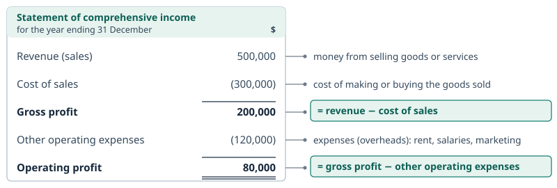
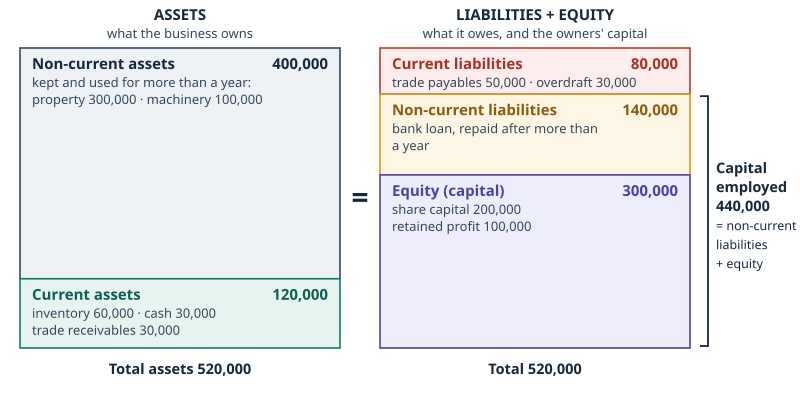

# Financial documents

## Specification coverage

| Point | Section |
| --- | --- |
| 3.4.1 Statement of comprehensive income: features, use in decision making, nature and importance of profit | §1, §2, §3 |
| 3.4.2 Statement of financial position: features, interpretation | §4, §5 |

## 1. Statement of comprehensive income

::: definition
**Statement of comprehensive income** (income statement) — a financial statement showing a
business's revenue, costs and profit or loss over a period of time, usually one year.
:::

*Main features, with example figures (used again in 3.5). Brackets mean the figure is subtracted.*

Real statements may continue below operating profit (finance costs, tax, profit for the year).

## 2. Using the statement in decision making

- **Managers and owners** compare profit with previous years, targets and competitors to judge
  performance, find which costs are rising (→ 3.5), and decide whether profit can fund expansion or
  a new product.
- **Shareholders and investors** decide whether to invest, and expect dividends from profit.
- **Banks and lenders** judge whether profit is high enough to repay a loan.

## 3. The nature of profit and why it matters

Profit (revenue − total costs, → 3.3) is the owners' **reward for taking the risk** of running the
business.

- **Gross profit** shows how well the business buys or makes, and sells, its products.
- **Operating profit** shows performance after all day-to-day running costs — gross profit can be
  high while operating profit is low if expenses are high.

Profit matters because it:

- rewards owners and shareholders → attracts investment;
- is retained as a source of finance for growth (→ 3.1);
- shows success → lenders and suppliers are more willing to lend and give credit;
- is needed for long-term survival.

## 4. Statement of financial position

::: definition
**Statement of financial position** — what a business owns (assets), owes (liabilities) and its
owners' capital (equity) on one date.

**Non-current assets** — items owned and kept for more than one year, e.g. property, machinery,
vehicles.

**Current assets** — items owned that will turn into cash within one year: inventory, trade
receivables, cash.

**Inventory** — stocks of raw materials, work in progress and finished goods.

**Trade receivables** — money owed to the business by customers who bought on credit.

**Current liabilities** — debts that must be paid within one year, e.g. trade payables, overdraft.

**Non-current liabilities** — debts repayable after more than one year, e.g. long-term bank
loans.

**Capital employed** — long-term finance used in the business: equity + non-current liabilities
(= total assets − current liabilities).
:::

*Assets always equal liabilities plus equity. Example figures ($), used again in 3.5.*

## 5. Interpreting a statement of financial position

- **Liquidity** — are current assets enough to pay current liabilities? (→ 3.5)
- **How the business is financed** — large non-current liabilities mean heavy borrowing: interest
  to pay and more risk; mostly equity means less risk.
- **Change over time** — rising non-current assets suggest investment and growth; rising retained
  profit shows profitable years; rising inventory may mean goods are not selling.

## Common traps

- The statement of comprehensive income covers a **period**; the statement of financial position
  is a snapshot on **one date**.
