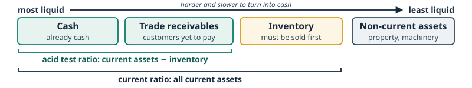

# Accounts analysis

## Specification coverage

| Point | Section |
| --- | --- |
| 3.5.1 Ratios: gross profit margin, operating profit margin, markup, ROCE, current ratio, acid test ratio | §1, §2 |
| 3.5.2 Liquidity: concept and importance; comparisons with previous years and other businesses | §2, §3 |
| 3.5.3 Use of financial documents: assess performance, inform decision making | §4 |

The six formulae are given in the exam. Worked examples use the figures in 3.4: show the
substitution, the unit (% or none) and round as asked, often to two decimal places.

## 1. Profitability ratios

| Ratio | Formula | Worked example | What it shows |
| --- | --- | --- | --- |
| Gross profit margin | gross profit ÷ revenue × 100 | 200,000 ÷ 500,000 × 100 = **40%** | % of revenue left after cost of sales. Raise it by raising price or cutting cost of sales (cheaper supplier, bulk discounts) |
| Operating profit margin | operating profit ÷ revenue × 100 | 80,000 ÷ 500,000 × 100 = **16%** | % of revenue left after all running costs. Falling while GPM holds → expenses are rising → cut overheads |
| Markup | profit per item ÷ cost per item × 100 | item costs $25, sells for $40: 15 ÷ 25 × 100 = **60%** | % added to cost to set the price. Not a margin: the same $15 on a $40 item is a 37.5% margin (margins divide by revenue) |
| Return on capital employed (ROCE) | operating profit ÷ capital employed × 100 | 80,000 ÷ 440,000 × 100 = **18.18%** | profit made from each $100 of long-term finance invested; compare with interest from a bank |

For all four, **higher is better**.

## 2. Liquidity

::: definition
**Liquidity** — the ability of a business to pay its short-term debts (current liabilities) when
they are due, from its current assets.
:::

*The acid test leaves out inventory because it may be slow or hard to turn into cash.*

| Ratio | Formula | Worked example | What it shows |
| --- | --- | --- | --- |
| Current ratio | current assets ÷ current liabilities | 120,000 ÷ 80,000 = **1.5** | current assets per $1 of short-term debt — a ratio, not a %; about 1.5–2 is usually comfortable |
| Acid test ratio | (current assets − inventory) ÷ current liabilities | (120,000 − 60,000) ÷ 80,000 = **0.75** | the same without relying on selling inventory; about 1 is usually comfortable |

**Why liquidity matters.** Too low (e.g. below 1) → the business may be unable to pay suppliers,
wages and overdraft on time → risk of insolvency (→ 3.2), even if it is profitable. Too high → cash
and inventory lie idle instead of being used to earn a return.

In the example, the acid test of 0.75 shows the business could not pay all its current liabilities
without selling inventory.

## 3. Making comparisons

A ratio on its own says little. Compare it with:

- **previous years** — is profitability or liquidity improving or getting worse?
- **other businesses** — ideally of similar size in the same industry.

::: note | Percentage change
% change = (new figure − old figure) ÷ old figure × 100
:::

## 4. Using financial documents

**To assess performance:** compare profit and ratios as in §3, and with the business's own targets.

**To inform decision making:**

- falling margins → act on suppliers, prices or overheads (§1);
- low liquidity → arrange an overdraft, reduce inventory, chase customers who owe money, delay
  spending;
- strong profitability and liquidity → can afford expansion or higher dividends;
- outside the business: suppliers check liquidity before giving credit, banks before lending.

:::: grid
::: advantages
- Turns figures into ratios → easy comparison over time and with businesses of any size
- Shows problems early (falling margins, poor liquidity) → action taken in time
- Gives stakeholders evidence for decisions (invest, lend, give credit)
:::
::: disadvantages
- Based on **past** data → may not reflect the future
- Ignores non-financial factors: staff, reputation, competitors, the economy
- Comparisons mislead if businesses differ in size, industry or accounting dates
:::
::::
