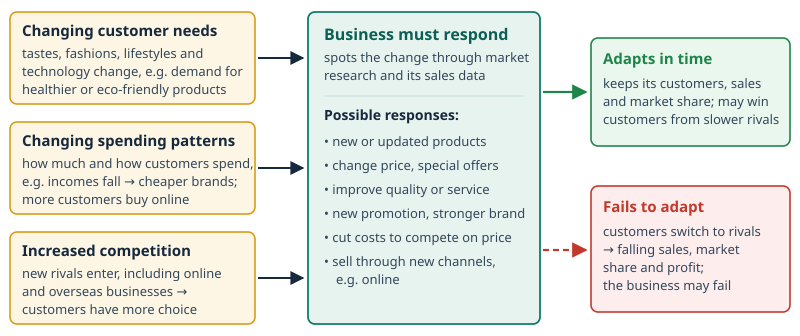
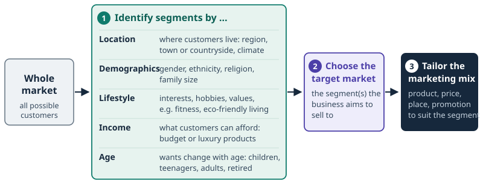

# The market

## Specification coverage

| Point | Section |
| --- | --- |
| 4.2.1 Importance of marketing | §1 |
| 4.2.2 Responding to changes in the market | §2 |
| 4.2.3 Market segmentation to target customers | §3 |

## 1. Importance of marketing

::: definition
**Marketing** — the management process of identifying, anticipating and satisfying customer
needs profitably.
:::

### Customers

| | What it involves | Why it matters |
| --- | --- | --- |
| Satisfying customer needs | Products with the features, quality, price and availability customers want | Customers buy and come back; the business can compete and may charge more |
| Building customer relationships | Regular two-way contact: after-sales service, handling complaints well, personalised offers, replying on social media | Customers trust the business, return and recommend it |
| Keeping customer loyalty | Getting customers to buy again and again rather than switch to rivals, e.g. loyalty schemes, consistent quality and service | Steady repeat sales; keeping a customer costs less than winning a new one; loyal customers switch less over small price differences and recommend by word of mouth |

### Market orientation and product orientation

| | Market orientation | Product orientation |
| --- | --- | --- |
| Meaning | Finds out what customers want through market research, **then** designs products to meet those needs | Focuses on the product it is good at making or that is technically excellent, **then** looks for customers |
| Advantages | • Products match customer needs → lower risk, higher sales • Quick to spot and react to market changes | • Can concentrate on quality, innovation and expertise → unique products • Lower market research costs |
| Disadvantages | • Market research is costly and slow • Frequent product changes raise costs | • Customers may not want the product → wasted costs • Can miss changes in customer needs |
| Suits | Markets where tastes change, e.g. clothing, food | Technical or highly innovative products, e.g. specialist machinery |

### Market share and market analysis

::: definition
**Market size** — total sales of all businesses in a market, by value (revenue) or volume (units).

**Market share** — one business's (or product's) sales as a percentage of total sales in the market.
:::

::: note | Formula
**Market share (%) = (sales of the business ÷ total sales in the market) × 100**

A sportswear retailer sells $3.6m in a market worth $24m: (3.6 ÷ 24) × 100 = **15%**.
:::

**Market analysis** means studying a market's size, growth, competitors, their market shares
and trends, to see how the business is doing against rivals. Rising market share shows the
business is winning customers from rivals; the market leader (largest share) gains brand
recognition and bargaining power with suppliers and retailers.

### Niche and mass marketing

| | Niche marketing | Mass marketing |
| --- | --- | --- |
| Meaning | Selling to a small, specific segment of a market with particular needs | Selling the same or similar products to most of the market |
| Advantages | • Less competition • Customers pay more for a specialist product → higher profit margins • Close customer relationships → loyalty | • High sales volumes → lower cost per unit (economies of scale, → 5.1) • Not reliant on one small group of customers |
| Disadvantages | • Small market limits sales and growth • Relies on one segment — risky if its needs change • Success attracts larger rivals | • Many competitors → pressure to cut prices • Mass-media promotion is expensive • Product may not fully satisfy any one group |
| Example | Handmade vegan cosmetics | Toothpaste, soft drinks |

## 2. Responding to changes in the market

*Figure 1. Three changes a market faces, how a business responds, and what happens if it does not.*

## 3. Market segmentation and targeting

::: definition
**Market segment** — a group of customers within a market who share similar characteristics
or needs.

**Market segmentation** — dividing a market into segments so each can be targeted with a
suitable marketing mix.

**Target market** — the group of customers a business aims to sell to.

**Demographics** — characteristics of a population, such as age, gender, ethnicity, religion,
family size and income.
:::

*Figure 2. Segmenting a market, choosing a target market and tailoring the marketing mix.*

:::: grid
::: advantages
- Products and promotion match each segment's needs → higher sales and loyalty
- Promotion reaches only the target market → less wasted spending
- Reveals segments no one serves (gaps) → new sales
- Different prices for different segments → higher revenue
:::
::: disadvantages
- Research to identify segments costs time and money
- Separate products or campaigns per segment raise costs
- Customers outside the target market may be ignored → lost sales
- A segment can be misjudged or change → wrong targeting
:::
::::

## Common traps

- Sales can rise while market share **falls**, if the whole market grows faster than the business.
- Demographics covers more than age: gender, ethnicity, religion, family size and income too.
