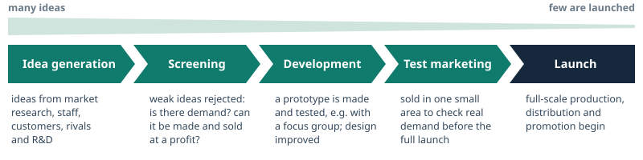
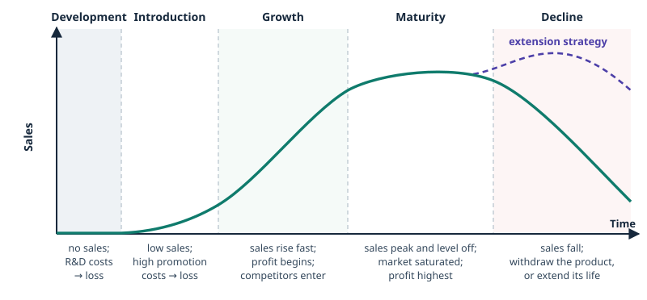
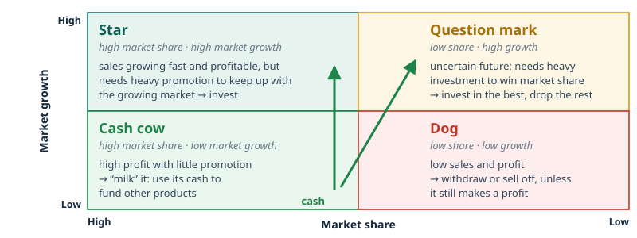
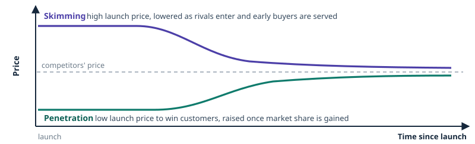
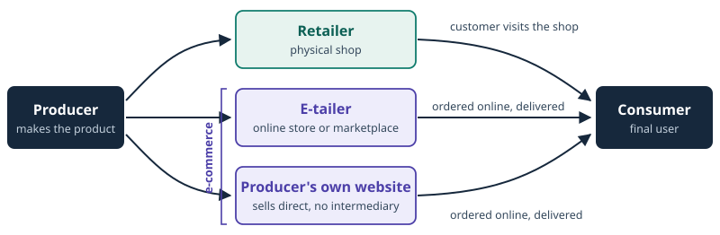

# The marketing mix

## Specification coverage

| Point | Section |
| --- | --- |
| 4.3.1 Product | §1 |
| 4.3.2 Price | §2 |
| 4.3.3 Place – distribution channels | §3 |
| 4.3.4 Promotion | §4 |

::: definition
**Marketing mix** — the combination of product, price, place and promotion (the 4Ps) a
business uses to meet customer needs and sell its product.
:::

## 1. Product

### Developing a new product or service

*Figure 1. New product development: most ideas are dropped before launch.*

:::: grid
::: advantages
- New sales revenue; replaces products in decline
- Something rivals do not offer → competitive advantage, higher prices
- Wider product range spreads risk
:::
::: disadvantages
- Research and development is expensive
- Many new products fail → the money is lost
- Takes time — a rival may launch first
:::
::::

### Goods and services

| | Goods | Services |
| --- | --- | --- |
| Meaning | **Tangible** — physical products that can be touched and owned | **Intangible** — activities carried out for the customer |
| Storage | Can be made in advance and stored as inventory | Cannot be stored — produced and consumed at the same time |
| Quality | Standardised; can be checked before sale | Depends on the person providing it; harder to keep consistent |
| Examples | Phone, shoes, car | Haircut, flight, bank account |

### Packaging

:::: grid
::: advantages | Why packaging matters
- **Protects** the product in transport and storage → less damage
- **Informs**: ingredients, instructions, legal details
- **Attracts** attention and shows the brand → stands out on the shelf
- Makes the product easy to carry, store and use
:::
::: disadvantages
- Adds to cost → higher price or lower profit
- Excess or non-recyclable packaging → environmental criticism, damaged image
:::
::::

### Product life cycle

::: definition
**Product life cycle** — the phases a product goes through from development to withdrawal,
shown by its sales over time.

**Extension strategy** — action to lengthen a product's life and delay its decline, usually
taken in maturity.
:::

*Figure 2. Phases of the product life cycle and the effect of an extension strategy.*

**Extension strategies:** update the product (new features, flavours, sizes) · sell in new
markets (other countries or segments) · find new uses · new packaging or rebranding · a new
advertising campaign · lower price or special offers.

:::: grid
::: advantages
- Keeps revenue coming from an existing product
- Cheaper and less risky than developing a new product
- Uses the brand customers already know
:::
::: disadvantages
- Costs money and may only delay decline
- The money might earn more spent on a new product
- Changes can put off loyal customers
:::
::::

### Product portfolio and the Boston matrix

::: definition
**Product portfolio** — the range of products a business sells.

**Boston matrix** — a model that classifies a business's products by market share and market
growth, to help manage the product portfolio.
:::

*Figure 3. The Boston matrix. Cash from cash cows funds stars and question marks.*

A business aims for a **balanced portfolio**: cash cows provide the money, question marks and
stars are the future cash cows, dogs are replaced. Relying on one product is risky.

:::: grid
::: advantages
- Shows at a glance whether the portfolio is balanced
- Helps decide where to spend the marketing budget: invest, keep or drop
- Shows which products need replacing
:::
::: disadvantages
- Uses only two factors — ignores profit, costs and loyalty
- A snapshot: positions change quickly
- Needs accurate market data, which costs money; a "dog" may still be profitable
:::
::::

## 2. Price

| Strategy | How it works · when used | Advantages | Disadvantages |
| --- | --- | --- | --- |
| Cost plus | A fixed percentage **mark-up** is added to the cost per unit. Used when costs are easy to measure, e.g. retailers. | • Simple • Every sale covers its cost and makes a profit | • Ignores rivals' prices and what customers will pay → may be too high or too low |
| Penetration | **Low** price at launch to win customers and market share, raised later. Used for a new product in a competitive, price-sensitive market. | • Quick sales and market share • Can build loyalty early | • Low profit per unit at first • Customers may leave when price rises • Can start a price war |
| Competition | Price set **at, just above or just below** rivals' prices. Used when products are similar and there are many competitors. | • Unlikely to lose customers on price • Simple, little research needed | • May not cover costs • Must compete on other factors, e.g. quality, brand |
| Skimming | **High** price at launch for a new, unique or innovative product, lowered over time. Used when few rivals exist and some customers will pay to be first. | • High profit per unit → recovers development costs • Premium, high-quality image | • Low sales volume at first • High profits attract rivals • Early buyers may resent later price cuts |
| Promotional | Price **cut for a short time**, e.g. % discount, sale, buy one get one free. Used to launch a product, clear inventory or answer a rival. | • Quick boost to sales and new customers • Clears old inventory | • Lower profit per unit • Customers wait for discounts • Overuse cheapens the brand |

*Figure 4. Skimming and penetration: opposite starting prices for a new product.*

::: note | Calculations
**Cost plus:** selling price = cost per unit + (cost per unit × mark-up % ÷ 100) 
Cost £40, mark-up 25%: 40 × 25 ÷ 100 = £10 → selling price = 40 + 10 = **£50**.

**Promotional discount:** new price = original price − (original price × discount % ÷ 100) 
$64.80 with 15% off: 64.80 × 15 ÷ 100 = $9.72 → new price = 64.80 − 9.72 = **$55.08**.

Money answers to 2 decimal places, in the currency given. The mark-up formula (profit per item ÷
cost per item × 100) is given in the exam (→ 3.5).
:::

## 3. Place – distribution channels

::: definition
**Place** — making the product available where and when customers want to buy it.

**Distribution channel** — the route a product takes from the producer to the final consumer.

**Retailer** — a business that sells products to final consumers, usually from physical shops.

**E-tailer** — a business that sells products to consumers online (e-commerce: buying and
selling over the internet).
:::

*Figure 5. Channels through retailers and e-tailers (e-commerce).*

| | Retailers | E-tailers (e-commerce) |
| --- | --- | --- |
| Advantages | • Customers see, touch and try before buying → confidence • Face-to-face advice and service • Displays encourage impulse buying; no wait for delivery | • Reaches customers nationally or globally, 24/7 → more sales • No shop rent, fewer staff → lower costs and prices • Customer data can be collected for targeted promotion |
| Disadvantages | • Shop rent and staff → higher costs • Limited opening hours and local reach • A retailer selling for a producer takes a share of the price and controls the display | • Customers cannot try products → more returns • Delivery costs and waiting time • Website and security costs • Easy price comparison → fierce competition |

## 4. Promotion

::: definition
**Promotion** — communicating with customers to inform them about a product and persuade them
to buy it.
:::

### Promotion strategies for different market segments

Choose the method and media that reach the **target segment**, e.g. social media for young
people, local radio or newspapers for older customers, specialist magazines for a hobby.

| Strategy | What it is | Advantages | Disadvantages |
| --- | --- | --- | --- |
| Advertising | Paid messages in media: TV, radio, press, billboards, cinema, online. | • Reaches a large audience → awareness fast • Media can be chosen to fit the segment | • Expensive, especially TV • Effect on sales hard to measure |
| Sponsorship | Paying to support an event, team or cause in return for showing the business's name. | • Links the brand to something popular → good image • Reaches the event's audience | • Expensive • Bad news about the team or person harms the brand |
| Product trials | Free samples or free trial periods. | • Customers try with no risk → encourages first purchase of new products | • Cost of free products • Some take the sample and never buy |
| Special offers | Short-term incentives: buy one get one free, discounts, coupons, free gifts. | • Quick sales boost • Attracts new customers, rewards loyal ones | • Lower profit per unit • Short-lived; overuse cheapens the brand |

Branding, the fifth strategy, is below.

### Above the line and below the line

| | Above the line (ATL) | Below the line (BTL) |
| --- | --- | --- |
| Meaning | Promotion through paid **mass media**, reaching a wide audience | Promotion **not** through mass media; the business targets chosen customers directly |
| Examples | TV, radio, newspapers, magazines, cinema, billboards, online adverts | Sponsorship, product trials, special offers, public relations, e-newsletters, direct mail, point-of-sale displays |
| Advantages | • Huge audience → builds brand awareness fast | • Cheaper; targeted at a segment → less waste • Response is easier to measure |
| Disadvantages | • Expensive • Much of the audience is not in the target market | • Reaches fewer people • Offers reduce profit per unit |
| Suits | Large businesses, mass markets | Small businesses, niche markets, keeping existing customers |

### Public relations

::: definition
**Public relations (PR)** — activities that create and keep a good public image of a business
and its brand, e.g. press releases, media interviews, charity and community work, events.
:::

:::: grid
::: advantages
- Free or cheap publicity compared with advertising
- Seen as more believable than adverts → trust, better image, loyalty
- Can repair the image after bad publicity
:::
::: disadvantages
- No control over what the media reports
- Effect on sales is hard to measure
- Bad publicity spreads fast, especially on social media
:::
::::

### Technology in promotion

| Method | How it works | Advantages | Disadvantages |
| --- | --- | --- | --- |
| Targeted advertising online | Adverts shown only to people chosen by their online data: searches, browsing, location, age, interests. | • Reaches the target segment → little wasted spending • Results easy to measure (clicks, sales) | • Privacy concerns can annoy customers • Ad blockers; data may be inaccurate |
| Viral advertising via social media | Content people share, so the message spreads rapidly from person to person. | • Reaches millions at very low cost — customers do the sharing • Builds awareness fast among social-media users | • Cannot be controlled or guaranteed to spread • Can be mocked or twisted → bad publicity |
| E-newsletters | Regular emails to subscribers with news, new products and offers. | • Cheap to send to many • Subscribers already interested → repeat purchases, loyalty | • Often ignored or sent to spam • Too many → customers unsubscribe |

### Branding and the importance of a brand

::: definition
**Brand** — a name, logo, symbol or design that identifies a product and makes it different
from competitors' products.

**Branding** — creating a recognisable identity and image for a product or business.
:::

:::: grid
::: advantages | Why a brand is important
- Easily recognised → chosen over rivals
- Builds loyalty → repeat purchases
- Customers pay more for a trusted brand → higher profit margins
- New products under a known brand are accepted more readily
:::
::: disadvantages
- Building a brand takes time and costly promotion
- Bad publicity damages every product under the brand
:::
::::

## Common traps

- Life-cycle phases are defined by **sales**, not profit; the Boston matrix uses **market share
  and market growth**, not sales and profit.
- Skimming and penetration are launch strategies for **new** products; promotional pricing is a
  short-term cut for any product.
- Advertising is above the line; sponsorship, product trials and special offers are below the line.
