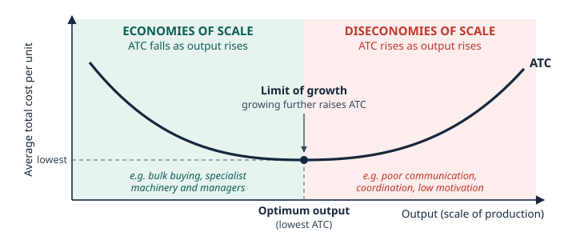

# Economies and diseconomies of scale

## Specification coverage

| Point | Section |
| --- | --- |
| 5.1.1 Economies of scale — internal (falling ATC as output increases) | 1, 2 |
| 5.1.1 Economies of scale — external (falling ATC due to external factors) | 3 |
| 5.1.2 Diseconomies of scale — limits of growth | 1, 4, 5 |

## 1. Average total cost and scale

**Definition — Average total cost (ATC):** the cost of producing each unit of output.

::: note | Formula — learn it (not on the exam formula list)
**Average total cost = total costs ÷ output** — e.g. $50 000 ÷ 20 000 units = **$2.50 per unit**.
:::

::: definition
**Economies of scale** — the fall in average total cost as a business increases its scale of production.

**Diseconomies of scale** — the rise in average total cost when a business grows beyond a certain size.
:::

*Figure 1. Growth lowers ATC only up to the optimum size. Beyond it, diseconomies outweigh economies — the limit of growth.*

## 2. Internal economies of scale (5.1.1)

**Internal economies of scale** come from the growth of the business itself: its ATC falls **as its own output increases**. Only that business benefits.

| Type | How average total cost falls |
| --- | --- |
| Purchasing (bulk buying) | buys in large quantities → suppliers give discounts → lower cost per unit |
| Technical | can afford large, specialised machinery → more output; its cost is spread over many units |
| Financial | seen as lower risk by banks → borrows more easily, at lower interest rates |
| Managerial | can employ specialist managers (finance, marketing, HR) → better, more efficient decisions |
| Marketing | advertising cost is spread over many more units → lower marketing cost per unit |

## 3. External economies of scale (5.1.1)

**External economies of scale** are falls in ATC **due to factors outside the business** — usually the whole industry growing in one area. Every business in that area can benefit.

- **Pool of skilled labour** and local training courses → lower recruitment and training costs.
- **Specialist suppliers** locate nearby → cheaper, quicker supplies.
- **Better infrastructure** (roads, ports, broadband) → lower transport and communication costs.

## 4. Diseconomies of scale — the limit of growth (5.1.2)

| Cause | Why average total cost rises |
| --- | --- |
| Poor communication | more layers of management → messages slow or distorted → mistakes, slow decisions |
| Coordination and control | many sites and departments are hard to manage together → duplication and wasted resources |
| Low motivation | workers feel remote from managers and undervalued → lower productivity, more absence and labour turnover |

These problems set the **limit of growth**: once the business passes its optimum size (Figure 1), extra growth **raises** ATC, so profit per unit falls and the business becomes less price-competitive.

## 5. Growing to gain economies of scale

:::: grid
::: advantages | Growth — advantages
- Lower ATC → can cut prices to win sales, **or** keep prices and earn a higher profit margin.
- Cost advantage over smaller rivals → harder for them to compete.
:::
::: disadvantages | Growth — disadvantages
- Risk of diseconomies of scale once past the optimum size (§ 4).
- Growth needs large amounts of finance → borrowing costs and risk.
- A larger business is slower to respond to changes in the market.
:::
::::

## Common traps

- Economies of scale lower **average** (unit) cost — **total** costs still rise as output rises.
- External economies come from the **industry or area**, not from the firm's own growth.
- Diseconomies of scale mean ATC is **rising**, not that the business is making a loss.
