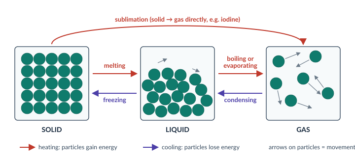
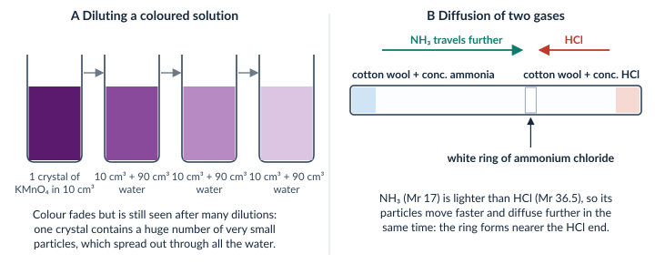
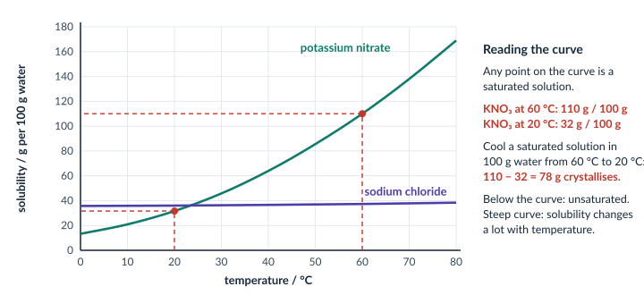

# States of matter

## Specification coverage

| Point | Section |
| --- | --- |
| 1.1 | §1 |
| 1.2 | §1 |
| 1.3 | §2 |
| 1.4 | §3 |
| 1.5C | §4 |
| 1.6C | §4 |
| 1.7C | §5 |

## 1. The three states and changes of state

| | Solid | Liquid | Gas |
| --- | --- | --- | --- |
| **Arrangement** | regular pattern, particles touching | irregular, particles still touching | random, particles far apart |
| **Movement** | vibrate about fixed positions | move around each other (slide past) | move quickly in all directions |
| **Energy of particles** | lowest | higher | highest |



*Figure 1. Heating (red) or cooling (blue) changes the state.*

**How a change of state happens.** Heating gives the particles more energy, so they vibrate or move
faster. When they have enough energy to overcome the forces of attraction holding them in place,
the arrangement changes:

- **melting** — particles vibrate so strongly they leave their fixed positions but stay touching;
- **boiling** — particles gain enough energy to separate completely, throughout the liquid, at the
  boiling point; **evaporation** is the same change but only from the **surface**, below the
  boiling point;
- **sublimation** — solid turns straight into gas (e.g. iodine, solid carbon dioxide).

Cooling reverses each change (**condensing**, **freezing**): particles lose energy, slow down and
the forces of attraction pull them closer together.

## 2. Evidence for moving particles: dilution and diffusion



*Figure 2. A: each step transfers 10 cm³ of the previous solution into 90 cm³ of water. B: the
two gases meet and react to form a white solid.*

::: definition
**Diffusion** — the net movement of particles from an area of **higher** concentration to an area
of **lower** concentration, caused by the particles' **random movement**.
:::

- **Dilution** and **ammonia / hydrogen chloride**: explained in Figure 2.
- **Bromine**: brown bromine gas spreads through the air in a gas jar above it until the colour is
  even, because the particles of both gases move randomly and mix.

## 3. Solutions

::: definition
**Solute** — the substance that dissolves.

**Solvent** — the liquid in which it dissolves.

**Solution** — the mixture formed when a solute dissolves in a solvent.

**Saturated solution** — a solution in which no more solute can dissolve at that temperature.
:::

## 4. Solubility and solubility curves — Paper 2 only

::: definition
**Solubility** — the mass of solute that dissolves in **100 g of solvent** to form a saturated
solution at a stated temperature. Unit: **g per 100 g of solvent**.
:::



*Figure 3. For most solids, solubility increases with temperature.*

**Plotting.** Temperature on the x-axis, solubility on the y-axis; plot each result and draw a
**smooth curve** of best fit (not dot-to-dot).

**Interpreting.**

- Read the solubility at a temperature, or the temperature at which a solution becomes saturated.
- **Mass of crystals formed on cooling** = solubility at the higher temperature − solubility at the
  lower temperature (per 100 g of water).
- For a different mass of water, scale: 50 g of water holds half the mass shown on the curve.

## 5. Practical: solubility of a solid at a set temperature — Paper 2 only

1. Stir the solid into water held at the chosen temperature (water bath, thermometer) until no
   more dissolves and some solid is left over — the solution is **saturated**.
2. Weigh an empty evaporating basin. Pour in some of the saturated solution, leaving the excess
   solid behind, and weigh again.
3. Evaporate the water by heating gently, then weigh the basin and dry solid. Reheat and reweigh
   until the mass is constant, so all the water has gone.

```
mass of solid = (basin + solid) − basin
mass of water = (basin + solution) − (basin + solid)
solubility    = mass of solid ÷ mass of water × 100      in g per 100 g water
```

::: note | Worked example
Basin 30.00 g; basin + solution 58.40 g; basin + dry solid 36.40 g.

Solid = 36.40 − 30.00 = 6.40 g; water = 58.40 − 36.40 = 22.00 g.

Solubility = 6.40 ÷ 22.00 × 100 = **29.1 g per 100 g water**.
:::

## Common misunderstandings

| Wrong | Right |
| --- | --- |
| "The particles expand when heated." | The particles stay the same size; they move faster and further apart. |
| Solubility in g per 100 cm³ of solution. | Solubility is per **100 g of solvent**. |
| Mass of crystals = the solubility at the lower temperature. | It is the **difference** between the two solubilities. |
