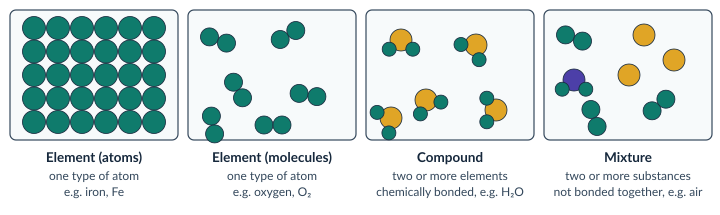
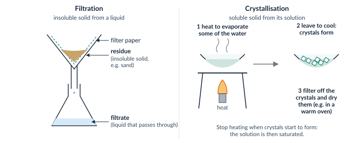
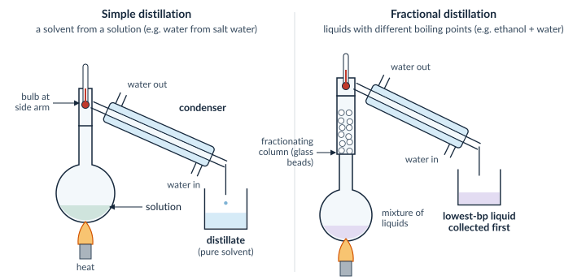
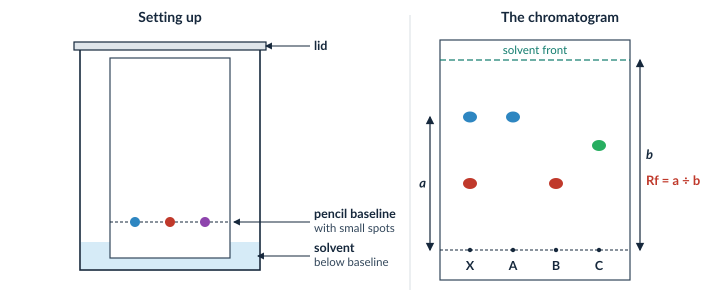

# Elements, compounds and mixtures

## Specification coverage

| Point | Section |
| --- | --- |
| 1.8 | §1 |
| 1.9 | §2 |
| 1.10 | §3 |
| 1.11 | §4 |
| 1.12 | §4 |
| 1.13 | §5 |

## 1. Element, compound or mixture?



*Figure 1. Classify by asking: how many types of atom? Are different atoms chemically bonded?*

::: definition
**Element** — a substance made of only one type of atom.

**Compound** — a substance made of two or more elements **chemically bonded** together in fixed
proportions.

**Mixture** — two or more substances (elements or compounds) **not chemically bonded** together;
the proportions can vary and the parts can be separated by physical methods.
:::

## 2. Pure substances and mixtures: melting and boiling points

A **pure** substance (one element or one compound only) melts and boils at a **fixed**
temperature. A **mixture** melts or boils over a **range** of temperatures. So measuring a melting
point tests purity: a sharp melting point at the expected value means pure; melting over a range
means impure.

## 3. Separating mixtures



*Figure 2. Filtration and crystallisation are often used one after the other.*



*Figure 3. In both, the vapour is cooled back to a liquid in the condenser. Cold water enters at
the bottom of the condenser.*

- **Filtration** — the filter paper's tiny holes let liquid and dissolved substances through but
  trap undissolved solid particles.
- **Crystallisation** — heating removes water until the solution is saturated; the solute is less
  soluble when cold, so crystals form as the solution cools.
- **Simple distillation** — the solvent boils off, is condensed and collected; the dissolved solid
  stays in the flask. The thermometer reads the boiling point of the substance being collected.
- **Fractional distillation** — the liquid with the lowest boiling point reaches the top of the
  column first and is collected while the thermometer stays at its boiling point. When that
  liquid has distilled off, the temperature rises and the next liquid can be collected.
- **Paper chromatography** — separates dissolved substances, e.g. the dyes in an ink (§4, §5).

## 4. Chromatograms and Rf values



*Figure 4. The solvent moves up the paper and carries each substance a different distance.*

Substances separate because each has a different balance between **solubility in the solvent**
(moves it up) and **attraction to the paper** (holds it back).

Reading the chromatogram in Figure 4:

- X gives **two** spots, so X is a mixture of at least two substances; a **pure** substance gives
  **one** spot.
- X's spots are at the same heights as A and B, so X contains **A and B** but not C.
- A spot left on the baseline is a substance **insoluble** in that solvent.

```
Rf = distance moved by the substance ÷ distance moved by the solvent front
```

Both distances are measured **from the baseline**; Rf has no units and is always less than 1. A
substance has the same Rf value in the same solvent, so comparing an unknown's Rf with those of
known substances identifies it.

::: note | Worked example
A spot moves 3.5 cm; the solvent front moves 7.0 cm. Rf = 3.5 ÷ 7.0 = **0.50**.
:::

## 5. Practical: chromatography of inks or food colourings

1. Draw a **pencil** baseline about 1 cm from the bottom of the paper (pencil does not dissolve
   and move up the paper). Put a **small**, concentrated spot of each ink or food colouring on it,
   so the spots stay separate.
2. Stand the paper in a beaker of solvent (e.g. water) with the solvent **below** the baseline, so
   the spots do not dissolve into the solvent in the beaker. Put a **lid** on to stop the solvent
   evaporating from the paper.
3. Remove the paper when the solvent is near the top; mark the solvent front in pencil, let it dry,
   and measure the distances to calculate Rf values.

## Common misunderstandings

| Wrong | Right |
| --- | --- |
| Air or salt water is a compound. | Both are mixtures: the substances are not chemically bonded. |
| Rf = distance from the top of the paper. | Measure both distances from the **baseline**. |
| Filtration separates salt from salt water. | Dissolved salt passes through the filter paper; use crystallisation or evaporation. |
