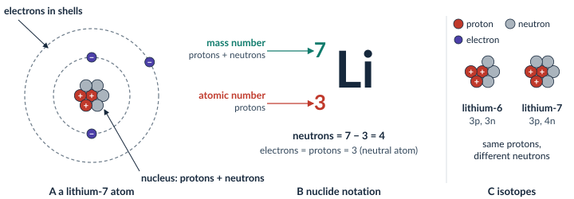

# Atomic structure

## Specification coverage

| Point | Section |
| --- | --- |
| 1.14 | §1 |
| 1.15 | §2 |
| 1.16 | §3 |
| 1.17 | §4 |

## 1. Atoms and molecules

::: definition
**Atom** — the smallest particle of an element that can take part in a chemical reaction.

**Molecule** — a particle of two or more atoms joined by covalent bonds (e.g. O₂, H₂O, CH₄).
:::

## 2. Inside the atom

| Particle | Position | Relative mass | Relative charge |
| --- | --- | --- | --- |
| proton | nucleus | 1 | +1 |
| neutron | nucleus | 1 | 0 |
| electron | shells around the nucleus | 1/1836 (negligible) | −1 |

An atom has equal numbers of protons and electrons, so it has **no overall charge**. Almost all
its mass is in the tiny nucleus.

## 3. Atomic number, mass number and isotopes



*Figure 1. Nuclide notation gives the number of each particle.*

::: definition
**Atomic number** — the number of protons in the nucleus of an atom.

**Mass number** — the total number of protons and neutrons in the nucleus of an atom.

**Isotopes** — atoms of the same element with the same number of protons but different numbers
of neutrons (same atomic number, different mass number).

**Relative atomic mass (Ar)** — the weighted mean mass of the atoms of an element, taking account
of the abundance of each isotope, compared with 1/12 of the mass of a carbon-12 atom.
:::

Isotopes of an element have the same number of electrons, so they have the **same chemical
properties**.

## 4. Calculating relative atomic mass

```
Ar = Σ(mass number × percentage abundance) ÷ 100
```

::: note | Worked example
Chlorine is 75% chlorine-35 and 25% chlorine-37.

Ar = (35 × 75 + 37 × 25) ÷ 100 = (2625 + 925) ÷ 100 = **35.5**
:::

If abundances are given as relative amounts rather than percentages, divide by their **total**
instead of 100. Check the answer lies between the lightest and heaviest isotope masses and nearer
the more abundant one.

## Common misunderstandings

| Wrong | Right |
| --- | --- |
| Isotopes have different numbers of protons. | Same protons (same element); different **neutrons**. |
| Ar is the mass number of the commonest isotope. | Ar is a **weighted mean**, so it is often not a whole number. |
| Electrons have no mass. | Their mass is very small (1/1836), not zero. |
