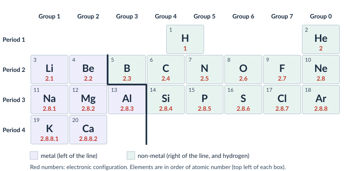
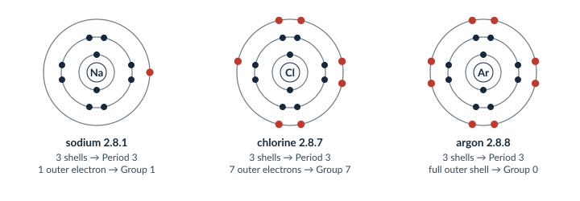

# The Periodic Table

## Specification coverage

| Point | Section |
| --- | --- |
| 1.18 | §1 |
| 1.19 | §2 |
| 1.20 | §3 |
| 1.21 | §3 |
| 1.22 | §2 |
| 1.23 | §4 |
| 1.24 | §4 |

## 1. How the table is arranged

*Figure 1. The first 20 elements. The transition metals (not shown) fit between Groups 2 and 3
from Period 4 onwards.*

- Elements are arranged in order of increasing **atomic number**.
- A vertical column is a **group**; a horizontal row is a **period**.

## 2. Electronic configurations from position

Electrons fill shells from the nucleus outwards: **2** in the first shell, then **8**, then **8**,
then the rest (for the first 20 elements).

For a main group element:

- **period number = number of occupied shells**;
- **group number = number of electrons in the outer shell** (Group 0: a full outer shell — 2 for
  helium, 8 for the others).

*Figure 2. Reading the configuration from the position, and the position from the configuration.*

::: note | Worked example
Sulfur is in Period 3, Group 6: three shells, six outer electrons → **2.8.6**.
:::

## 3. Metals and non-metals

Metals are to the **left** of the stepped line in Figure 1, non-metals to the **right**. Hydrogen is
a non-metal.

| Test | Metal | Non-metal |
| --- | --- | --- |
| **Electrical conductivity** | good conductor (solid or liquid) | poor conductor / insulator (graphite is an exception) |
| **Character of its oxide** | **basic**: reacts with acids; if it dissolves, gives an **alkaline** solution (pH > 7), e.g. Na₂O | **acidic**: dissolves to give an **acidic** solution (pH < 7), e.g. CO₂, SO₂ |

To classify an unknown element: test whether it conducts; burn it in oxygen, shake the oxide with
water and add universal indicator.

## 4. Why groups behave alike — and why noble gases do not react

- Chemical reactions involve the **outer electrons**. Elements in the same group have the **same
  number of outer electrons**, so they have **similar chemical properties**.
- Noble gases (Group 0) have a **full outer shell**, a stable arrangement. They have no tendency to
  lose, gain or share electrons, so they do not readily react.

## Common misunderstandings

| Wrong | Right |
| --- | --- |
| Group 0 elements have 0 outer electrons. | They have a **full** outer shell (He 2, others 8). |
| Elements in a group are similar because they have the same number of shells. | Same number of **outer electrons**; atoms in the same **period** have the same number of shells. |
| Potassium is 2.8.9. | The third shell holds 8 here, so potassium is **2.8.8.1**. |
