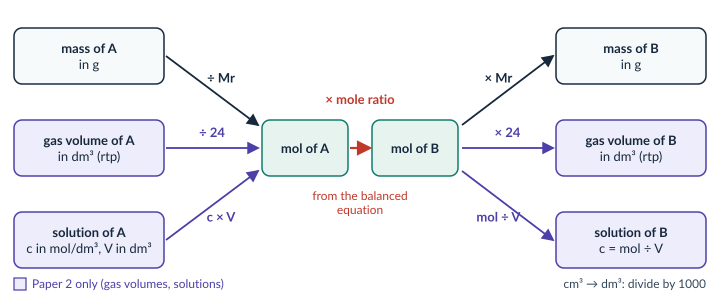
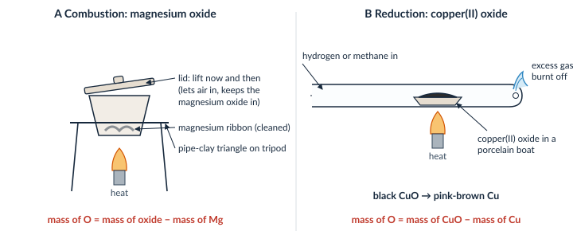

# Chemical formulae, equations and calculations

## Specification coverage

| Point | Section |
| --- | --- |
| 1.25 | §1 |
| 1.26 | §2 |
| 1.27 | §2 |
| 1.28 | §2 |
| 1.29 | §3 |
| 1.30 | §4 |
| 1.31 | §6 |
| 1.32 | §5 |
| 1.33 | §5 |
| 1.34C | §7 |
| 1.35C | §8 |
| 1.36 | §6 |

Ar values used below are those on the Edexcel Periodic Table (e.g. Cl = 35.5, Cu = 63.5).

## 1. Word and balanced equations

A **word equation** names the reactants and products. A **balanced symbol equation** has the same
number of each type of atom on both sides — balance by changing the **numbers in front** of
formulae, never the formulae themselves.

::: note | Worked example — balancing
Aluminium burns in oxygen to form aluminium oxide, Al₂O₃.

aluminium + oxygen → aluminium oxide

Al + O₂ → Al₂O₃ — O: 2 on the left, 3 on the right; the lowest common multiple is 6, so use 3O₂
and 2Al₂O₃, which needs 4Al:

4Al(s) + 3O₂(g) → 2Al₂O₃(s)
:::

**State symbols:** (s) solid · (l) liquid · (g) gas · (aq) dissolved in water. For an unfamiliar
reaction, take the formulae and states from the information given in the question, then balance.

## 2. Relative formula mass and the mole

**Relative formula mass (Mr)** — the sum of the relative atomic masses of all the atoms in the
formula (called relative molecular mass for a molecule). Multiply out brackets and water of
crystallisation:

```
Ca(OH)₂      = 40 + 2 × (16 + 1)            = 74
CuSO₄·5H₂O   = 63.5 + 32 + 4 × 16 + 5 × 18  = 249.5
```

The **mole (mol)** is the unit for **amount of substance**. One mole of a substance has a mass in
grams equal to its Ar or Mr (1 mol of H₂O = 18 g).

```
amount (mol) = mass (g) ÷ Ar or Mr        mass = amount × Mr        Mr = mass ÷ amount
```

## 3. Reacting masses



*Figure 1. Every reacting-quantity calculation follows this route: to moles, across by the ratio,
back out.*

::: note | Worked example — reacting masses
What mass of calcium oxide forms when 25.0 g of calcium carbonate is heated?

CaCO₃ → CaO + CO₂

mol CaCO₃ = 25.0 ÷ 100 = 0.250 mol

ratio CaCO₃ : CaO = 1 : 1, so mol CaO = 0.250 mol

mass CaO = 0.250 × 56 = **14.0 g**
:::

## 4. Percentage yield

```
percentage yield = actual yield ÷ theoretical yield × 100
```

The **theoretical yield** is the mass calculated from the equation (§3). The actual yield is less,
e.g. because the reaction is incomplete, some product is lost when separating it, or side reactions
occur.

::: note | Worked example
From the reaction above only 11.2 g of CaO was obtained: 11.2 ÷ 14.0 × 100 = **80.0%**.
:::

## 5. Empirical and molecular formulae

::: definition
**Empirical formula** — the simplest whole-number ratio of atoms of each element in a compound.

**Molecular formula** — the actual number of atoms of each element in one molecule.
:::

::: note | Worked example
A hydrocarbon is 82.8% carbon and 17.2% hydrogen by mass; its Mr is 58.

| | C | H |
| --- | --- | --- |
| mass or % ÷ Ar | 82.8 ÷ 12 = 6.90 | 17.2 ÷ 1 = 17.2 |
| ÷ smallest | 1 | 2.49 ≈ 2.5 |
| whole numbers (× 2) | 2 | 5 |

Empirical formula **C₂H₅**. Mass of C₂H₅ = 29; 58 ÷ 29 = 2, so molecular formula **C₄H₁₀**.
:::

If the ratio is x.5, double everything; do not round 2.5 to 3.

## 6. Finding formulae by experiment

The method is always: find the **mass of each element** (or of salt and water) in a sample, then
use the §5 table.



*Figure 2. Two ways to find the formula of a metal oxide.*

**Practical — combustion (magnesium oxide).** Weigh the crucible and lid, add magnesium ribbon and
weigh again. Heat strongly, lifting the lid now and then (Figure 2A). When the magnesium no longer glows, cool and weigh; **reheat to
constant mass** so all the magnesium has reacted.

**Practical — reduction (copper(II) oxide).** Weigh the boat with copper(II) oxide. Pass hydrogen
or methane through the tube to remove the air **before** heating (a gas–air mixture could explode)
and burn off the excess gas at the hole. Heat until the black solid has all turned pink-brown.
Keep the gas flowing while the copper **cools**, so hot copper cannot react with air again; weigh,
and repeat to constant mass.

::: note | Worked example — magnesium oxide
Magnesium 0.24 g; magnesium oxide 0.40 g, so oxygen = 0.16 g.

Mg 0.24 ÷ 24 = 0.010; O 0.16 ÷ 16 = 0.010; ratio 1 : 1 → **MgO**.
:::

**Water of crystallisation.** Weigh a hydrated salt, heat it until it reaches constant mass (all
the water driven off), and weigh the anhydrous salt. Mass lost = water.

::: note | Worked example — CuSO₄·xH₂O
2.50 g hydrated copper(II) sulfate gives 1.60 g anhydrous CuSO₄ (Mr 159.5); water = 0.90 g.

CuSO₄ 1.60 ÷ 159.5 = 0.0100 mol; H₂O 0.90 ÷ 18 = 0.050 mol; ratio 1 : 5 → **x = 5**.
:::

**Water.** When hydrogen reduces copper(II) oxide, the oxygen removed combines with hydrogen to form
water. The mass of oxygen lost by the oxide and the mass of water formed give the masses of hydrogen
and oxygen in water, and so the formula H₂O.

## 7. Concentration of solutions — Paper 2 only

```
concentration (mol/dm³) = amount (mol) ÷ volume (dm³)          1 dm³ = 1000 cm³
```

::: note | Worked example
4.00 g of sodium hydroxide (Mr 40) is dissolved to make 250 cm³ of solution.

mol = 4.00 ÷ 40 = 0.100 mol; volume = 250 ÷ 1000 = 0.250 dm³

concentration = 0.100 ÷ 0.250 = **0.400 mol/dm³**

How many moles are in 25.0 cm³ of it? 0.400 × 0.0250 = **0.0100 mol**.
:::

## 8. Gas volumes — Paper 2 only

One mole of **any** gas occupies **24 dm³ (24 000 cm³)** at room temperature and pressure (rtp).

```
volume of gas (dm³) = amount (mol) × 24          amount = volume (dm³) ÷ 24
```

::: note | Worked example
Volume of CO₂ at rtp from heating 25.0 g of CaCO₃ (§3): mol CO₂ = 0.250 mol;

volume = 0.250 × 24 = **6.0 dm³** (6000 cm³).
:::

Because equal amounts of gases have equal volumes, gas volumes react in the **same ratio as the
moles** in the equation: in 2H₂ + O₂ → 2H₂O, 100 cm³ of hydrogen reacts with 50 cm³ of oxygen.

## Common misunderstandings

| Wrong | Right |
| --- | --- |
| Balancing by changing a formula (H₂O → H₂O₂). | Only change the numbers in front. |
| Using the mass ratio from the equation. | Use the **mole** ratio; convert masses to moles first. |
| Rounding 1 : 2.5 to 1 : 3 for an empirical formula. | Multiply to whole numbers: 2 : 5. |
| Dividing by volume in cm³ for concentration. | Convert to dm³ first (÷ 1000). |
