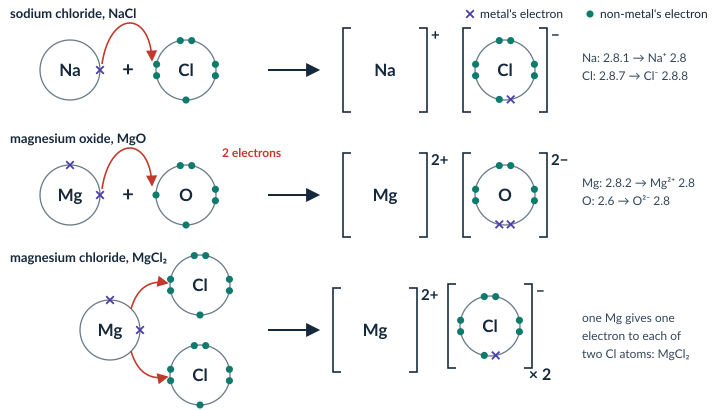
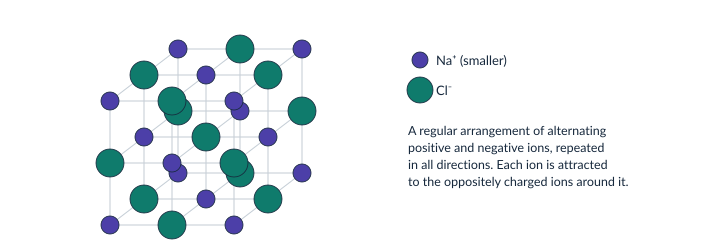

# Ionic bonding

## Specification coverage

| Point | Section |
| --- | --- |
| 1.37 | §1 |
| 1.38 | §2 |
| 1.39 | §2 |
| 1.40 | §3 |
| 1.41 | §4 |
| 1.42 | §4 |
| 1.43 | §5 |

## 1. Forming ions

An **ion** is a charged particle formed when an atom loses or gains electrons.

- **Metal** atoms **lose** their outer electrons → **positive** ions. Na (2.8.1) → Na⁺ (2.8) + e⁻
- **Non-metal** atoms **gain** electrons to fill their outer shell → **negative** ions.
  Cl (2.8.7) + e⁻ → Cl⁻ (2.8.8)

The ions end up with a **full outer shell**, the same electronic configuration as a noble gas.
Charge = number of electrons lost (+) or gained (−).

## 2. Ion charges and formulae

| +1 | +2 | +3 | −1 | −2 | −3 |
| --- | --- | --- | --- | --- | --- |
| Group 1: Li⁺, Na⁺, K⁺ | Group 2: Mg²⁺, Ca²⁺ | Group 3: Al³⁺ | Group 7: F⁻, Cl⁻, Br⁻, I⁻ | Group 6: O²⁻, S²⁻ | Group 5: N³⁻, P³⁻ |
| Ag⁺ | Cu²⁺, Fe²⁺, Pb²⁺, Zn²⁺ | Fe³⁺ | hydroxide OH⁻ | carbonate CO₃²⁻ | |
| hydrogen H⁺, ammonium NH₄⁺ | | | nitrate NO₃⁻ | sulfate SO₄²⁻ | |

Simple negative ions end in **-ide** (chloride, oxide, sulfide, nitride). A Roman numeral gives the
charge of a metal ion that can vary: iron(II) = Fe²⁺, iron(III) = Fe³⁺, copper(II) = Cu²⁺.

**Writing a formula:** use enough of each ion for the charges to **cancel to zero**. Put a
compound ion in brackets when more than one is needed.

```
sodium oxide        Na⁺  O²⁻     → Na₂O
aluminium oxide     Al³⁺ O²⁻     → Al₂O₃      (2 × +3 = +6, 3 × −2 = −6)
calcium hydroxide   Ca²⁺ OH⁻     → Ca(OH)₂
ammonium sulfate    NH₄⁺ SO₄²⁻   → (NH₄)₂SO₄
iron(III) nitrate   Fe³⁺ NO₃⁻    → Fe(NO₃)₃
```

## 3. Dot-and-cross diagrams



*Figure 1. Only outer electrons are shown. Crosses are the metal's electrons, dots the
non-metal's.*

To draw one: show the outer shell of each atom; move each metal electron to a non-metal atom
(arrows); draw each ion in square brackets with its charge. The metal ion has lost its outer shell, so its
bracket shows no outer electrons; the non-metal ion now has eight.

## 4. Ionic bonding and giant ionic lattices

::: definition
**Ionic bonding** — the strong **electrostatic attraction** between **oppositely charged ions**.
:::



*Figure 2. The sodium chloride lattice: a giant structure of ions.*

**High melting and boiling points.** A giant ionic lattice has a very large number of strong
electrostatic attractions between oppositely charged ions, acting in all directions. A lot of
energy is needed to overcome them, so ionic compounds are solids with high melting and boiling
points. Ions with larger charges attract more strongly: MgO (Mg²⁺, O²⁻) melts at a much higher
temperature than NaCl (Na⁺, Cl⁻).

## 5. Electrical conductivity

Ionic compounds **do not conduct** electricity when **solid**, but **do conduct** when **molten**
or **dissolved in water** (aqueous). A current needs charged particles that can move: in the solid
the ions are held in fixed positions; when molten or dissolved, the ions are free to move.

## Common misunderstandings

| Wrong | Right |
| --- | --- |
| Ionic compounds conduct because electrons move. | The **ions** move (when molten or aqueous). |
| Ionic bonding is sharing electrons. | Electrons are **transferred**; the bond is the attraction between the ions formed. |
| "Intermolecular forces" in NaCl. | There are no molecules: it is a giant lattice of ions held by ionic bonds. |
| CaOH₂ for calcium hydroxide. | Brackets are needed: Ca(OH)₂. |
