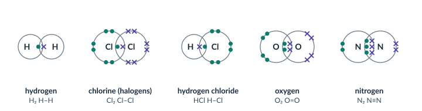
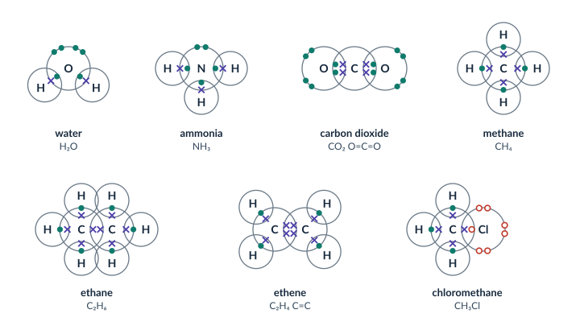
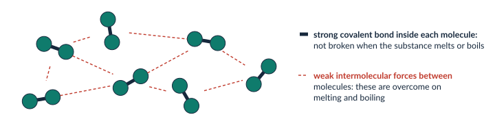
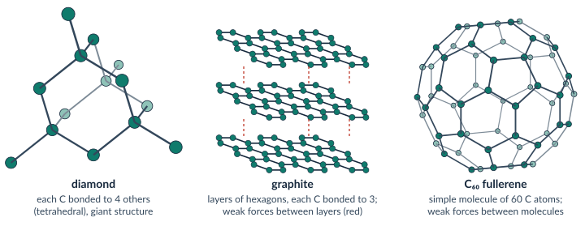

# Covalent bonding

## Specification coverage

| Point | Section |
| --- | --- |
| 1.44 | §1 |
| 1.45 | §1 |
| 1.46 | §2 |
| 1.47 | §3 |
| 1.48 | §3 |
| 1.49 | §4 |
| 1.50 | §4 |
| 1.51 | §5 |

## 1. The covalent bond

::: definition
**Covalent bond** — a bond formed between two atoms by **sharing a pair of electrons**.
It is the strong **electrostatic attraction** between the **shared pair of electrons** (negative)
and the **nuclei of both atoms** (positive).
:::

Covalent bonds form between **non-metal** atoms. By sharing, each atom gains a full outer shell.
The number of bonds an atom forms = the number of electrons it needs: H and halogens **1**,
O **2**, N **3**, C **4**. Two shared pairs make a **double bond** (O=O), three a **triple bond**
(N≡N).

## 2. Dot-and-cross diagrams of molecules

*Figure 1. Diatomic molecules. The other halogens (F₂, Br₂, I₂) and hydrogen halides (HF, HBr, HI)
look the same as Cl₂ and HCl.*

*Figure 2. Inorganic and organic molecules. Each atom's electrons have their own symbol.*

To draw one: overlap the outer shells of bonded atoms, put each shared pair in the overlap (one
electron from each atom), put the remaining outer electrons as pairs outside the overlap, then
check every atom has a full outer shell (2 for H, 8 for the others).

## 3. Simple molecular substances

*Figure 3. Two kinds of attraction in a simple molecular substance.*

**Low melting and boiling points.** The forces **between** the molecules (intermolecular forces)
are **weak**, so little energy is needed to overcome them. So simple molecular substances are gases
or liquids, or solids with low melting and boiling points. Melting and boiling do **not** break
the covalent bonds.

**Effect of relative molecular mass.** Larger molecules (higher Mr) have **stronger**
intermolecular forces, which need more energy to overcome, so melting and boiling points generally
**increase with Mr**. For example, at room temperature chlorine (Mr 71) is a gas, bromine (160) a
liquid and iodine (254) a solid.

## 4. Giant covalent structures: diamond, graphite and C₆₀

In a **giant covalent** structure every atom is joined to others by strong covalent bonds in a
huge network. Melting means **breaking many strong covalent bonds**, which needs a lot of energy,
so giant covalent substances are solids with **high** melting and boiling points.

*Figure 4. Three forms of carbon with different structures and so different properties.*

| | Diamond | Graphite | C₆₀ fullerene |
| --- | --- | --- | --- |
| **Structure** | giant covalent; each C bonded to **4** others | giant covalent layers of hexagons; each C bonded to **3**; weak forces between layers | simple molecules of 60 C atoms; weak intermolecular forces |
| **Hardness** | very **hard**: rigid 3D network of strong bonds | **soft** and slippery: layers slide over each other | **soft**: weak forces between molecules easily overcome |
| **Electrical conductivity** | does **not** conduct: all outer electrons used in bonds, none free to move | **conducts**: one electron per C is **delocalised** and moves along the layers | does **not** conduct: electrons cannot move from one molecule to another |
| **Melting point** | very high | very high | low (simple molecular) |

## 5. Conductivity of covalent substances

Covalent compounds **do not usually conduct** electricity. Graphite is the main exception.

## Common misunderstandings

| Wrong | Right |
| --- | --- |
| Boiling water breaks O–H bonds. | Boiling overcomes the weak **intermolecular forces**; the covalent bonds stay intact. |
| Graphite is soft because its covalent bonds are weak. | The bonds **within** layers are strong; the forces **between** layers are weak. |
| Graphite conducts because it has free ions. | It has **delocalised electrons**. |
| C₆₀ has a high melting point because it is carbon. | C₆₀ is **simple molecular**, unlike diamond and graphite. |
